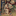

Tuesday, May 25, 2010

## Portrait of the Artist as a Digital Native \[Redux\]

**\[Originally posted on my former blog, *Never Neutral,* on 2009/08/26\].**

Artwork by [Eddie Campbell](http://eddiecampbell.blogspot.com/)

**O**ne of the best links I read yesterday \[25/08.2009\] was [“Why are artists poor? Self promotion and making money in the new digital economy”](http://tinyurl.com/lnh9x5), an article by Andrew Keen in the online version of *[The Telegraph](http://www.telegraph.co.uk/)*. Even if I often disagree very strongly with Keen, an article like this is the kind of journalism I enjoy reading because it takes a critical or editorial stance, analyzes a situation and gives food for thought.

I believe the article is relevant for both humanities scholars and artists alike. Very often one and the other are undistinguishable; artists are scholars and scholars are artists.   I have a lot to say about the article, because although the piece is refreshingly aware that the “neat historical narrative” that purports that the cultural economy of “old” media has been “seamlessly succeeded” by the digital one “makes perfect sense in theory, but it isn’t born out in practice,” it still resorts to well-known celebrity examples such as [Chris Anderson](http://www.thelongtail.com/), Prince, Trent Reznor and Radiohead.

**T**he problem with using them as paradigms of the new digital cultural economy is a fundamental one: none of them *started out and made their financial and artistic success* in the digital economy. While it’s true, as Keen argues, that in the 21st century the “destruction” of the value of the copy “is actually adding to the value of physical events,” and, also importantly, that “the job of all artists is now self-promotion,” the truth is that artists, writers, musicians and creative types of all kinds are still forced to play the game of an old-fashioned, gate-kept cultural and economic model deeply rooted on so-called “old” media such as physical releases, magazine covers and features, music videos, newspaper reviews, the NYT bestsellers list, industry magazines such as *Billboard*, etc.

**F**or example, Trent Reznor has been of late hailed by many as a hero of digital culture, but his over-enthusiastic fans seem to forget that the Nine Inch Nails frontman is far from being an independent artist, with six best-selling hard-copy albums on Interscope Records before he got tired of the recording industry and released two independent, partially free/digital albums on his own Null Corporation. Techno-optimists often overlook that by the time Reznor —and Anderson in the realm of writing— decided it was time to give their work away for free, they were already well-established figures because the old cultural and economic model based on the value of the copy had already granted them mainstream celebrity and the guarantee they would sell-out stadium tours and talks everywhere.

**C**hris Anderson is not a revolutionary “digital economy” pioneer.  He is in fact the best representative of the new world order, still gate-kept and self-perpetuating. Anderson had the reputation he built on *[Wired](http://www.wired.com/)*, mainly a physical magazine with editions in the US and recently (in the midst of the biggest print media crisis in history) [in the UK](http://www.wired.co.uk/?zed). He also had a real, hardcover-and-paperback publishing deal for *Free* with [Hyperion Books](http://www.hyperionbooks.com/titlepage.asp?ISBN=1401322905), which allowed him  to partially avoid the blatant contradiction of a [$26.99 list cover price](http://www.amazon.com/Free-Future-Radical-Chris-Anderson/dp/1401322905) by offering it (again partially, [for a limited time and while *it lasted*](http://www.longtail.com/the_long_tail/2009/07/free-on-the-kindle-free-get-it-while-it-lasts.html)), for “free.” As Keen told me yesterday on Twitter,  [“Anderson can have his cake and eat it too.”](http://twitter.com/ajkeen/status/3535781595) So far there aren’t too many Andersons in the writing world.

**T**he new cultural and economic paradigms being developed by the Internet and related technologies are still changing and will take a while before we can resolve the inner contradictions of the digital model that sells with the “As Seen on TV/The New York Times!” label attached to it. As a creative type you can promote your work as much as you can online, you can give samples or all of your work for free, but until now a sure foot on “old” media is still needed for success.

**N**otions of authority, professionalism, quality, respectability and good artistic reputation are still defined by gate-kept models.  The likes of Reznor or Anderson, Radiohead or Stephen King belong to an economic model analogue to the big-bonus culture of the bankers; a transition towards successful economics of digitally-distributed work needs to pay attention to the independent artists out there.   Instead of thinking Reznor, we are thinking [Deupree](http://www.12k.com/index.php/site/artists/taylor_deupree/).

**I**n other words, for digital culture really to succeed in allowing artists to make a living in the share economy we cannot keep on focusing on the superstars, who are the ultimate paradigm of the old economic and cultural model. This model is not only the model of the physical copy sold through intermediaries, but one of social (educational, racial, ethnic, linguistic, geographic) privilege. Theoretically, the digital/share economy may allow anyone anywhere to create, disseminate and get paid for creative/informational work, but in reality it is still wealthy white men in London and New York the ones who have the final call.

Instead of following the hype of the privileged usual suspects, we should be paying attention to those who have started online and that have gradually achieved mainstream critical recognition (and hopefully buying their way out of financial need) later. Think of the recently-released print version of [Josh Neufeld’s, *A.D. New Orleans After the Deluge*](http://www.smithmag.net/afterthedeluge/), already one of the must-read graphic novels of today, which started out as a [a free webcomic](http://www.smithmag.net/afterthedeluge/2007/01/01/prologue-1/), but which only acquired [critical acclaim](http://www.nytimes.com/2009/08/24/books/24neufeld.html) until it found a physical printed form (i.e., a role in the old cultural and economic model of the copy). It is only now, after the book was published, that the media and the general public took note, and that Neufeld can [tour](http://www.smithmag.net/afterthedeluge/2009/06/16/ad-book-tour-dates/), participating in what Keen calls “the economy of the physical event.” (Another example would be Jorge Cham from [PhD Comics](http://www.phdcomics.com/comics.php), but just look at how many years of constant free work passed before he started making money out of giving talks).

**A**s a conclusion, here’s the nine (slightly edited) *tweets* I came up with yesterday that sum up some of my views:

**1.** Artists cannot expect to survive in the 21st century without doing their own promotion (this means also giving work for free).

**2.** This does not mean that those who already make a comfortable living whilst giving away (some) of their work free made it solely online.

**3.** Stephen King, Chris Anderson, Sonic Youth, Radiohead and Trent Reznor were already best-sellers of “old” media before embracing digital.

**4.** There are thousands of talented artists out there online posting their work for free & promoting themselves and still remain impoverished and unnoticed.

5\. While it is true that we are living through a paradigm shift, “old” media still determines what’s popular and appreciated.

**6.** Television, cinema, radio, record label deals, print books, magazines and print newspapers are still the ruling factors of success. Not blog posts.

**7.** We may be living “the age of sharing” and self-publishing but a book on Hyperion has more demand than a self-published or independent print-on-demand book.

**8.** No emerging artist without old media backup can afford to make a living from live shows or readings merely from sharing her work online.

**9.** Granted, there are no chances for any serious 21st century artist to make a living without working your arse off promoting and sharing online.

(**10** is for you to fill out, as well as all the other following points!)

**F**inally. I have been blogging for seven years now. It took me ~~an hour and a half~~ two hours to write and edit this post \[not including the hour and a half it took me to recode it to repost it here in May 2010\], not counting the previous research needed to think about it and the time I will invest moderating any comments. I can’t really afford to take the time to write these posts and just give them away. Writing is my work, and here it is, for free. Here’s the catch: because it is *my work*, I can’t avoid doing it. It’s what I do.

As [Anne Boyer suggested yesterday](http://twitter.com/anne_boyer/status/3538314295), someone is clearly winning and someone is clearly losing out in this Mexican standoff.  So, you tell me. Why are artists in the digital age poor?

—-

**How *A.D.* came to be,** [here](http://butterflyhunt.tumblr.com/youtube=http:/www.youtube.com/watch?v=kdMpxlgE0ic).

**Also,** please see [this](http://www.timeshighereducation.co.uk/story.asp?sectioncode=26&storycode=407911&c=1).

#### Notes

1.  [saidtotheuniverse](http://saidtotheuniverse.tumblr.com/) liked this
2.  [mxmlsm](http://micro.maximalis.me/) liked this
3.  [butterflyhunt](http://butterflyhunt.tumblr.com/) posted this
