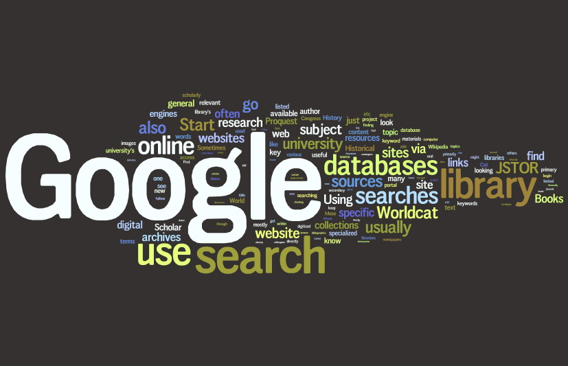

## Diderot as Digital Humanist

*The following piece is loosely based on a talk I gave at the 2010 meeting of the American Society of Eighteenth-Century Studies in Albuquerque, NM.*

Although the research and reference management software [Zotero](http://zotero.org) has garnered plenty of attention for its pithy taglines and millions of delighted users, less well-known is the mission statement that guides every last detail of the project’s development:

To collect knowledge disseminated around the globe; to set forth its general system to those with whom we live, and transmit it to those who will come after us, so that the work of preceding centuries will not become useless to the centuries to come; and so that our offspring, becoming better instructed, will at the same time become more virtuous and happy, and that we should not die without having rendered a service to the human race.

Okay, I’m just kidding. Mission statements are ridiculous, and no one should ever use them. Ever. But if the above lines ring familiar, it’s because they’re lifted directly from *philosophe* Denis Diderot’s 1755 article “Encyclopedia,” included in the eighteenth century’s great *Encyclopédie*.[1](http://quintessenceofham.org/2010/05/28/diderot-as-digital-humanist/#footnote_0_179) And if you’ll bear with me, I hope you’ll agree that Diderot’s ambitions are not entirely absurd in the context of Zotero and of the digital humanities more generally.

First, a brief digression: like many practitioners in the digital humanities, I’m plagued by an identity crisis. What does technology have to do with my [“real” research](http://historyarthistory.gmu.edu/faculty-and-staff/sean-takats/)? In principle, this question is certainly valid, but it is unfortunately typically framed unidirectionally. In other words, scholars frequently ask how technology can help their humanities research, not how humanities research can help their technology. I recently came across the letter I wrote a million years ago in 2006 to apply for a postdoctoral fellowship at the Center for History and New Media, and that’s precisely the case I made. But in my own situation, why not ask what familiarity with the history of the Enlightenment can bring to the digital humanities? Or more pointedly, how does someone who has studied eighteenth-century cooks wind up also directing software development?[2](http://quintessenceofham.org/2010/05/28/diderot-as-digital-humanist/#footnote_1_179)

One way to answer these questions is to focus on one of the classic problems of digital humanities. As sources, methods, and publication have gone digital, scholars have faced a world which Roy Rosenzweig characterized as plagued simultaneously by scarcity and abundance.[3](http://quintessenceofham.org/2010/05/28/diderot-as-digital-humanist/#footnote_2_179) Worries about scarcity stemmed from the problem of preservation. Digital materials require special consideration when we imagine their storage and access decades or centuries hence, unlike paper documents where the solutions are already well-known. But another, more insidious problem has been the inverse of scarcity: abundance. As humanists have turned to digital practices, how do scholars cope with the ever-rising availability of documents? When bound by the physical constraints of time and space presented by, say, nine months in the archives, a lower burden of proof might have sufficed for a dissertation or a monograph. But today that same scholar can access many times over more documents than before. How have the practices of scholarship adapted to these new conditions?

A few months ago the Center for History and New Media conducted a survey of historians as part of a project funded by NEH to study text-mining and the use of digital tools by historians. Two key findings were the perceived challenges of digital sources and the chief method used by historians to interact with such material. First, historians were overwhelmingly interested in increasing the amount of digitized content available. They claimed that the largest problem facing them was the need to digitize more materials. But the second key finding exposed a serious risk to this demand for more digitization. When we turned to how historians characterized their methods of finding and interacting with digital content, we found a disturbing result.

As we can see, Google overwhelmingly dominates the way that scholars locate digital materials and is far and away the most commonly cited tool used by historians. Yes, keyword search is incredibly powerful, but it’s also a fairly crude tool. For example, to take a common (and valid) criticism, what happens to the first page of 20 hits as the overall corpus of documents continues to grow? The net result for resources like Google Books can be dismaying, since search results frequently return a sea of useless texts.

Yet this challenge should strike a chord with students of the eighteenth-century, which witnessed an analogous dramatic acceleration in publication. Roger Chartier identifies eighteenth-century concerns about scarcity and abundance which closely parallel the challenges faced by digitial humanists. For example, he notes that the “fear of obliteration obsessed the societies of early modern Europe.” According to Chartier the eighteenth century compounded the problem of scarcity with unexpected abundance. He describes the scenario as one of “uncontrollable textual proliferation, of a discourse without order or limits. The excess of writing piled up useless texts and stifled thought beneath the weight of accumulating discourse, creating a peril no less ominous than the threat of disappearance.”[4](http://quintessenceofham.org/2010/05/28/diderot-as-digital-humanist/#footnote_3_179)  Anyone who has studied printed materials during the late seventeenth and early eighteenth century is acutely aware of the explosion of new titles and reeditions that transformed the literary landscape of early modern Europe. This revolution in supply was matched by equally transformative growth in demand, with literacy rates spiking and growing especially fast among women. In France, for example, the percentage of women who could read doubled, and the overall rate among men and women rose from about 1/3 to 1/2 of the population. Authors developed new strategies to differentiate their works, and readers had to develop new filters to determine what was worth reading.

The eighteenth century was thus a time when people grappled, often uneasily, with the problem of abundance. One response was the Enlightenment fascination with taxonomy and system-building. The eighteenth century gave us enduring systems for ordering living things (Linnaeus) and physical matter (Lavoisier), but it also attempted to systematize more or less the entire material world with a spate of projects tackling language, arts, cooking, hair styles, whatever. All were designed not only to impose order but also to solve the problem of abundance. Perhaps the most ambitious (and well-known) of these system-building projects was Diderot and D’Alembert’s great *Encyclopedia*.

The *Encyclopédie, ou dictionnaire raisonné des sciences, des arts et des métiers* was the Enlightenment’s crowning achievement in the effort to confront the problem of abundance. Spanning 28 volumes, it grew to include 72,000 articles, each carefully distilling — or less charitably put, plagiarizing — a broad range of contemporary sources in order to provide a manageable interface to the period’s exploding corpus of knowledge. Most famously, the *Encyclopedia* made extensive use of the novel system of cross-referencing in order to cluster information around related concepts.

As editor of the *Encyclopedia*, Diderot was acutely aware of the challenges of abundance, and his concerns anticipate the challenges of the digital age. He wrote, “It will be said that a single man is master of all that exists, and will dispose as he wishes of all the riches that other men have accumulated.” This premise, of course, is precisely what we were all promised the Internet would do for us. But Diderot continued, “I cannot agree to this principle: I do not believe it is given to a single man to know all that can be known, to make use of all there is, to see all that can be seen, to understand all that is intelligible.”[5](http://quintessenceofham.org/2010/05/28/diderot-as-digital-humanist/#footnote_4_179) Diderot understood that abundance in and of itself posed a grave challenge to human understanding, and he sought to channel this torrent of information into a stream his readers could handle.

It hasn’t been my intent to build a sterile “we’ve-been-here-before” argument but rather to suggest that digital humanists think twice before easily succumbing to the temptation to prove how the “digital” informs “humanities” rather than vice-versa. This is a mistake, not just rhetorically, but also because it overlooks the chief strengths of the humanities and its practices. On the one hand, scholars who focus their attention on the past study a range of efforts aimed at coping with a flood of new knowledge. On the other hand, these same scholars face the challenge of mastering that rapidly expanding body of evidence themselves, whatever their particular areas of inquiry. Not only are we familiar with the historical challenges of abundance, as scholars we have no shortage of experience confronting abundance, whether in the archives, or more generally in the research practices of sifting, sorting, selecting, and writing.

1. [Denis Diderot, “Encyclopedia,” in *The Encyclopedia of Diderot & d’Alembert Collaborative Translation Project*, trans. Philip Stewart (Ann Arbor: Scholarly Publishing Office of the University of Michigan Library, 2002)](http://hdl.handle.net/2027/spo.did2222.0000.004). \[[↩](http://quintessenceofham.org/2010/05/28/diderot-as-digital-humanist/#identifier_0_179)\]
2. The editors at *Nature* certainly seemed to find this scenario hilarious if not implausible. [“Beta blockers?” *Nature* 455, no. 7214 (October 9, 2008): 708](http://www.nature.com/nature/journal/v455/n7214/full/455708a.html). \[[↩](http://quintessenceofham.org/2010/05/28/diderot-as-digital-humanist/#identifier_1_179)\]
3. [Roy Rosenzweig, “Scarcity or Abundance? Preserving the Past in a Digital Era,” *The American Historical Review* 108, no. 3 (June 2003)](http://www.historycooperative.org.mutex.gmu.edu/journals/ahr/108.3/rosenzweig.html). \[[↩](http://quintessenceofham.org/2010/05/28/diderot-as-digital-humanist/#identifier_2_179)\]
4. Roger Chartier, *Inscription and Erasure: Literature and Written Culture from the Eleventh to the Eighteenth Century*, trans. Arthur Goldhammer (Philadelphia: University of Pennsylvania Press, 2007), vii. \[[↩](http://quintessenceofham.org/2010/05/28/diderot-as-digital-humanist/#identifier_3_179)\]
5. [Diderot, “Encyclopedia](http://hdl.handle.net/2027/spo.did2222.0000.004).” \[[↩](http://quintessenceofham.org/2010/05/28/diderot-as-digital-humanist/#identifier_4_179)\]
