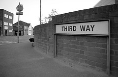

Over the summer there was much discussion among my colleagues about making digital humanities work “count” in academic careers. This included [two](http://edwired.org/?p=313) [fantastic](http://edwired.org/?p=349) threads on Mills Kelly’s *Edwired* blog, [a great post](http://www.hastac.org/node/1427) by Kathy Davidson, and [an informal chat](http://digitalcampus.tv/2008/07/03/episode-29-making-it-count/) on our own *Digital Campus* podcast. As usual the topic of tenure also undergirded discussions at the various digital humanities workshops and conferences I attended during June, July, and August. The cooler weather and tempers of autumn having arrived, I’d like to take a quick look back and commit to writing some of the thoughts I offered on our podcast and at these meetings.

Let me use Mills’ “Making Digital Scholarship Count” series as a starting point. For those of you who weren’t following his posts, Mills argues that if scholars want digital scholarship to count in traditional promotion and tenure decisions, then they have to make sure it conforms to the characteristics and standards of traditional scholarship (though Mills points out that some of those standards, such as peer review, will have to be modified slightly to accommodate the differences inherent in digital scholarship.) At the same time Mills suggests that we have to accept that digital work that does not fit the standards of traditional scholarship, no matter how useful or well done, will not count in traditional promotion and tenure decisions. Essentially Mills makes a distinction between digital “scholarship” and other kinds of digital “work,” the first which bears the characteristics of traditional scholarship and the second which does not. The first should count as “scholarship” in promotion and tenure decisions. The second should not. Rather it should count as “service” or something similar.

I more or less agree this, and I’m fine with Mills’ distinction. Communities have the right to set their own standards and decide what counts as this or that. But this situation does raise questions for those of us engaged primarily in the second kind of activity, in digital humanities “work.” What happens to the increasing numbers of people employed *inside university departments* doing “work” not “scholarship?” In universities that have committed to digital humanities, shouldn’t the work of creating and maintaining digital collections, building software, experimenting with new user interface designs, mounting online exhibitions, providing digital resources for students and teachers, and managing the institutional teams upon which all digital humanities depend count for more than service does under traditional P&T rubrics? Personally I’m not willing to admit that this other kind of digital work is any less important for digital humanities than digital scholarship, which frankly would not be possible without it. All digital humanities is collaborative, and it’s not OK if the only people whose careers benefit from our collaborations are the “scholars” among us. We need the necessary “work” of digital humanities to count for those people whose jobs are to do it.

Now I’m not arguing we bestow tenure in the history department for web design or project management, even if it’s done by people with PhD’s. What I am saying is if we’re going to do digital humanities in our departments, then we need something new. It can’t be tenure-track or nothing. With the emergence of the new digital humanities, we need some new employment models.

I myself do relatively little work that would fit traditional definitions of scholarship. Practically none of my digital work would. Because of that I am more than willing to accept that tenure just isn’t in the picture for me. With my digital bent I am asking for a change in the nature of academic work, and therefore I have to be willing to accept a change in the nature and terms of my academic employment.

That said, I am not willing to accept the second-class status of, for instance, an adjunct faculty member. My work—whether it is “scholarship” or not—wins awards, attracts hundreds of thousands of dollars in grant funding, turns up periodically on CNN and in the New York Times, enables the work of hundreds of other academics, and is used every day by thousands of people, scholars and non-scholars alike. That may not make it tenureable, but it’s certainly not second class. My work requires a “third way.”

 Fortunately I’m at an institution committed to digital humanities and willing to experiment with new models of academic employment. Technically I have two titles, “Managing Director of the Center for History & New Media” and “Research Assistant Professor.” That puts me somewhere between an untenured administrative faculty member and an untenured research faculty member. It is a position which would frighten some of my tenure-track colleagues terribly, and I can, indeed, be fired from my job. Sometimes that worries me too. Then I remember that probably 99% of the rest of working Americans can also be fired from their jobs. I also remember that just like that other 99%, if I do what’s expected of me, it probably won’t happen. If I continue to win grants and awards from panels of my peers and continue to produce quality, well-received, well-used digital humanities products, I’ll probably continue to have a job. If I exceed expectations, I’ll probably advance.

Just as important to note are the benefits my job has over more traditional scholarly career paths, some of which are pretty serious. I’m not terrorized by the formalized expectations that accompany traditional P&T decisions. I won’t perish if I don’t publish. I also don’t have fixed teaching obligations. I can focus full-time on my research, and I have greater freedom and flexibility to explore new directions than most of my tenure-track colleagues. I get to work on lots of things at once. Some of these experiments are likely to fail, but as long as most succeed, that’s expected and OK. I manage my own travel budgets and research schedule rather than being held hostage to department committees. I get to work every day with a close-knit team of like-minded academics rather than alone in a library. I have considerably greater freedom to negotiate my pay and benefits. And to the extent that it advances the mission and interests of the Center for History & New Media, this blog “counts.”

Mine is not a tenure-track position, and based on the work I do, I don’t expect it to be. Nor do I care. There are some downsides and some upsides to my position, but it’s a reasonably happy third way. More importantly, I believe it is a necessary third way for the digital humanities, which in Mills’ terms require not only digital “scholarship” but also digital “work.” I’m lucky to be at an institution and to have colleagues that make this third way possible. Other institutions looking to build digital humanities capacity should follow suit. If digital humanities are going to flourish in the academy, we need both to accept and advocate for new models of academic employment.

\[Image credit: [Dave Morris](http://flickr.com/photos/davemorris/)\]

Late Update (10/2/08): I very absentmindedly neglected to list my friend [Margie McLellan](http://tellhistory.wordpress.com/) among the important voices in this discussion. Along with Mills and Kathy Davidson, Margie’s three posts, [On Defining Scholarship](http://tellhistory.wordpress.com/2008/01/29/on-defining-scholarship/), [Scholarship Update](http://tellhistory.wordpress.com/2008/06/14/digital-scholarship-update/), and [Is a Blog Scholarship?](http://tellhistory.wordpress.com/2008/07/13/is-a-blog-scholarship/), are required reading on these matters.
