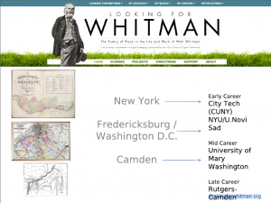

When I discuss the “[Looking for Whitman](http://lookingforwhitman.org)” project, a multi-campus experiment in digital pedagogy sponsored by the [NEH Office of the Digital Humanities](http://www.neh.gov/ODH/ODHHome/tabid/36/BlogId/17/Default.aspx), I often emphasize the place-based structure of the project.  As part of it, four courses were offered in institutions located in cities in which Walt Whitman lived; students spent the Fall 2009 semester reading texts that Whitman had written in their location and sharing their thoughts, reactions, and research with one another in a dynamic, social, web-based learning environment.

What I discuss a little less often, even though it was extremely important to the project, was the way in which the project worked within existing institutional structures in order to encourage, or at least model, a shift in their functioning. Rather than forming a meta-course that would run classes outside of traditional, credit-bearing disciplinary and institutional frameworks, we chose to work within existing academic boundaries. This wound up necessitating a great deal of administrative work: faculty participants had to ensure that their courses would get on the books in forms that would allow them to be aligned with the project, which involved extensive consultations with departments, deans, registrars, colleagues, and curriculum committees.

But by working within those institutional structures, we subverted some elements of them.  Perhaps the most radical element of the project was the way in which it brought participants from very different types of schools into linked virtual learning spaces.  The colleges chosen for participation in Looking for Whitman–-[New York City College of Technology (CUNY)](http://www.citytech.cuny.edu/), [New York University](http://www.nyu.edu/), [University of Mary Washington](http://www.umw.edu/), and [Rutgers University-Camden](http://www.camden.rutgers.edu/)-–represented a wide swath of institutional profiles:  an open-admissions public college of technology, a private research-intensive university, a public liberal arts college, and a public research university, each with very different types of students.  Beyond that, the courses explicitly engaged different types of classes and learners with very different types of backgrounds and knowledge-bases.  The class at University of Mary Washington consisted of senior English majors who were taking the course as a capstone experience.  There were two classes at Rutgers; one contained a mix of undergraduate English majors and master’s-level students; the other consisted entirely of graduate students who were taking a methods course that served as an introduction to graduate english studies.  At City Tech, meanwhile, undergraduate students with little training in literary studies were taking a course on Whitman as part of their general education requirements.

The roster of schools became even more diverse when our NYU faculty member, [Karen Karbiener](http://karbiener.lookingforwhitman.org/), received a Fulbright Fellowship to Serbia and decided to include her class at the [University of Novi Sad](http://www.uns.ac.rs/en/) in the project.  It was this interesting mix of institutions that Jim Groom wrote about in [his post on Looking for Whitman](http://bavatuesdays.com/looking-for-whitman-a-grand-aggregated-experiment/):

From the University of Mary Washington to Rutgers-Camden to CUNY’s City Tech to Serbia’s University of Novi Sad, the project represents a rather compelling spectrum of courses from a variety of universities that provide a unique network of students from a wide array of experiences. This is not a “country club for the wealthy,” but a re-imagining of a distributed, public education that is premised on an approach/architecture that is affordable and scales with the individual. It’s a grand, aggregated experiment that will hopefully demonstrate the possibilities of the new web for re-imagining the boundaries of our institutions, while at the same time empowering students and faculty through a focused and personalized learning network of peers, both local and afar.

Mixing all of these students together in a single online space — especially one that placed a great deal of emphasis on social interaction — might seem to some observers to be at best a bad idea, and at worst a dangerous one. What could graduate students studying literature learn from undergraduate students taking gen-ed courses at an urban school of technology? Would undergrads flame one another on the course site? Would undergrads be intimidated by the work of more advanced students who were working within their fields of specialization?

A look around the [project website](http://lookingforwhitman.org) will show that productive interactions did take place, though not always without complications.  We’re just beginning to sort through the data associated with the project, and we’re especially looking forward to examining student responses to the extensive survey we circulated at the close of the semester.

Still, it’s not too early to say that the radical potential of projects like “Looking for Whitman” — and, I would argue, the radical potential of Digital Humanities pedagogical projects more generally — lies in their ability to connect learners in ways that hack around the artificial boundaries of selectivity and elitism that educational institutions have erected around themselves. And if one result of that hacking is the creation of more open, more diverse, more egalitarian learning environments that engage a broader spectrum of students and institutions, the Digital Humanities might find that it has a social mission that complements its technological one.

(Submitted to [Hacking the Academy](http://hackingtheacademy.org))
