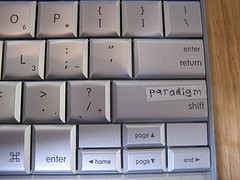

Sometimes friends in other disciplines ask me the question, “So, what are the big ideas in history these days?” I then proceed to fumble around for a few minutes trying to put my finger on some new “-ism” or competing “-isms” to describe and define today’s historical discourse. Invariably, I come up short.

Growing up in the second half of the 20th century, we are prone to think about our world and our work in terms of ideologies. Late 20th century historical discourse was dominated by a succession of ideas and theoretical frameworks. This mirrored the broader cultural and political discourse in which our work was set. For most of the last 75 years of the 20th century, Socialism, Fascism, Existentialism, Structuralism, Post-Structuralism, Conservatism, and other ideologies vied with one another broadly in our politics and narrowly at our academic conferences.

But it wasn’t always so. Late 19th and early 20th century scholarship was dominated not by big ideas, but by methodological refinement and disciplinary consolidation. Denigrated in the later 20th century as unworthy of serious attention by scholars, the 19th and early 20th century, by contrast, took activities like philology, lexicology, and especially bibliography very seriously. Serious scholarship was concerned as much with organizing knowledge as it was with framing knowledge in an ideological construct. Take my sub-discipline, the history of science, as an example. Whereas the last few decades of research have been dominated by a debate over the relative merits of “constructivism” (the idea, in Jan Golinski’s succinct definition, “that scientific knowledge is a human creation, made with available material and cultural resources, rather than simply the revelation of a natural order that is pre-given and independent of human action”), the history of science was in fact founded in an outpouring of bibliograpy. The life work of the first great American historian of science, George Sarton, was not an idea, but a journal (

*Isis*), a professional society (the [History of Science Society](http://www.hssonline.org/)), a department (Harvard’s), a primer (his *Introduction to the History of Science*), and especially a bibliography (the *Isis Cumulative Bibliography*). Tellingly, the great work of his greatest pupil, Robert K. Merton, was an idea: the younger Merton’s “Science, Technology and Society in Seventeenth Century England” defined history of technology as social history for a generation. By the time Merton was writing in the 1930s, the cultural climate had changed and the consolidating and methodological activities of the teacher were giving way to the ideological and theoretical activities of the student.

I believe we are at a similar moment of change right now, that we are entering a new phase of scholarship that will be dominated not by ideas, but once again by organizing activities, both in terms of organizing knowledge and organizing ourselves and our work. My difficulty in answering the question “What’s the big idea in history right now?” stems from the fact that, as a digital historian, I traffic much less in new theories than in new methods. The new technology of the Internet has shifted the work of a rapidly growing number of scholars away from thinking big thoughts to forging new tools, methods, materials, techniques, and modes or work which will enable us to harness the still unwieldy, but obviously game-changing, information technologies now sitting on our desktops and in our pockets. These concerns touch all scholars. Our [Zotero](http://zotero.org) research management tool is used by three quarters of a million people, all of them grappling with the problem of information overload. And although much of the discussion remains informal, it’s no accident that [Wikipedia](http://www.wikipedia.org/) is right now one of the hottest topics for debate amongst scholars.

Perhaps most telling is the excitement that now (or really, once again) surrounds the library. If you haven’t been to a library conference lately, I suggest you do so. The buzz amongst librarians these days dwarfs anything I have seen in my entire career amongst historians. The terms “library geek” and “sexy librarian” have gained new currency as everyone begins to recognize the potential of exciting library-centered projects like [Google Books](http://books.google.com/).

All of these things—collaborative encylcopedism, tool building, librarianship—fit uneasily into the standards of scholarship forged in the second half of the 20th century. Most committees for promotion and tenure, for example, must value single authorship and the big idea more highly than collaborative work and methodological or disciplinary contribution. Even historians find it hard to internalize the fact that their own norms and values have and will again change over time. But change they must. In the days of George Sarton, a thorough bibliography was an achievement worthy of great respect, and an office closer to the reference desk in the library an occasion for great celebration (Sarton’s small suite in Study 189 of Harvard’s Widener Library was the epicenter of history of science in America for more than a quarter century). As we tumble deeper into the Internet age, I suspect it will be again.

\[Image credit: [Alex Pang](http://flickr.com/photos/askpang/); Quote: Jan Golinski, *Making Natural Knowledge* (Cambridge University Press, 1998), p. 6.\]
