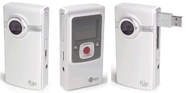

In June 2008 I received [a grant for 20 Flip Video Cameras](http://williamwolff.org/wp-content/uploads/2009/01/wolff-innovations-in-tech-grant-2008-app.pdf) (.pdf) to be used in one of the required courses in the Writing Arts undergraduate major at Rowan, “[Writing, Research, and Technology](http://williamwolff.org/courses/wrt-spring-2009/).” The general goal of the course was to extend traditional conceptions of composition by applying it to the medium of video. To accomplish this goal, students competed three primary assignments: 1) a semester-long vlog on their own YouTube channels; 2) a 3 – 5 minute video on the subject, “[What Does YouTube Mean to You?](http://williamwolff.org/courses/wrt-spring-2009/wrt-assignments-s09/assignment-1-what-does-youtube-mean-to-you/)“; and 3) an 8 – 10 minute [oral history video project](http://williamwolff.org/courses/wrt-spring-2009/wrt-assignments-s09/assignment-3-oral-history-video-composition/) grounded in oral history research methodologies. [I have discussed the YouTube project on this blog](http://williamwolff.org/composingspaces/what-students-learned/) and will discuss the oral history video project at a later date (all videos can be found at the [Oral History Video Archive YouTube channel](http://www.youtube.com/user/oralhistoryvideo)).

This post, however, is going to be specifically about how I integrated the [Flip Video camera](http://www.theflip.com/) and related software applications into the course. I have broken the post into 6 primary recommendations.

**Recommendation 1: Use the Flip Video Camera and get students to play with it right away**

The Flip is designed with a specific purpose: to make video recording, editing, and uploading to the Web as easy as possible. It is light, portable, and durable. It is perfect for a student to take into the field, conduct interviews, and video variety of landscapes. Its wide angle lens helps make it excellent in low-light situations, though zooming in the Ultra series (which we used) is not recommended. If your goal is to create professional quality video productions, the Flip may not be for you. But, if it is perfect for introducing students to video composition, editing techniques, and the rhetorical issues surrounding both.

The Ultra series cameras have 60 minutes worth of hard drive memory (2GB); the ability to record, playback, and delete video files; a built-in USB port; and bundled software installed (see a [complete list of specifications](&lt;http://www.theflip.com/products_flip_ ultra_specs.II.shtml>)). The videos are formatted specifically for the YouTube screen (640px x 320px).

No bigger than an iPhone, the camera is amazingly easy to use: press the record button to start, press it again to stop, connect the unit to any computer via the USB port (and if one would like, wait for the software to install, edit the video, save the file, and one-click upload it to YouTube \[or other online video site\]). The video quality for such a small camera is excellent and the unit has outstanding battery life. Its extreme usability and bundled software makes it an ideal technology for students who are not technology- or video-savvy. The 640px x 320px image size—and resulting small file size—makes it easy to import into more advanced video editing applications, such as Windows Movie Maker and iMovie.

Before I put the cameras in students hands, however, and because students would take the cameras home with them for the rest of the semester, I had to ask students [to sign an agreement](http://williamwolff.org/wp-content/uploads/2009/06/student-agreement.pdf) (.pdf) detailing how the camera could be used and what would happen if the camera was lost or broken. No students objected to signing the form. Please feel free to adapt it to your purposes.

I have been teaching since 1996 and I have never seen a group of students become so enamored with a piece of technology so quickly as when I handed out the Flip Video Cameras during the first week of class. It was spectacular. An early activity in most of my classes is to do some brief ice-breaker so that we can get to know each other. This time, however, I broke the students into groups of two and asked them to interview each other using one of Studs Turkel’s favorite techniques for starting an interview. They asked each other three questions: 1) What is your name? 2) Where are we located? 3) Who is \[insert name given\]? After a brief intro to Windows Movie Maker students edited down the footage to a small video that introduced themselves to the class (this might have taken 2 class meetings). Then over a weekend I edited the movies into one long movie and we watched it as a class. This minor activity designed to get students to know each other resulted in learning how to use the video camera and do some very basic video editing. And it was great fun watching the full movie in class.

**Recommendation 2: Ensure that students have the ability to edit video outside of class and from home**

The question of which software applications to use was, and still is, a difficult one. When I wrote the grant that funded the video cameras I asked for access to Final Cut Pro so that students could learn how to use one of the top video editing software applications. Then, while teaching a web design course and seeing my generally non-tech-savvy students struggle with gaining access to Photoshop outside of the classroom, I thought better of using Final Cut Pro. Students wouldn’t be able to work at hom and my limited time spent editing video was enough to know that students would need ample time outside of class to work on their videos.

However, if we used Windows Movie Maker (WMM) (most students at Rowan own PCs not Macs) they would be able to work from home and/or from computers in Rowan’s computer labs. Plus, the goal of the course was not to learn how to make the savviest movies. Rather, it was to think about how we might be able to conceive of video production as a form of composition. WMM metaphors allow for that to be abundantly clear, even if the production isn’t the cleanest. So, ultimately I decided to go with WMM and it was so nice not having to worry about students not being able to gain access to the software. (My two Mac users learned iMovie and one of them procured Final Cut Pro taught himself how to use it). To enhance some of WMM’s limited Ken Burns effects (where still images are panned left-to-right, top-to-bottom, or zoomed in and out) students eventually used the free [Windows Photo Story 3](http://www.microsoft.com/windowsxp/using/digitalphotography/PhotoStory/default.mspx) (WPS3). The movies produced with WPS3 can be imported into WMM and edited like any other movie clip.

One of the great things about video editors is that the screens are essentially identical. The learning curve is finding out how to use new features within set screen constraints. There is also an online video editing site called Jaycut ([http://jaycut.com/](http://jaycut.com/)) which I had anticipated using, but because everyone had access to WMM or iMovie there wasn’t a need.

**Recommendation 3: Teach students more advanced editing techniques over time**

Though WMM is limited as compared to iMovie and Final Cut Pro it does allow for some advanced editing techniques, such as separating audio from a video clip and with Windows Photo Story 3 movies, the ability to create some excellent Ken Burns effects.

I strongly recommend introducing these and other advanced techniques later in the semester as a way to enhance editing practices with which students are already comfortable. Video editing is fun and time consuming and can be overwhelming even for tech-savvy students. Introducing advanced techniques over time rather than all techniques carte blanche will help students focus, first, on the process of composing their videos (and not on nifty techniques) and will help mitigate any sense of being ovewhelmed.

**Recommendation 4: Talk with students at length about best practices for working with video files, moving video files to and from USB drives, and backing up their work** The Flip offers 2 ways for users to download video files from the camera to their computer. The first is to use the video editing software that comes pre-packaged in the camera. The second is to view the files through Windows Explorer or the Mac Finder windows. I prefer the latter. This allows students to drag and drop whole files from the camera to their computer and save it in a specific location. Then, they can import and work with the videos in WMM, iMovie, or other video editor.

During the semester I found that students were attempting to import their movies into WMM directly from their Flip camera. That is, they did not first move the movie from the camera to their computer and work with the file from their computer. This caused a number of problems, including lost files (eventually found), agonizingly slow import and export times, and crashing software. It is essential that students understand that moving the files is a best practice for working with video and also backing-up their work.

The biggest issue with moving files, however, came with how students were moving files (video, image, and music) from their computer to their required USB drive to the lab/classroom computer and back again. The trouble stems from how WMM works with the files themselves. On the surface it looks as if the files are actually in the WMM interface. However, WMM only remembers the location of the files. As such, if a student has a WMM project saved and moves only the project file (and not the files that make up the project) from their home computer to their USB drive to work with at school, when they open WMM on the new computer they will be greeted with a series of red Xs rather than their movie. The same will happen if the files are not in the exact same location in relation to the project file.

Students need to be instructed on moving whole folders rather than individual files and to keep folder and file locations consistent from computer to computer. (If they do run in to the Red X problem, they can just right click on the X, find the original file, and it will appear as normal.)

**Recommendation 5: Provide multiple avenues for file conversion and anticipate some problems**

As part of their assignments, I asked students to incorporate clips of YouTube videos into their movies. To facilitate this  suggested students install the [Firefox Download Helper plug-in](https://addons.mozilla.org/en-US/firefox/addon/3006). This plug-in allows users to download any video to their desktop.

YouTube movies, however, are in .flv format; WMM and iMovie will not import .flv. [Brian Croxall](http://twitter.com/briancroxall) suggested [Zamzar](http://www.zamzar.com/), which will convert video (and other files) into multiple formats. You can either upload your own video (the default tab) or add in the video URL and it will send you an email notification when the conversion is complete. Then all you need to down is download it and import it into WMM or iMovie. Very easy. I also provided students with a few other options for [capturing and converting video](http://williamwolff.org/courses/on-capturing-and-converting-video-files/). Most, however, found Zamzar to be fast and reliable, so stayed with it.

**Update June 4, 2010:** Those of you using Flip Ultra HD will experience trouble trying to import the videos into Windows Movie Maker. This is because WMM does not accept .mp4 files (iMovie does). I suggest using the [Pazera  Free MP4 to AVI Converter](http://download.cnet.com/Pazera-Free-MP4-to-AVI-Converter/3000-2194_4-10784027.html). As noted in the comments below, I have used it to convert 200+ videos in one shot and had no problems at all.

**Recommendation 6: Require students to use only Creative Commons approved music**

There are many sites where musicians have assigned Creative Commons licenses to their music. The best ones so far have been Jamendo ([http://www.jamendo.com/en/](http://www.jamendo.com/en/)) and Splice Music ([http://www.splicemusic.com/](http://www.splicemusic.com/)). I ask students to cite the artist, title, and URL in their movies and in the YouTube description.

I hope you find these recommendations useful and think about using the Flip in your classes. If you have used the Flip in your classes and have other recommendations, please add them below. If you are trying the Flip for the first time, please do not hesitate to ask questions. As always, I look forward to your comments and suggestions.

**Update June 4, 2010:** On March 10, I led a workshop at Rowan entitled “6 7 Recommendations for  Using Flip (and other) Video Cameras in the (non-video) Classroom.” This workshop builds and expands on ideas discussed in this post. You can [see the Prezi](http://j.mp/9KBk2H) and/or [download the full presentation](http://j.mp/cJdHWH).

**Update June 5, 2010:** For a comparison of various free video editing software tools, see “[Free Video Editing Tools: Guide To The Best  Software And Web-Based Services](< http://www.masternewmedia.org/free-video-editing-tools-guide-to-the-best-software-and-web-based-services/>).” Some of the tools are no longer available, but it is an otherwise great resource. I’ll be trying some of them out, especially [Video Spin](http://www.videospin.com/Redesign/), to replace WMM. I’ve already ruled out Jaycut and the other online editors.
