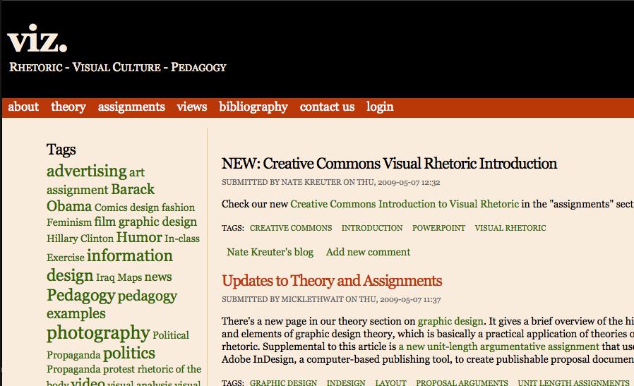
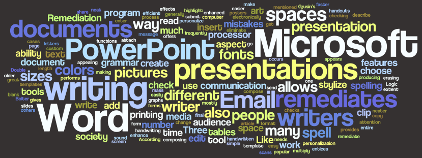
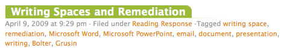
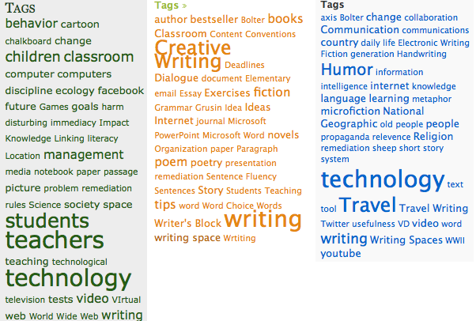

[Ryancordell](http://twitter.com/ryancordell) asked me to say a few words about teaching tagging to my students and I am very happy to do so.

I have been trying to figure out how to teach tagging to my graduate and undergraduate students since I began using [Diigo](http://diigio.com) several years ago. Actually, after I finished presenting [a paper](http://williamwolff.org/composingspaces/preparing-writers-for-the-future-of-information-systems/) at the  [4th International Conference on Technology, Knowledge, and Society](http://t08.cgpublisher.com/) a woman attending the talk asked me if I had figured out how to teach tagging. My response: “No; teaching tagging is the hardest thing I have tried to do in years—and perhaps, ever.” This semester, however, by sheer accident, as I walked down the steps on my way to class, I came up with an activity that unintentionally changed how I teach tagging.

**background** In my

[Technologies and the Future of Writing](http://williamwolff.org/courses/tfw-spring-2009/)module in the team-taught course, Introduction to Writing Arts, I break students into groups of 4 – 5 based on their professional goals. Each group creates a Wordpress.com blog where they will blog about items relating to their future profession. My goals for the assignment are for the students to learn about blogging while entering into an online discourse community of peers in class and out there on the Web. We read portions of Diane Penrod’s very useful book

[*Using Blogs to Enhance Literacy: The Next Powerful Step in 21st-Century Learning*](http://bit.ly/12bKuZ), which, in part, talks about how blogs need maintain consistency in terms of topic, layout, theme, and so on. This, of course, extends, to the titles of the blog. So, for example, this semester’s module 3 blogs were about education (

[Elementary Behavior Management Magic](http://ebmm.wordpress.com/),

[Teaching 411](http://teaching411.wordpress.com/)) and creative writing (

[The Creators’ Conscience](http://creatorsconscience.wordpress.com/),

[ill-literate](http://illliterate.wordpress.com/)) because those students’ goals were to become teachers or writers.

During the set-up of Module 1 student blogs we were running behind and in the rush to get the blogs set up, I allowed students create blog titles that had nothing do with their professional goals or the theme of the blog itself. After class I realized that the blog titles had to be changed, which meant that the second day of class would have to be spent on the blogs, again, instead of the first readings of the module—selections from Bolter’s *Writing Spaces* and Bolter and Grusin’s *Remediation*. Students would have posted their responses to the reading on the blog we had set up the previous class, and they would have to be transferred to the new blog (as way to help students feel comfortable with the blog interface, I ask them to post responses to the first two readings on the blog; thereafter they are responsible for posting 5 times a week on topics relating to the theme of their blog, one of which should be on the readings.) However, I also saw this as an opportunity to take time to show students more about the Wordpress dashboard, including the widgets, tagging, and categories—functions I had yet to be able to effectively introduce in prior sections of the class.

**tagging blog posts**

Usually I talk about tagging when students are introduced to Diigo during the 3rd week of the 4-week module. That had pretty much been a failure—my discussion was always too abstract. As I walked down the steps that day, [Wordle](http://wordle.net) popped in to my head as way to help students break down their posts to suggest keywords for what was important about the post itself. I usually start my discussion of tagging with a space where students are familiar with tagging: Facebook photos. I tend to quickly draw on the board a stick-figure photo of Jane, Jim, John, and Jill passed out at some party that Jason had uploaded and tagged. We talk about how this allows the photo to appear on each of the tagged’s Facebook page, allowing one item to appear to be in 5 places at once. This time, after the discussion, which usually comes before introducing Diigo, I put the wonderful visual rhetoric blog, [Viz](http://viz.cwrl.utexas.edu/), on the screen. Aside from the content, I like how they make so prominent the tag cloud and the tags under each post.

We talk about how the tag cloud is a semantic representation of the tags that the bloggers have chosen for their posts, that the bigger the word the more the tag has been used, how this tells us something about the topics covered in the blog, and so on. Still, however, this discussion is in the abstract; students are not gaining the experience of how to create their own tags.

The next step changed everything. The prompt for the response to the Bolter and Grusin readings asks students to “identify three of the writing spaces you use most frequently, discuss their characteristics, and what makes them unique. Then, choose two of those spaces, and using Bolter’s and Grusin’s definition of remediation, discuss how one remediates the other (or how they remediate themselves).” Each student was to have that posted to their blog. In class, I asked students to:

1. copy the text of their response
2. paste it in to the Wordle form field
3. create a Wordle of that post that was aesthetically pleasing to them
4. locate the 5 – 6 words that were most prominent and write them down
5. go back to their post and add those words as tags for that post, as well as adding the authors discussed

So, for example, [a student’s post](http://creatorsconscience.wordpress.com/2009/04/09/writing-spaces-and-remediation/) resulted in the following Wordle:

From this Wordle, we might select the following as tags: documents, writing spaces, presentation, email, remediates, Microsoft PowerPoint, Microsoft Word. Here is what the student selected:

This post now has effective, meaningful tags. The next step would be to create the tag cloud. After the students saved their tags, we took a look at their blogs and saw that though the tags were appearing with their posts, they were not appearing in a tag cloud. This led to an introduction of sidebar widgets. Once they had activated the tag cloud widget the clouds appeared. Over the course of the module, clouds from 3 blogs evolved into the following:

**social bookmarking tagging**

As mentioned above, I used to introduce tagging to students when they were learning how to use Diigo (I prefer Diigo to Delicious because I like Diigo groups and the social annotation feature, which I used to introduce students). Now, because students are familiar with tagging through tagging their blog posts, when we talk about social bookmarking they have a much better idea of how to tag the Web sites they bookmark. The discussion then moves to folksonomies and what makes an effective folksonomy. I reinforce the idea that tags should be chosen wisely, that when bookmarking similar kinds of pages, the same tags should be used so that they create a folksonomy that accurately represents the sites they are bookmarking.

As part of the Diigo assignment, students share 12 bookmarks (relating to their professional goals) to a group that I have set up (Spring 2009 groups: [Module 1](http://groups.diigo.com/groups/tfw-s09-mod1), [Module 2](http://groups.diigo.com/groups/tfw-s09-mod2), [Module 3](http://groups.diigo.com/groups/tfw-s09-mod3)). My hope is that students will see what their classmates have bookmarked and will check out the sites and perhaps blog a bit about what they learn. Students are, however, assessed on the quality of their tags and the quality of their individual folksonomies as representations of the kinds of pages that they have bookmarked and as discussed in their final paper. I have found that assessing the tags and folksonomy results in students paying more attention to the quality of both, such as with [this student](http://www.diigo.com/user/Laffer90) and [this student](http://www.diigo.com/user/nichol59).

**conclusion**

To wrap up what has become a much longer post than intended, I have found that engaging students in the activity of creating and interpreting a tag cloud of one of their own posts is an effective way to introduce students to the concept of tagging. It is still a difficult and time-consuming concept to teach and to learn. But, over time, with repeated emphasis and evaluation of their tags in class, students are able to understand how to create meaningful tags and understand why doing so is important.

As always, I am interested in your thoughts. How have you been able to effectively teach tagging?
