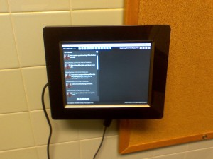
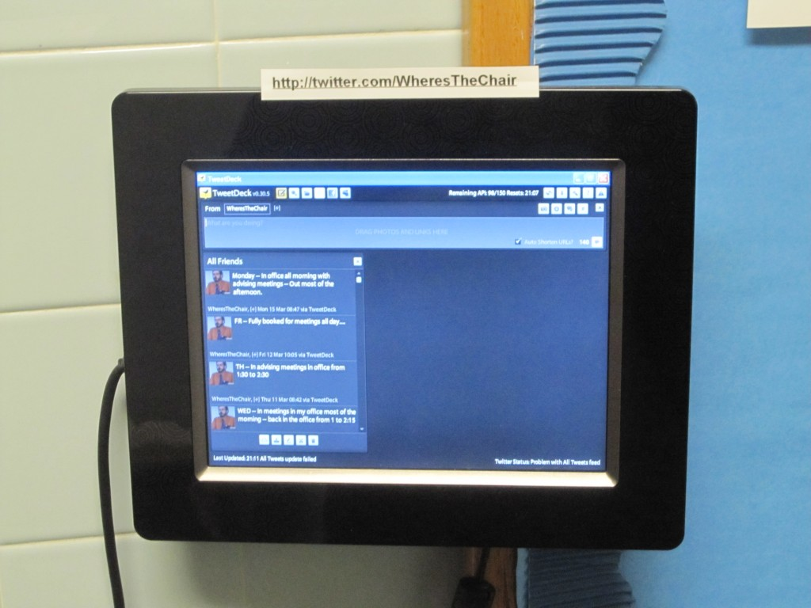
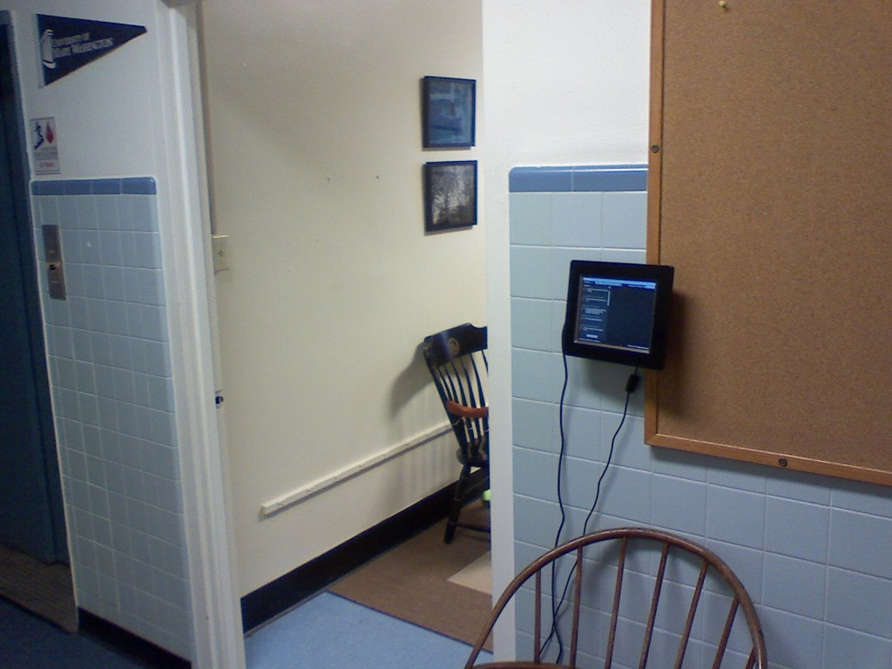

**The Problem**

I schedule at least five office hours per week. \[I'm there a LOT more, but these are scheduled hours, the same from week to week throughout a given semester, when people can more or less count on me to be there.\]

The problem is that as chair of my department, I’m involved in a number of on and off-campus committees, many of which, of necessity, conflict with those office hours. Although I try to let students and department faculty know about these changes in advance, the fact is that sometimes these meetings are scheduled at the last minute, sometimes they just run late, and sometimes I just don’t want to overwhelm my students and colleagues with a torrent of emails about my office hours that the vast majority will just delete and don’t need.

Also, as chair, there are a number of people who stop by my office, expecting me to be there, regardless of scheduled office hours (needing forms signed, questions answered, advice given, complaints heard, or just to hang out).

**The Plan**

So, early in 2008, after a year of having been on Twitter, I began to  wonder if there was some way to use an account to update where I was.   Then, via my spouse, I ran across [this  post](http://mrmoses.org/?p=254) by an assistant principal who figured out how to keep a  monitor in his office that he could update from elsewhere to let his  staff and students know where he was.  So, I grabbed the Twitter handle,  [wheresthechair](http://twitter.com/WheresTheChair), as a  test account until I could figure out how to do it.  The problem was one  of hardware and location.  I didn’t want to leave my door open all the  time (as the school principal did), but I also couldn’t figure out how  to get a monitor outside the office without just leaving a laptop  outside the door.

I played around with the idea of [taking  an old laptop](http://lifehacker.com/5177762/turn-an-old-laptop-into-a-wall+mounted-computer) and converting it to a [digital picture  frame](http://shuttertalk.com/articles/digitalframe) that I could mount outside, but frankly I’m just not that  handy.

So, I mostly played around with various ideas and kept looking for a  solution that would meet my needs **and** my skill level.   And then I ran across this [Samsung  series of picture frames](http://www.samsung.com/hk_en/consumer/detail/detail.do?group=computersperipherals&type=photoframe&subtype=photoframe&model_cd=LP08MNLSB/XK).   Like many other digital frames, they  can play slideshows of images from internal memory (1 GB) or from SD or  other memory cards.  Unlike most other frames, however, they also have a  mini-monitor function which allows you to hook them up directly to a  computer just using a USB port.  The frame then becomes an extension of  your desktop.  \[As far as I know, it's Windows only at this point, even in [Samsung's newer models](http://www.samsung.com/us/consumer/photography/digital-photo-frames/index.idx?pagetype=type).\]

**The Project**

Last summer, I got one of the 8-inch frames ([SPF-85H](http://www.samsung.com/hk_en/consumer/photography/photo-frame/photo-frame/LP08MNLSB/XK/index.idx?pagetype=prd_detail&returnurl=)) and set it up outside my  office.  I needed to do the following to make it work:

1\) Install the frame’s drivers (I used the [updated  ones from the Samsung site](http://www.samsung.com/hk_en/consumer/photography/photo-frame/photo-frame/LP08MNLSB/XK/index.idx?pagetype=prd_detail&tab=support)).

2a) [Install Tweetdeck](http://tweetdeck.com/).  Although text layout on it isn’t quite   as flexible as I’d like, the software automatically refreshes on a fixed schedule, and has been easy to set up and forget.

2b) I’ve also played around with using the Firefox add-on [ReloadEvery](https://addons.mozilla.org/en-US/firefox/addon/115) so that my home Twitter page will refresh itself, but that setup was less reliable.

3\) I used a [16-ft  USB repeater cable](http://www.amazon.com/exec/obidos/ASIN/B000FSTKO4/profhacker-20/) and a 10-ft USB extension since the computer  I’m using is nowhere near the door.  I also needed a power extension  cord since the included one was not long enough. I was fortunate enough  to have a door on my office that has plenty of room  under the door for the power and USB cable to fit.  \[Note that in at least one of the [newer models from Samsung](http://www.samsung.com/hk_en/consumer/photography/photo-frame/photo-frame/LP08IPLSB/XK/index.idx?pagetype=prd_detail&returnurl=) the frame can draw its power from the USB cable alone.\]

4\) I tucked the cables under the rug, along the wall and under the door.

5\) I attached the monitor to the wall outside my door

6\) I placed the URL for the [wheresthechair](http://twitter.com/wheresthechair/) account on my syllabi and office door.

 

**The Results**

Each morning I post to the account when I’m going to be in my office. But, I am also able update my status on the fly. I can tweet from my computer or iPod Touch in meetings that I’ll be late and it will show up on the monitor outside my door. \[I could also set up updating of the Twitter account via SMS from my cell phone, though I haven't done that yet.\]

After nearly a semester and a half of this setup, I’ve found that although \~30 people (mostly colleagues) follow the Twitter account online, the vast majority of students and others use the device outside my office to check and see if I’m going to be available. Even if new visitors don’t know what to make of it, my colleagues know to tell people to check the monitor or my twitter account for updates of where I am. The one drawback I’ve found is that the screen occasionally freezes and the computer has to be reset. Still, this setup has become a valuable way to remain accessible to my students and colleagues despite my busy schedule.

Thoughts? Comments? Suggestions?

\[Images are my own; the title is from [Brian Croxall](http://www.profhacker.com/masthead/contributors/brian-croxall/); an earlier version of this article was posted [here](http://make.umwblogs.org/2009/07/12/taking-advantage-of-social-media-tech-to-do-my-job-better/).\]
