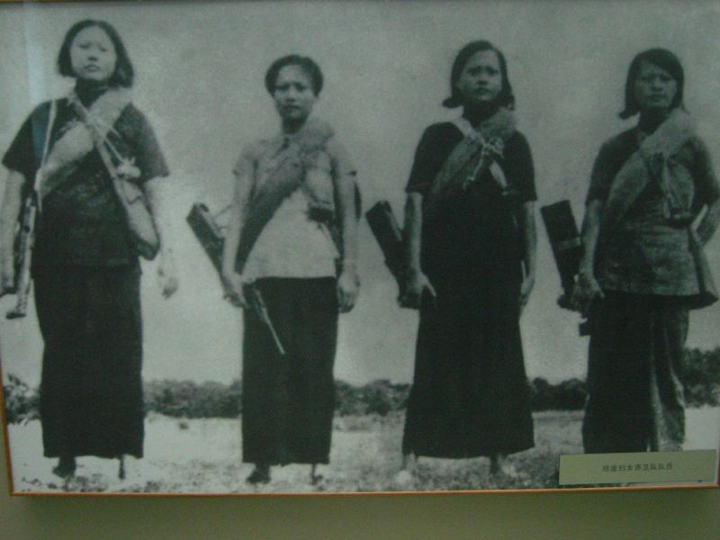
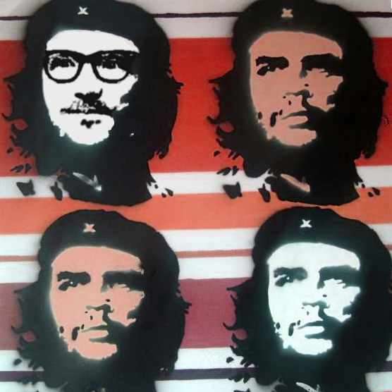

One of the secret missions behind my work with [Mikhail Gershovich](http://www.twitter.com/mikhailg) in developing an open source publishing platform at Baruch College is to gradually integrate into the school’s general education curriculum the deep, critical examination of how digital tools are changing the way we think and live. This curricular purpose is not currently present on any kind of scale at our college. Because of political realities at the school, we’ve very much built [Blogs@Baruch](http://blsciblogs.baruch.cuny.edu) in a haphazard, take-what-we-can-get kind of way, and we haven’t had the luxury of being systematic about the thing. But we’re now two years into our experiment, and we’re widely established enough throughout the college that we’re confident we will continue to operate.  We’re now able to theorize what we’ve done and to strengthen our case for more attention to the types of curricular innovation we’d like to see.

 *[photo](http://www.photodropper.com/photos/) credit: [jectre](http://www.flickr.com/photos/jectre/544530898/)*

Of course, we’re far from the only ones considering these questions, and we’re certainly not the only ones who’ve borrowed the terminology of revolution to cheekily make our case. Matt Gold has already done [a fantastic job creating a hit-and-run guide to guerrilla pedagogy](http://guerrillapedagogy.mkgold.net/) that delineates the tools, philosophy, and connective processes requisite at its core. Gardner Campbell has argued for a trajectory in liberal education towards the development of [media fluency](http://www.gardnercampbell.net/blog1/?p=1238) and in favor of a shift from both “signature pedagogies” to “pedagogies of signature” and from [general education to *generalizable* education.](http://www.slideshare.net/GardnerCampbell/integrative-learning-and-the-gift-of-new-media-general-education-for-the-21st-century-3543849) Gardner has also spoken passionately about the role of movements around the integration of digital tools into the work of higher education in destabilizing the institutions at our center. Joss Winn and Mike Neary have written of [“The Student as Producer,”](http://eprints.lincoln.ac.uk/1675/) connecting pedagogies that place the student squarely in the role of knowledge-maker within broader efforts to combat the corporatization of higher education and to reimagine a university that for once might be fully committed to the development of humanistic thinkers.  Jeff McClurken has [argued smartly that digital literacy is something that should be developed within the disciplines and shown how](http://mcclurken.blogspot.com/2008/12/digital-history-and-undergraduate.html), though I’d guess he’d agree that such an approach does not preclude a broader college-wide addressing of these questions.  And besides being actively involved in building the tools from the ground up, Boone Gorges has  [brilliantly theorized](http://teleogistic.net/2010/03/my-queens-college-presidential-roundtable-talk/) the structural similarities between the types of communication and personalized connections that happen within social media and the specific goals of a college’s general education program.

There are others, many others, who’ve been doing this type of [work](http://umwblogs.org) and [thinking](http://bavatuesdays.com), and their models and theories are very much the fuel that propels us along our path.

**Che Groom**

 *[photo](http://www.photodropper.com/photos/) credit: [5tein](http://www.flickr.com/photos/5tein/3609261904/)*

[Blogs@Baruch](http://blsciblogs.baruch.cuny.edu) has evolved along three broad publishing contours in its first two years, and each can be seen as a step towards developing a foundation upon which those in power at the College might do some tough thinking about how the general education could be reimagined. This said, I have no idea whether or not they might do this, or even when the gen ed was last revisited.  But if they call, we’ll be ready to contribute what we’re learning.

**Non-Course Publishing**

We’ve become the go-to shop for folks at the College who want to get stuff online. [Student publications](http://blsciblogs.baruch.cuny.edu/luc), [online magazines](http://blsciblogs.baruch.cuny.edu/dollarsandsense), [faculty development sites](http://blsciblogs.baruch.cuny.edu/teachingblog), [exhibits](http://blsciblogs.baruch.cuny.edu/photoexhibit), [extra-curricular project journals](http://blsciblogs.baruch.cuny.edu/cfk), document reviews using [CommentPress](http://www.futureofthebook.org/commentpress/), [grant competitions](http://blsciblogs.baruch.cuny.edu/performingdiasporas) and committee sites… we host them all.

Members of our community now recognize that they no longer need HTML skills to be able to publish to the web or CSS skills to control how what they publish looks. On the flip side, each of the individuals and groups involved in these projects has been forced to confront questions of audience, tone, purpose, tools, design, and connectedness. This has spurred conversations that otherwise might have been offloaded to a contracted web group, or might not have happened at all. The [Schwartz Institute](http://faculty.baruch.cuny.edu/blsci), through our nurturing of these conversations, has joined the staff of the [Newman Library](http://newman.baruch.cuny.edu/index.php) at the center of thinking on campus about the role of digital tools in the varied work of the college. This broad “culture of self-publishing” is raising the overall digital literacy of staff, faculty, and administrators at the College by creating and sustaining unavoidable engagement with the implications of doing professional and intellectual work on the open web. This engagement has been more incidental than systematic, but it’s been ongoing and persistent, and more and more people are taking part.

**Course-based Publishing**

Our most exciting work is taking place inside of courses. We’ve supported more than a hundred course sections over the last two years, and they are inspiring faculty members towards more experimental and experiential pedagogy. We’ve featured much of this work at [Cac.ophony.org](http://cac.ophony.org). Some courses are using [Blogs@Baruch](http://blsciblogs.baruch.cuny.edu) as little more than an open CMS, taking advantage of a [flexible aesthetic](http://cac.ophony.org/2006/11/02/the-aesthetics-of-the-virtual-learning-space/) to create a more intimate relationship between students and their engagement with course materials online. Others have used the system to explode students’ prevailing understandings of audience by creating and capturing collaborative writing through the integration of wikis, scaffolding research papers in public groups, or bringing in the voices of outside authorities. Many have used the power of writing for classmates’ consumption (and beyond) to raise the stakes of an assignment. Some have staged engagement with a difficult text through a dialogic close reading that evolves into performed knowledge about the themes of the work. Many have taken advantage of lowered barriers of entry to the production of multi-media work to create opportunities for students to engage with course themes and texts through video and other media, and then to write about how the process impacts their understanding of the genres engaged in the course. Most have embraced the connectedness of the web to integrate additional resources into their teaching and expose students to critical research methods.

These courses have done three types of work. First, they’ve produced models that are replicable within this college and beyond, and fueled a buzz and interest in teaching with digital tools that hadn’t been very present on campus until recently. Second, they’re helping us develop a local “community of practice” committed to dialogue around the implications of digital pedagogy, which has filtered into the faculty development initiatives already afoot at the Schwartz Institute. And, third and most importantly, these courses have worked to instill in students a critical sense of how to exist intellectually and professionally on the Web by spurring dozens of small conversations about online ethics, linking, sharing, identity, performance, knowledge building, collaboration, mashing, hacking, looking, listening, and learning. These conversations have not been systematized, but they’re most definitely happening.

**Social Publishing**

The third contour in which we’ve been working is social publishing. This is an infant compared to the two toddlers described above, and is based primarily in our work supporting [Freshman Seminar](http://blsciblogs.baruch.cuny.edu/fro), which draws all incoming students into conversations on [Blogs@Baruch](http://blsciblogs.baruch.cuny.edu). I’ll spare you the details of how the project has evolved, which you can read up on by following [this tag on Cac.ophony.org](http://cac.ophony.org/tag/fro/). We hope that our pending integration of [BuddyPress](http://buddypress.org) will both challenge some of the alienation that happens on a purely commuter campus, and enable what [Matt Gold](http://mkgold.net/) has called “serendipitous connections” around shared interests that otherwise might not happen. Matt and [George Otte’s](http://purelyreactive.commons.gc.cuny.edu/) framing and stewardship of the [CUNY Academic Commons](http://commons.gc.cuny.edu/) is very much our model for structuring and naming such a possibility. This coming Fall our first year students will be writing creative blog posts that integrate freely-available digital tools to examine their own processes of identity formation. In doing so, they will be sharing and connecting their experiences to others at the school and beyond, and also reflecting upon the choices they make and tools they use. This is non-credit bearing work, but we hope that it will provide for our students a critical base from which to use the web to engage and learn that they will carry through their four years at the College.

All of the above work intersects only incidentally with the formal general education curriculum at the College. And, yet, I think we can safely say that what we’ve built with [Blogs@Baruch](http://blsciblogs.baruch.cuny.edu) has impacted the *generalizable education* that our students are getting. What’s needed, however, is some kind of systematization, which will create more points of reflection and articulation, more staging towards digital and media fluency, and more buy-in across the curriculum. As guerrillas, we’ve made and built our critique while modeling an alternative approach to supporting educational technology that saves the College money and raises its profile. If we are indeed in the midst of the revolution that will remake higher education, then we stand with our [colleagues](http://hackingtheacademy.org/) at the vanguard, arguing that universities must embrace the core values of the open web, and work them systematically into curricula.
