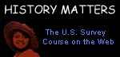
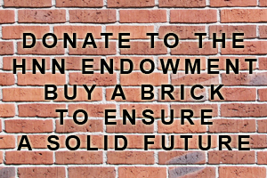

5-22-06

Manan Ahmed, who is writing his dissertation in the history of South Asia and Islam at the University of Chicago, is a member of the HNN group blog [Cliopatria](http://hnn.us/blogs/2.html)

During the last few weeks, I have had occasion to think seriously about my discipline, my scholarship and my future. We had a conference recently on the [Fate of the Disciplines](http://hum.uchicago.edu/frankeinstitute/) \[scroll down to Recent Events\] at which many luminaries wrung their hands and furrowed their brows - worried that money and the right wing will soon destroy the Humanities. Sadly, the brilliantly organized conference had no space for new and recent graduates, those that might actually be responsible for the fate of the discipline. Never mind that. Of particular interest was the talk given by the always brilliant and intriguing [Sheldon Pollock](http://www.columbia.edu/cu/mealac/faculty/pollock/): He spoke about the fate of philology in scholarship. Of service departments and lack of rigorous training in languages. Of what happens when the historian is not a polyglot. And of what happens when the scholar does not inhabit the present. Pollock told us that we have to do philology that is aware of the moment - of the political. The history I study, a friend said to me afterwards, is so far removed from the present that no way I could ever make it relevant. But, my answer was, you are not so far removed from the present. That point stuck with me: What does it mean to be a humanist today? What does it mean, to me, to be a historian?

It is not an idle question. To be honest, the usual concerns have never occupied my thoughts: Will I get a job? Will I publish enough? Will I get tenure? Perhaps because that I have had a job as long as I have been in graduate school, the profession-as-trade dynamic has never taken root within me. Who am I, as a scholar? What is my role within my community? What are my responsibilities to the public? Those questions, when I had a moment to think about them, were much more intriguing to me. My blogging ([Chapati Mystery](http://www.chapatimystery.com/) and [Cliopatria](http://hnn.us/blogs/2/authors/1443.html)) over the last two years was sometimes an attempt to answer such questions. In a sense, as a historian, I am interested in translation - moving from one language to another, from academy to the public. I am interested in speaking, as Jaroslav Pelikan�s astounding essay put it, past-ese and present-ese.

**Polyglot Interpreters**

I admit that the only time I had heard of [Pelikan](http://www.washingtonpost.com/wp-dyn/content/article/2006/05/15/AR2006051500554_pf.html) was when he was co-awarded the Kluge Prize along with Paul Ricoeur. I promised myself that I will read Pelikan and even purchased his *Whose Bible Is it?*, but never got around to it. [Caleb McDaniel recommended](http://hnn.us/blogs/comments/25088.html#comment) an essay from 1993, [The Historian as Polyglot](http://www.jstor.org/view/0003049x/ap030545/03a00190/0) - an address given to the American Philosophical Society on their 250th anniversary. The entire essay is an example of the clarity of thought and ideas so often lacking in people like me who want to call ourselves historians.
Akin to Pollock�s call to philology, Pelikan talks about the necessary task of the historian:

The historian of ideas needs to be able - and, in some recognizable measure, still is able - to understand one or more of the dialects of past-ese, and by an act of historical imagination to serve as an interpreter of them, �interpreter� being, interestingly, the very word we use both for the translator and for the historian.
�
That is as well a function of being a historical polyglot and of learning the language I have been calling here past-ese: to put our own present-ese into perspective, not by claiming to be able to jump out of our own skin, which is physically impossible, but by demonstrating the difference between the body and the mind precisely in this, that we are able in considerable measure to jump out of our own mind-set, and thus (to invoke as well an even newer dialect of present-ese, the language of computer-ese) that we are able to �toggle� between past-ese and present-ese.

Pelikan is concerned with the role of historian and historiography but the idea of �interpreter� can be stretched both inside the university to communications between various disciplines as well as outside the university to our actions as political and social members of society. Do note the deliciousness of his usage of then-rare computer jargon in his conclusion, which echoes our dilemmas today.

There is nothing new in the notion about scholars as public intellectuals -- Noam Chomsky, Edward Said, Bernard Lewis, Cornel West etc. are readily available examples. Yet, the fact that all of the people I cited are highly polarizing figures illustrates, to me, the reticence of the average scholar to engage with the public. It is not hard to see why. The economy of mass-communication demanded sound-bites, telegenic personalities, rhetoric -- all the things that a diligent scholar would avoid like the plague (especially the telegenic part!). Those that sought the glow of television cameras, had facility with words and felt fine prognosticating in op-eds often came under fire (remember Larry Summers checklisting Cornel West�s scholarship?). Added to all that, was the severe work of it. A scholar had to seek contacts, build networks, do the things that keeps one on the journalist�s rolodex - all for no glory. No extra points come tenure time (if you were indeed foolish enough to even say your name out loud before you got tenure).

However, mass-communication (does anyone even use that term anymore?) has changed since then (define �then� however you like). We live, as O�Reilly tags it, in a [Web 2.0](http://www.oreillynet.com/pub/a/oreilly/tim/news/2005/09/30/what-is-web-20.html) world. Two recent developments have profoundly affected the world of knowledge.

1. Mass digitization - through Google Library, Gutenberg Project, Digital Library projects, etc.
2. Mass publication - through wikis, blogs, tags, etc.

In this brave new world, then, what does it mean to be a humanist? What does it mean, to me, to be a historian? It should be plain that what I have in mind is the notion of a socially-engaged scholar. But, how? And to what scholarly benefit?

**Digitisation and Contextualization**

I recently attended a talk by [Gregory Crane](http://www.perseus.tufts.edu/About/grc.html) - a Classicist and the founder of the Perseus Project, one of the most significant digital project in all of humanities. His talk was about the digitization projects at Google, Yahoo etc. as well as Perseus Project (see his article, [What Do You Do With a Million Books?](http://www.dlib.org/dlib/march06/crane/03crane.html)). More significantly for me, he talked about the future of humanities - of our audiences and how will we �talk� to them. In his talk, was the other version of a polyglot, the �Connector� - people who can stand between humanities and computer scientists - who can guide the digital channels. But, why, what is at stake? Why should someone studying 12th centurySanskrit or medieval Indo-persian culture care about computer science geeks? Because mass-digitization is just inchoate without us as translators. It is also not something that will pause and reflect whether the Sanskrit and Persian sources are being done at all, or rightly.

The humanist has no choice, *none*, but to speak this language and to help create this knowledge system. The cost of non-action is annihilation - and I am not being over-dramatic. The concern is grave, indeed, for those of us who already are in super-sub-sects of disciplinary creeds. How will we compete? How will we attract funding? Those 12th centurySanskrit texts must be scanned, must be annotated, must be re-imagined in their digital avatars. That medieval indo-persian culture needs digital archives and networks of scholars and readers. The computer scientist does not know the head of a critical digital edition from the tale of a critical digital edition. It is our job to engage with them. To be the interpreter. It is also, keenly, our scholarship. A blog may not get you tenure points. But a Digital Archive on Indo-Persian Culture will -- or at least, it should.

I am not speaking as someone aglow with the nirvana of technology nor am I offering a "digitize or perish" screed. I am simply talking about myself and the way I understand my discipline of choice. To engage with the public does not just mean to get on Charlie Rose. It also means to create a digital archive that is accessible to the general public. It means to construct networks of knowledge between various disciplines and share structural information. It means to practice philology. It means to be a polyglot. It means to not only speak past-ese and present-ese but also, future-ese.

**Reimagining Roles and Resources**

There are, hence, two types of interlocutions required for the historian interested in future-ese. One within the disciplines and one outside. One with the colleagues in Social Sciences, Physical Sciences and Computer Sciences and the other with the digital public. The historian has to learn to speak other languages -- to be a polyglot -- and communicate effectively. In both cases, the act of translation is key. I concede that the necessity of being a translator or a connector may not be apparent or deemed beneficial by many, especially on the point of connecting to the public. Academics are, after all, pursuing our inner monologues in the book stacks and who really wants to invite the barbarians in? Fair enough. I will leave that conversation for some other time except to say that history itself is publicly contested, and not solely among historians: for example, the storm over Profs. Dower and Miyagawa�s [Visualizing Culture](http://web.mit.edu/newsoffice/2006/visualizing-cultures.html) materials.

So, let me focus just on the first type of discussion that we must have - with our colleagues in computer science or those pursuing digital projects in other disciplines. How do we become connectors? What can we offer to the historian as incentive for learning another language? What scholarly benefit could there be to someone who has sunk 8-10 years mastering Arabic or Persian or Sanskrit in learning PhP or XML or Java? *This* is what we do; *that* is what they do. Pelikan, again, gives us a wonderful explication:

For it is the repeated experience of those who learn a second language, as it is of those who have always oscillated between their mother tongue and one or more other languages, that the other language sets them free from the confinement of one vocabulary, one semantic system, even one phonetic system, and thus gives them both a freer and a deeper awareness of their own language than they could have had if they had not learned to look at it, as it were, from the outside.

It is exactly the act of speaking with the computer scientist that provides us the scholarly incentive we need. To reimagine our archive digitally is not to d�j� vu the print revolution -- it is to reimagine text itself. It is our conversation with the computer scientist that will allow us to see the future of the humanities or the discipline. It will give us another knowledge system to construct without the limitation of print. Yes. I said it: *Print is Limited*. Let me immediately clarify that I am not saying that print is *dead*. We will always have the Book. Ok? Now, can we move on?
Imagine, if you please, a 13th century Persian text -- yes, like the one that I am writing my dissertation on -- which exists in 5 manuscripts, one translation done in 1900, and one critical edition done in the 1950s. To get that tenure, it would behoove me to re-assemble the five manuscripts, claim that the translation and the critical edition lack xyz and produce my own book. But, what if I reimagined the text anew. What if I scanned, annotated, tagged all five manuscripts and the translation into a [comprehensible data-structure](http://www.tei-c.org/) and presented the text so that the reader could peel, as it were, the layers of various recensions; read the translation against the manuscripts; follow the thread or weave by theme in and out of various chapters? And coolest of all: What if my reader could annotate and tag and link my medieval Persian text to another medieval Persian text and another still? What if the texts spoke to one another and threads connect the reader, the text and the historian?

What I need to make that text I described above: [OCR](http://en.wikipedia.org/wiki/Optical_character_recognition) to scan the text, some [database](http://en.wikipedia.org/wiki/Database) to hold it, XML or SGML to [markup the text](http://en.wikipedia.org/wiki/Markup_language) with meta-information and structure, a [query language](http://en.wikipedia.org/wiki/SQL) to get the text back out of the database, [CSS](http://en.wikipedia.org/wiki/Cascading_Style_Sheets) to display the data in a browser, some [feeds or output](http://en.wikipedia.org/wiki/Web_syndication) available to the public, built-in [tagging](http://en.wikipedia.org/wiki/Folksonomy), comments and Viol�! That is what my digital text would look like. I am sure, if you sat to imagine it, yours would look like something else. The point is that as historians we cannot use that imagination unless we speak with the programmer and unless we learn a bit of their language. All that is required is to [expand our reading](http://www.dlib.org/) a bit. I highly recommend [A Companion to Digital Humanities](http://www.amazon.com/gp/product/1405103213/102-9673654-2566510?n=283155).

**Translating Thought to Action**

So, how do we get to the future of the humanities? My response is a programmatic one. I would like to see training in the tools of the digital trade available to every graduate student in the humanities. I would like to see articles on digital archives published in *Journal of Asian Studies* and other flagship publications. I would like to see established historians undertake digital projects employing graduate students. I would like to see divisional efforts to nurture and fund such initiatives. If 10 graduate students in South Asian history reading this went and created a digital archive each�we would have 10 digital archives in South Asian history. That�s how far behind we are (I exaggerate, but only a tiny bit). The good folks at the [Center for History and New Media](http://chnm.gmu.edu/projects.php) at GMU are a shining beacon of hope in this regard.

Where do we go from here? How about a reading list for historians on digital humanities? How about a forum where historians could speak/converse with programmers? How about talking to [these guys](http://booksearch.blogspot.com/)? Who�s with me?

**Related Links**

