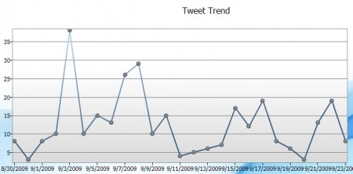

I’m five weeks into the new semester, and it’s time to consider how my ambitious technology-heavy [Graphic Novel](http://samplereality.com/gmu/fall09-493/) course is going. And I’m serious when I say it’s technology-heavy: we’re doing a blog, a wiki, Twitter, and rigorous [Pecha Kucha](http://en.wikipedia.org/wiki/Pecha%20Kucha) presentations. About the only thing we’re missing is a MMORPG.

I plotted out the major components of the class [back in May](http://www.samplereality.com/2009/05/13/teaching-technologies-for-large-classes/), and the actual implementation is surprisingly close to my original vision. There were two reasons for all this technology:

1. I wanted to use technology to help me maintain the student-centered environment of a smaller class when I was in fact going to be teaching a much larger class (there are 40 students in the class instead of the usual 25). Let’s call this goal *community-building*.
2. I wanted to use a range of smaller, low-stakes writing assignments paced steadily throughout the semester instead of two or three major assignments. My intention was to keep students continually engaged throughout the semester rather than “checking in” once mid-semester and once at the end.  Let’s call this goal *focus-sustaining*.

The chief mechanism of the class is The Group. My 40 students are evenly divided into five groups, and each week they rotate group roles. For example, last week students in Group 1 were responsible for the collaboratively-written [class notes on the wiki](http://engl493.pbworks.com/Class-Notes-Assignment), while this week they are the class’s [Searchers](http://samplereality.com/gmu/fall09-493/archives/category/links), charged with blogging short evaluative reviews of relevant online resources. The group has next week off and the week after that, they are Respondents, commenting upon the work of another group (the [First Readers](http://samplereality.com/gmu/fall09-493/archives/category/first-readers-2)) on the blog. And in the midst of all this activity, students are expected to post to Twitter using the class’s hashtag ([#eng493](http://twitter.com/#search?q=%23eng493)) and prepare class presentations following the strictly defined Pecha Kucha format (20 slides at 20 seconds per slide, focused on a single page from the week’s graphic novel).

My inspiration for all these activities came from a number of sources, which I simply pulled together and stitched into a cohesive structure: the initial idea of groups came from my friend and longtime collaborator [Randy Bass](http://cndls.georgetown.edu/index.cfm?fuseaction=main.people&person=bass); the wikified class notes were based on something similar [Brian Croxall](http://briancroxall.pbworks.com/Wiki-Class-Notes) does; the use of Twitter in the classroom was influenced by [Dave Parry’s thoughts](http://academhack.outsidethetext.com/home/2008/twitter-for-academia/) on the matter; and I’m indebted to my George Mason colleague [Doug Eyman](http://mason.gmu.edu/~deyman/) for introducing me to the idea of Pecha Kucha.

So how is it all working?

Preliminary evidence suggests it’s working, and working well. When it’s only the second week of the semester and a student hopes aloud that all our collaborative work will remain online after the semester’s over, that’s a good sign. When students in my other class spontaneously start *their own* Twitter hashtag after hearing about this class’s, that’s a good sign. When students are documenting the class discussion with photographs and adding them to the wiki, that’s a good sign. When I am seeing the most disciplined and focused undergraduate presentations of my career, that’s a good sign.

Any difficulties so far?

Oh, yes.

The primary challenge at the outset is the deluge of information I’m faced with every week. I’ve never had so many things to keep track of at once in a course. If it weren’t for a few tricks I’ve already learned, I’d be drowning in data. Here are some administrative and pedagogical hacks I couldn’t live without:

- **RSS is my friend.** All of the online resources I use (the WordPress class blog, the PBWorks wiki, the Twitter hashtag) have RSS feeds, and I stream all of them into one monster-stream using [Postbox](http://postbox-inc.com/), an enhanced version of Mozilla Thunderbird. You could also use Google Reader’s bundle feature or Yahoo Pipes to achieve the same all-in-one-space aggregated feed. I like Postbox because it archives my feeds on my hard drive, so they’re always there, whether I’m online or off, and they’ll continue to be there long after the semester is over. Here is what the master activity stream looks like in Yahoo Pipes:

- **RSS is my friend.** Seriously. I can’t emphasize this enough. Being able to read blog posts, Twitter updates, and changes to the wiki pages all in one integrated stream is essential. Postbox is always open on my laptop and I can see at a glance how much activity there’s been with the students. Unread items are in bold, which helps me keep track of what I’ve read (and graded) and what I haven’t.
- **Grading doesn’t have to be hard.** As I’ve [written elsewhere](http://www.samplereality.com/2009/08/14/pedagogy-and-the-class-blog/), I use a simple [0-4 point scale](http://samplereality.com/gmu/fall09-493/blogging-rubric) to rate the critical value of each entry on the blog. As a matter of routine, I’ll let students know their grade on the blog if they are habitually getting less than 3 or 4 points per post. I also comment on several posts a week, to let everyone know that I am indeed reading their work. By the end of the semester I plan to have commented on every student’s work at least three times.
- **Let students evaluate each other.** Though the students are divided into groups, the only time they work *as a group* is when they collaborate on the weekly class notes. PBWorks tracks every user’s edits, so it’s easy for me to see who’s done what (or who hasn’t done anything). But trusting in the power of peer pressure, I wanted to make the value of each member’s contributions more transparent to the rest of the group. So I ask the students to rate themselves and the other members of their group at the end of the week, with two questions about each student, one on the *quantity* of their contributions to the wiki and another question on the *quality* of their work. It’s a simple form on Google Docs, and the results are automatically feed into a Google Docs spreadsheet:

- **Redundancy is redundancy is redundancy is important** when it comes to archiving. I am very aware of the ephemeral nature of online communication, especially with something like Twitter. Don’t trust the cloud. So in addition to preserving feeds in my offline reader, I use [The Archivist](http://www.flotzam.com/archivist/) to capture the #eng493 Twitter conversation and save it as an exportable XML file. Once the data is in XML format, you can manipulate it in all sorts of ways. The Archivist has a few inline data visualizations too. Here we can see when spikes in activity occur (usually the night before class, when students are reading and tweeting as they read):

So there you have it, some reflections on a technology-driven syllabus. These reflections are strictly from my own perspective, of course. Something I need more information about, then, is what *my students* think about the technology in the course. My sense is that it’s a daunting amount of activity for them to keep track of. I sometimes forget that students have three or four other courses besides mine, each with their own demands. I’m hoping that some activities, like Twitter, fit into their existing lifeflow, though I know others, like working with a wiki, can punctuate their daily lives in a disruptive way.

Then again, the kind of estrangement and readjustment such pedagogical tools precipitate can be valuable in their own right, if only they’re harnessed properly…something I’ll be writing about soon.
