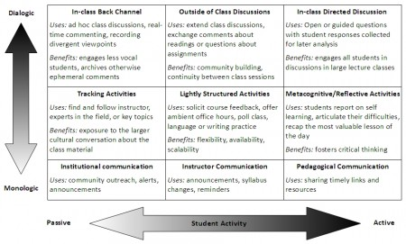

Last week I described [the intensive role of social networking](http://www.samplereality.com/2009/09/30/reflections-on-a-technology-driven-syllabus/) in my teaching. Although I explained how I track and archive my students’ Twitter activity, I didn’t describe what they *actually do* on Twitter.

That’s because I wasn’t sure myself what they do.

I mean, of course I’ve reading their tweets and sending my own, but I hadn’t considered in a systematic way how my students use Twitter. That lack of reflection on my part echoes my initial guidelines to the students: my instructions were only that students should tweet several times a week at a minimum. I was deliberately vague about what they should tweet about. I didn’t want overly specific guidelines to constrain what might be possible with Twitter. I wanted my students’ Twitter use to evolve organically.

Now, six weeks into the semester, clear patterns are discernible and I can begin to analyze the value of Twitter as a pedagogical tool.

My most surprising find? Twitter is a snark valve.

Let me step back and explain.

I began with a Twitter Adoption Matrix, originally sketched out in late August by Rick Reo. Rick is an instructional designer at George Mason University, and he’d been keeping tabs on the different ways instructors have been using Twitter in their teaching. Rick sent a [draft of this adoption matrix](http://www.scribd.com/doc/20769928) to the university’s Teaching with Technology listserv, and I soon began trying to situate my own Twitter use on the chart. In the process, I adapted Rick’s original matrix, re-imagining the vertical axis as a spectrum ranging from monologic to dialogic, and redefining the horizontal axis as a measurement of student activity, ranging from passive to active. After some other changes based on my experience with Twitter, I ended up with this revised Twitter Adoption Matrix ([larger image](http://www.samplereality.com/wp-content/uploads/2009/10/Twitter-Matrix.jpg)):

Twitter Adoption Matrix (click image for full size)

You can also find a [downloadable version](http://www.scribd.com/doc/20781414) of my revised matrix on Scribd.

Right now, I’m mostly thinking about the **In-Class Back Channel** and **Outside of Class Discussion** matrices. When I look closely at what my students write in and outside of class, I find that their tweets fall into one of three categories:

1. Posting news and sharing resources relevant to the class
2. Asking questions and responding with clarifications about the readings
3. Writing sarcastic, irreverent comments about the readings or my teaching

In other words, one of the most common uses of Twitter among my students is snark.

And that is a good, powerful thing.

I know critics like [David Denby](http://www.amazon.com/gp/product/1416599452?tag=samplereality-20) have come down hard on snark as a pervasive, degraded, unproductive form of discourse. I couldn’t disagree more. Snark is, I argue, a legitimate way to engage culture. It’s involved, it’s witty, and most importantly, it takes an oppositional stance — a welcome reprieve from the majority of student writing, which avoids taking any stance at all.

## Back-of-the-classroom tittering has turned into backchannel Twittering

Judging by the high level of discourse and analysis in my classes, Twitter is a snark valve. By having a systematic, constrained outlet for the snipe and snark and sarcasm that smart twenty-year-olds might otherwise direct towards more civil discourse, or unleash outside of the classroom, or worse, bottle up, the Twitter snark valve frees up both class and the class blog for more “serious” dialog. And I’m putting “serious” in scare quotes because I believe even sardonic comments provide insight — insight into the topic under discussion, but also insight into how it’s being received by students.

I allow — and even encourage — students to Twitter during class. One outcome of this freedom is that back-of-the-classroom tittering has turned into backchannel Twittering. Even more interesting, though unmeasurable without further analysis, is the performative aspect of the backchannel. The tweets are unfiltered, in effect, the same comment somebody might mutter under his or her breath, uncensored, no-holds-barred opining. Yet the students know classmates are following the course hashtag and at the very least that I am listening (and contributing) as well. The backchannel assumes a Bakhtinian double-voiced discourse — using sarcasm both to show a kind of too-cool-for-school attitude but also to demonstrate that the student is in fact earnestly engaged with the material.

As the semester goes on and tweets accumulate, I should have more data to work with. But even at this early stage, I am certain that I have stumbled upon a complicated rhetorical dynamic I never would have imagined going just from the Twitter Adoption Matrix, a dynamic that illustrates how students find their own uses for technology, racing far ahead of our pedagogical intentions.

*Comments are now closed.*
