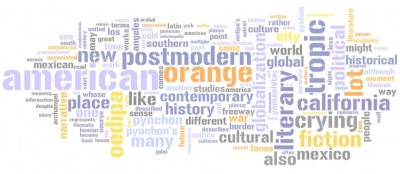

Lately I’ve been wondering how to use Jane McGonigal’s [Zen Scavenger Hunt](http://blog.avantgame.com/2005/08/im-not-werewolf.html) idea in my teaching. A Zen Scavenger Hunt is essentially a reversed-engineered scavenger hunt. The hunters go out and find ten or or so items and only *afterward* do they receive the list of the items they’re supposed to be scavenging for. The participants have to improvise a series of hacks and demonstrations to prove that their items perfectly match the list.

The most faithful pedagogical analog to a Zen Scavenger Hunt might be having students write about *anything* using any format or style, and *then* give them the question they were supposed to be answering. The students next have to persuade me (and their classmates) that their essays do indeed answer the question, perhaps via footnotes or annotations.

The bulk of creative and critical work on the students’ part comes in at the second, performative level, in the rhetorical act of proving by whatever means necessary that their essays match — and in fact have always matched — my question.

A less faithful, though perhaps more intriguing possibility for introducing the same kind of backwards-modding into student work might involve using [Wordle](http://www.wordle.net/). I can imagine students writing (though I am [pedagogically opposed](http://www.samplereality.com/2009/03/12/whats-wrong-with-writing-essays/) to overreliance on such writing) a typical essay, say an analysis of the failure of cognitive mapping in Karen Tei Yamashita’s [Tropic of Orange](http://www.amazon.com/Tropic-Orange-Karen-Tei-Yamashita/dp/1566890640%3FSubscriptionId%3D02E5W5871AJF7PMMMS82%26tag%3Dsamplereality-20%26linkCode%3Dxm2%26camp%3D2025%26creative%3D165953%26creativeASIN%3D1566890640). They feed their essay into Wordle, and then *other students* must recreate the argument of the original student essay based on the Wordle-produced word cloud.

Or, in a variation of this assignment, the professor creates a Wordle cloud out of a scholarly essay, and the students work collaboratively to reconstruct the original publication. So, here’s a [word cloud](http://www.wordle.net/gallery/wrdl/749531/Rachel_Adams_on_the_Tropic_of_Orange) generated from Rachel Adam’s essay in *Twentieth Century Literature* 53.3 (2007) on *Tropic of Orange*, “The Ends of American, the Ends of Postmodernism” ([larger version](http://www.samplereality.com/wp-content/uploads/2009/04/orange.jpg)):

Could a group of students reconstruct an essay out of this word cloud? And then persuade me and their classmates, through an overlay of textual and spoken improvisation, that their new essay is in fact a faithful recreation of the original?

We’re in Borges territory here, but it’s someplace I think students need to spend more time.

*Comments are now closed.*
