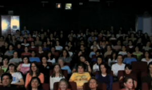

### 
    [Banning laptops doesn’t solve the distraction problem](http://monicabulger.com/2010/04/banning-laptops-doesnt-solve-the-distraction-problem/)    

To ban or not to ban laptops in classrooms? What about cell phones? And calculators? Before we hand students a list of technologies to leave at home, let’s consider the real problem: attention vs. distraction. If you’re going to ban everything distracting students, you should consider what you’re wearing, how you talk, the guy in the front row who hasn’t called the girl in the 7th row, etc.

After teaching for several years, training teachers, and studying learning, I’ve developed a few strategies for maintaining student engagement. Of course, nothing is full-proof and there will typically be someone who falls asleep, looks clueless, glares at you during lecture, leaves after 15 minutes, or stares off into space. Try not to take it personally. After all, intentionally or not, I’ve been that student, haven’t you?

I just posted the following list on Facebook in response to a [question on Metafilter](http://ask.metafilter.com/151266/What-to-do-about-teaching-and-the-internet) and am re-posting it here:

- **Call upon people randomly**. On the first day of classes, let students know that at any point in the lecture, you may call upon them. Cut  up your roster and, when participation reaches a low point, randomly pull a name out of a hat. Ask them to  concisely summarize something you just said, or discuss implications for  a different scenario, etc. The point is to let them know that there’s  rewards for paying attention…and consequences for not paying attention. I  did this pre-laptops in the classroom and it improved discussion. It’s also a  non-confrontational way of ensuring participation/attention.
- **Turn to someone next to you.** One strategy I find highly effective in teaching is to identify a concept from the readings and say, “For the next 3-5 minutes, I’d like you to turn to someone next to you and discuss what you think the term *participative media* means. Think of a few examples from the readings/your own experience and be prepared to share them with the larger group.” I usually either walk around to hear people’s conversations, or meet with a student close by who hasn’t found a conversation partner. While everyone is meeting, I pick a particularly chatty group, or volunteer the person I’m speaking with, and ask them if they’d be willing to go first. As people share their ideas, I write them on the whiteboard, or insert their insights into my slide presentation and use our discussion as a springboard for the next part of the lecture.
Having people speak in smaller groups primes them with ideas for sharing in the larger group and so accomplishes two goals: engages them in the discussion and empowers them to participate.
- You  can have **“laptops down” moments**, where you ask everyone to close their  laptops to help them think and focus.
- I start the quarter off **being  honest and saying that it’s really tough to speak to a large crowd** and  tougher still when you have to compete for their attention (e.g.,  talking in class, or using tech to tune out), so to make it easier on me  and more interesting for them, I’ll be asking questions throughout the  lecture and if I see someone not paying attention, I will most likely  call on them.
- **Have students present some of the info**, where  appropriate. Each class period, I have a 5 minute block for student  presentations — students definitely seem more interested in information  from their peers. If the students get the info wrong, I use it as a  teachable moment.

Audience from Napoleon Dynamite spoof posted on YouTube

- I also do fun things, like **take pictures  of the audience when they look the most bored and include it in the  next class period’s powerpoint**, just to let them know what my view is  like. Then I use the image as a background for some of the slides.  People love to see themselves.
-  Or, the best scenario is to  **incorporate the laptops into instruction.** Even in a lecture, you can  have scavenger hunts or discovery moments. **For every class period, I  assign a couple bloggers to report on what they learned.** You get a  record of the class, students who missed have a useful resource, and  students with restless finger syndrome have somewhere to focus their  energy. Here’s a link to course blogs from past students: [http://www.brenmesm.blogspot.com](http://www.brenmesm.blogspot.com).

There’s a misconception that in  lectures we should be the only ones talking. An ideal learning scenario is one in which we empower students to feel responsible for their learning experience and create an environment in which the technologies, no matter how seductively distracting, can be used as part of their learning.
