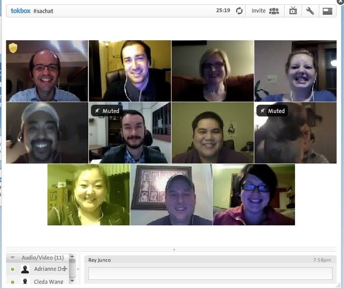

# [Using multiple video chats in education](http://blog.reyjunco.com/using-multiple-video-chats-in-education)

[Commentary](http://blog.reyjunco.com/category/commentary)|

Earlier this week, a few things gelled for me in thinking about my research area and about the higher education administrators, students, and researchers I’ve met online via Twitter (mostly through [#sachat](http://thesabloggers.org/2009/10/introduction-to-the-sachat-in-more-than-140-characters/)). First, I’ve been wanting to teach a **graduate course on social media in higher education**; however, I never thought it was possible because my university has no such program. This week, I realized that there is a great deal of interest in this course from people I’ve connected with who are current administrators in higher education and/or students in higher education or student affairs administration graduate programs. In addition to not having a graduate program where this course would “fit,” was the question of even if I developed a **social media in higher education** course how would I deliver it? It was clear that if I did create such a course, that I would have to offer it as a distance course to enroll the people I’d like to enroll (i.e., those who are interested in examining social media research and practice in higher education from a graduate-level standpoint).

That was the big “rub” for me– I’m a huge extrovert. When I say huge, I mean it– I love being around people and get a great deal of energy from interpersonal social situations. Add to that the central tenet in my philosophy of learning that in order for me to be an effective educator, I have to have a relationship with my students not as a group but as individuals within that group. Because of that, I believe that courses should be immersive and immensely interactive and engaging. I’m not talking about props here, or digital 3d worlds or new media– I’m talking about good, old fashioned, face-to-face socratic method and dialogue to enhance critical thinking about research and practice. So, I’ve always resisted even the idea of conducting online courses. While I can see the value in online education, especially as it relates to providing access to higher education for students who might otherwise not have that access, I’ve always conceptualized teaching online as “not for me.”

So there was my dilemma. I never considered it further because it was a no-win situation. Then last week, I had an epiphany. I’m not exactly sure how it came about. Perhaps it was because I was not focused on a current research project, a manuscript, or anything else. In any case, I thought “ok, if I were to teach such a course via distance, what would it look like?” Static Learning Management Systems (LMS’s) were out. Oh yes, another strike against online learning because I absolutely abhor LMS’s. I haven’t seen one that I like. Why? Because they are some of the least engaging technologies around. If my passion about engaging students isn’t enough, there’s plenty of research (see Kuh, 2009) that supports the benefits of engaging students academically and through co-curricular activities.

Even though the current and accepted model of distance education was a major roadblock to teaching such a course, I decided to do a little mind experiment and conceptualize the course anyway. I thought, “if I could teach a distance social media course in higher education, what would it look like?” The following were were my answers to that question:

1. The course would have to enroll advanced Master’s and Doctoral students in higher education, student affairs, counseling, and education programs with an interest in integrating social media into higher education.
2. The students would not only have to have some interests in technology, but also the technological skills to use social media as part of the course.
3. I’d have to find a technology that (I thought) didn’t exist– i.e., a technology that would let me conduct a video chat with 15-20 students in real time.
4. I’d want the course to be a graduate seminar– a course where participants would read a few articles/chapters before each session and we would discuss the readings and their implications during a video chat.
5. I needed to find a “home” for the course. My Chair, Dean, and Director of the Graduate Program were all supportive of having me teach the course within an existing graduate program. This seemed a little too easy given my experiences with the curricular process, but hey, I’m not complaining.

Ok, really, I was just hung up on #3. Numbers 1 and 2 would be relatively easy, as I’ve already gauged interest in the course and know there are enough takers. So, for a week, I asked around, sent out tweets, and had a few discussions with distance learning specialists. I did my own research, as I’ve done in the past to no avail, to see if there were any applications that would allow multiple video chats (MVC). I knew that iChat on the Mac lets you conduct MVC’s; however, iChat limits the number of participants to four. All of the other applications had similar limits. The highest participant limit I found was OoVoo which allowed for six people to chat simultaneously. Then, I stumbled across [TokBox](http://www.tokbox.com/). I don’t actually remember how I found it. Maybe a blog post I followed up? Anyway, I dug deeper and saw that TokBox promised connections with 20+ users simultaneously. Being the skeptic that I am, I thought “there is no way this is going to work” and enumerated reasons to myself including bandwidth, technical issues, etc.

So, I gave a shout out to my friends over in #sachat and asked if they’d like to try out the service with me. The evening I discovered TokBox, I hosted a chat with about six people online. It worked better than I expected, with the biggest issue being the echos of the person talking if other participants had their speakers turned up too loud. It was a short “proof of concept” chat. Afterwards, others on #sachat asked to participate. I paid the $9.99 monthly fee to be able to schedule a chat and have moderator controls. This gave potential participants enough notice to schedule their time around a chat. Plus, the moderator controls allowed me to mute others in the chat if they became “offenders” by having their speaker volume up too high.

I must say, it was really impressive to have a chat with so many people online at the same time. At our highest saturation, we had 11 people online:

There were a few issues that I need to think about some more in order to use this for a class. For instance, it’s hard to see who is talking if there’s an active conversation between a number of participants because of so many video streams coming in at the same time. I have some ideas to solve this which are akin to hand raising in a typical class and will post more about those later as I flesh out the course proposal some more. The verdict? It’s a go! I’ve spoken to the Director of our Graduate Program more and he has invited me to teach the course as a special topics course for the Spring. Stay tuned– I’ll be posting more details about the course in the weeks to come.

[reyjunco](http://blog.reyjunco.com/author/admin/)

Tags: [digital media](http://blog.reyjunco.com/tag/digital-media), [learning](http://blog.reyjunco.com/tag/learning), [Research](http://blog.reyjunco.com/tag/research), [social media](http://blog.reyjunco.com/tag/social-media), [teaching](http://blog.reyjunco.com/tag/teaching)

[blog comments powered by Disqus](http://disqus.com)

- ## Categories ## Tags ## @reyjunco on Twitter ## Follow this blog
  -  Social Media in Higher Education
  - 
  - 
  - 
## Meta
