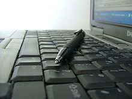
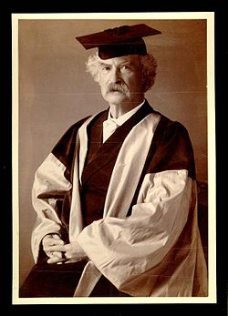
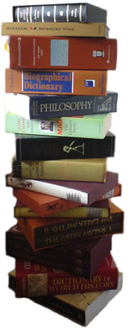
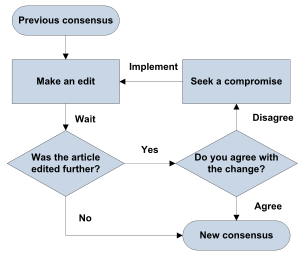
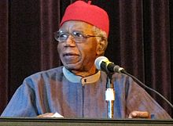
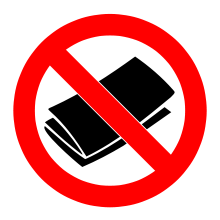

# User:Awadewit/TeachingEssay

### From Wikipedia, the free encyclopedia

| Contents | 

## \[[edit](http://en.wikipedia.org/w/index.php?title=User:Awadewit/TeachingEssay&action=edit§ion=1)\] Wiki-hacking: Opening up the academy with Wikipedia

By [Adrianne Wadewitz](http://en.wikipedia.org/wiki/User:Awadewit), [Anne Ellen Geller](http://en.wikipedia.org/wiki/User:AEG_English4994), [Jon Beasley-Murray](http://en.wikipedia.org/wiki/User:Jbmurray)

## \[[edit](http://en.wikipedia.org/w/index.php?title=User:Awadewit/TeachingEssay&action=edit§ion=2)\] Introduction

A week ago, on Friday, May 21, 2010, we three were part of a roundtable dedicated to Wikipedia and pedagogy as part of the [2010 Writing Across the Curriculum](http://www.indiana.edu/~wac2010/abstracts.shtml) conference. That was our first face-to-face encounter; none of us had ever met in real life. We had known one another previously, but only through our writing and our online personae at Wikipedia. For example, two of us had collaborated virtually for [a podcast on teaching with Wikipedia](http://en.wikipedia.org/wiki/Wikipedia:Wikivoices/Episode_41).

By serendipity, on that same Friday, a bold call for papers was released, *Hacking the Academy*, which proclaimed that "every aspect of scholarly infrastructure is being questioned, and even more importantly, being *hacked*.\[...\] Newly-minted Ph.D.’s are foregoing the tenure track for alternative academic careers that blur the lines between research, teaching, and service. Graduate students are looking beyond the categories of the traditional C.V. and building expansive professional identities and popular followings through social media. Educational technologists are 'punking' established technology vendors by rolling their own open source infrastructure."[\[1\]](http://en.wikipedia.org#cite_note-0) We believe that the form, content, and process of our efforts to teach with—and participate in—the Wikipedia community embody this new ethos. And we thought: what better way to illustrate the implications of this project than by collaboratively composing an essay using the wiki format? Thus, in the week given by the call for papers, we conceptualized, wrote, edited, and revised this essay together.

Googling "syllabus" and "no wikipedia" yields dozens of online syllabi that, without rationale, simply forbid students to consult or cite Wikipedia. To understand just how heated the debate about Wikipedia is in higher education, one may peruse the comments posted in response to Robert E. Cummings' essay ["Are We Ready to Use Wikipedia to Teach Writing?"](http://www.insidehighered.com/views/2009/03/12/cummings).[\[2\]](http://en.wikipedia.org#cite_note-1) The answer to Cummings' question, however, is already a resounding "yes" in the practical world. One need only consider the growing list of [school and university projects](http://en.wikipedia.org/wiki/Wikipedia:SUP) that support students as they add information to Wikipedia on such varied topics as [musculoskeletal injuries](http://en.wikipedia.org/wiki/Wikipedia:SUP#Cal_Poly_Pomona_--_Musculoskeletal_Injuries_--_Spring_2010), [American Indian law, history, and literature](http://en.wikipedia.org/wiki/Wikipedia:SUP#University_of_North_Carolina_-_Chapel_Hill_Department_of_American_Studies_.28Fall_2008.2C_Fall_2009.2C_Fall_2011.29_.28Ongoing.29) and [Wikipedia itself](http://en.wikipedia.org/wiki/Wikipedia:SUP#New_Jersey_Institute_of_Technology.2C_Newark.2C_New_Jersey_.28Fall_2007-present.29).

Numerous scholarly articles about Wikipedia have appeared across the disciplines in the past few years. Some describe classroom Wikipedia projects and assignment sequences, whereas others raise questions about our responsibility as scholars, teachers, and mentors to engage with Wikipedia, such as the journal *RNA Biology* requiring its contributors to add articles on their research to Wikipedia. These articles suggest that we, as scholars, should collectively reconsider our reluctance to ask our students to contribute to Wikipedia—and to contribute ourselves.

## \[[edit](http://en.wikipedia.org/w/index.php?title=User:Awadewit/TeachingEssay&action=edit§ion=3)\] Wikipedia in academia

Like an uninvited guest at a party, Wikipedia hovers at the fringes of academia. Yet the online encyclopedia's aims are eminently academic: it collects, processes, stores, and transmits knowledge. Judging by the site's over 3.3 million articles, many of which are extensively referenced to the scholarly literature, and [its popularity on the internet](http://www.alexa.com/data/details/traffic_details/wikipedia.org), Wikipedia has been remarkably successful at promoting a culture that honors intellectual inquiry. Yet it is derided by many academics.

Still, we all use Wikipedia in one way or another—even scholars, although we might not want to admit to the fact. Most of us find it a very convenient resource. Above all, students use Wikipedia, openly or otherwise; over half of US undergraduates use it "always" or "frequently" in their research.[\[3\]](http://en.wikipedia.org#cite_note-2) However, these students do so without necessarily knowing how the information is written and revised. They are often told not to use Wikipedia because it is "bad"—but they are not told why.

We do not want to debate whether or not Wikipedia is a reliable source for research. We agree that it is not.[\[4\]](http://en.wikipedia.org#cite_note-3) However, many academics use Wikipedia as a *first* source on a topic with which they are unfamiliar. A professor at Dartmouth, for example, posted the following to her Facebook page: "Do you think \[D\]artmouth parents would be upset about paying $40,000 a year for their children to go here if they knew that certain professors were looking up stuff on Wikipedia and asking for advice from their Facebook friends on the night before the lecture?"[\[5\]](http://en.wikipedia.org#cite_note-4) The extent to which Wikipedia is a credible source is one of many conversations about Wikipedia we can enter into with our students — but it is not the most interesting. Such discussions are already a *de rigeur* part of any research assignment, since we raise the same questions regarding other online sources such as blogs and other self-published websites. The deeper, more interesting conversations we want to foster with our students are about how and by whom knowledge is created and gate-kept.

We three have welcomed Wikipedia into our teaching in structured ways, as have other teachers and academics referenced below. What we all share is the belief that incorporating Wikipedia into our teaching is a form of hacking the academy, giving those who contribute to Wikipedia—*Wikipedians*—a mechanism by which to bypass the typical, hierarchical routes of knowledge construction and to become knowledge-makers themselves.[\[6\]](http://en.wikipedia.org#cite_note-5)

## \[[edit](http://en.wikipedia.org/w/index.php?title=User:Awadewit/TeachingEssay&action=edit§ion=4)\] Constructing knowledge

Students who analyze Wikipedia articles and participate in their development are made aware of the construction of knowledge and the ends towards which it is put. Most students utilize Wikipedia only to find information, and therefore have little understanding of how the articles are developed, who develops them, or the oftentimes extensive discussion and review that goes into making an article. For example, many students are unaware that every article on Wikipedia has an associated ["discussion"](http://en.wikipedia.org/wiki/Wikipedia:TP) page, also known as a "Talk" page. Such pages are filled with ongoing conversations about the development and revision of the articles; introducing students to them is an excellent way to begin a conversation about what knowledge is and who makes it.

For example, asking students to analyze the threads on discussion pages shows them that there are often multiple narratives about a particular historical event or person, and that these competing narratives have important political valences. To take one recent example, four days after the Texas Board of Education voted to "\[approve\] a social studies curriculum that will put a conservative stamp on history and economics textbooks, stressing the superiority of American capitalism, questioning the Founding Fathers’ commitment to a purely secular government and presenting Republican political philosophies in a more positive light,"[\[7\]](http://en.wikipedia.org#cite_note-6) according to *The New York Times*, an editor [entered into a discussion](http://en.wikipedia.org/w/index.php?title=Talk:John_Calvin&diff=next&oldid=350242255) about John Calvin's influence on "capitalism, democracy, and individualism" at [Talk:John Calvin](http://en.wikipedia.org/wiki/Talk:John_Calvin#John_Calvin_did_not_influence_Capitalism.2C_Democracy_or_Individualism). The editor was concerned by a particular assertion within the article:

"The American System of Government in particular" is another statement you make \[in the article\] that I am not sure is sufficiently backed up by the sources you cite. This statement implies that Calvin had a specific, particular impact on the American revolution, the Declaration of Independence, the Constitutional process, etc.\[...\] I believe this is a stretch designed for other purposes, and cannot be seriously included in this article. I see too much effort to politicize the role of Calvin into modern American issues. The American system of government was more directly influenced by its own contemporaries, founding fathers, and political realities of the time. The role that Calvin played may be trumped up by a single historian such as Hall, but I am not sure even Hall can make this kind of claim very accurately. I believe any such discussion of Calvin's impact upon the American System of Government, specifically, would require its own sub-article, with significantly more room for quotes, cites, and discussion. More than one historian would need to be referenced, and a detailed analysis of his theology (his hallmark to history) be incorporated in that specific discussion. Otherwise, it serves only as a throw-away concept here, designed to impart a certain credibility to a fringe viewpoint, embedded in an otherwise very well written and peer-reviewed article about John Calvin.

This editor is concerned that the Calvin article is being shaped to serve a specific conservative political agenda. Asking students to analyze the rhetoric of these discussions (both in addition to, or removed from, the accuracy of their content), will reveal how knowledge is constructed. This particular editor, for example, questions the legitimacy of the source used, as well as the pressure put on a single source for such an significant claim. S/he outlines ways in which the article should, in his/her opinion be constructed, citing the need for multiple sources and a "detailed analysis". Simply reading the discussion pages will alert students to new points of view on topics covered in class. [Anne Geller's](http://en.wikipedia.org/wiki/User:AEG_English4994) students were surprised, amazed and enlightened as they considered adding to the [Arundhati Roy](http://en.wikipedia.org/wiki/Arundhati_Roy) article, which [had editing restrictions on it](http://en.wikipedia.org/wiki/Wikipedia:Protection_policy) at the time they worked on it due to debates surrounding Roy's activist writing. Even after reading and discussing her book *War Talk*, the students might not have understood just how controversial Roy is without following the [discussion page](http://en.wikipedia.org/wiki/Talk:Arundhati_Roy) accompanying her Wikipedia biography.

In addition to disputes over article content, meta-discussions about articles in Wikipedia can allow students to see that editors may reasonably, if passionately, disagree how to represent and structure knowledge throughout the encyclopedia. For example, [this 2007 discussion about whether or not to include sections about "Themes" and "Cinematic style" in film articles](http://en.wikipedia.org/wiki/Wikipedia_talk:WikiProject_Films/Style_guidelines/Archive_1#Proposal_for_new_sections) reveals differing views on the importance of these topics to encyclopedia articles about films. [Wadewitz](http://en.wikipedia.org/wiki/User:Awadewit) began the debate by proposing that the style guidelines for film articles include these two sections since "The guidelines as they stand do not encourage editors to discuss the *meaning* of the film, apart from its plot, production and reception. While those elements are important, the most obvious place to look for a film's meaning is in its themes and artistic style (its content and its form)...." [User:Bignole](http://en.wikipedia.org/wiki/User:Bignole), the first respondent in a long debate, agreed to an extent, but emphasized that "Every film is different. I think it's something good to include, to make sure editors look for that stuff, but it should be noted that not every single film will have some underlying meaning in it. There are probably countless B-horror films whose only real theme would be "kill the stupid people". Certainly, there are classics that actually do have some underlying themes in them, but some do not." The debate continued with variations of these basic arguments. These editors have a fundamentally different understanding of what a film article should contain. Such debates about how to organize and present knowledge occur every day on Wikipedia.

Perhaps the most popular type of assignment using Wikipedia is one that involves article development. In the spring of 2008, [Jon Beaseley-Murray](http://en.wikipedia.org/wiki/User:Jbmurray) required his students in an upper-division Latin American literature class to research and write entire articles (see [WikiProject Murder Madness and Mayhem](http://en.wikipedia.org/wiki/Wikipedia:MMM)). The project had three aims: 1) to improve Wikipedia's coverage of selected articles on Latin American literature, particularly those related to dictator novels; 2) to submit those articles to Wikipedia review processes; 3) to increase the number of featured articles in this area. (Featured articles are considered the best articles of Wikipedia; they are vetted rigorously according to a stringent [set of criteria](http://en.wikipedia.org/wiki/Wikipedia:FA%3F).) All three aims were accomplished.

As with any research paper, students learned the basics of researching, citing, summarizing, and quoting. However, because they were doing this on Wikipedia, unique learning experiences were offered. The premise of the project was that students had been using Wikipedia as a source without properly considering its drawbacks. So it should come as no surprise that, when seeking sources for the Wikipedia articles they were writing, students all too often made analogous mistakes of scholarship. They added information that was unsourced, poorly referenced, or even plagiarized; or they resorted to referencing other webpages and online encyclopedias.

Yet herein lay a great benefit of the assignment. Because Wikipedia asks that assertions be referenced, students were forced to reveal their sources. These poor sources might never have been revealed, had the students been writing a term paper. Moreover, because writing on Wikipedia is a process of continual revision, they could be asked to go back and re-evaluate their sources, find better ones, and try again. Even with plagiarism, there was no longer a need to make a fuss, because at no time were they handing in what purported to be a final product. They simply had to start over.

In short, the assignment not only reveals the weaknesses in students' research skills, but also teaches them those skills. It shows them that research (like writing) is a process, often a lengthy one. Although you might start with suboptimal sources (such as Wikipedia itself), you progress to look for ever stronger evidence for the information at hand, or for new information that the first sources did not reveal.

## \[[edit](http://en.wikipedia.org/w/index.php?title=User:Awadewit/TeachingEssay&action=edit§ion=5)\] Writing within discourse communities

In his book *Lazy Virtues: Teaching Writing in the Age of Wikipedia*, Cummings emphasizes the benefits of "commons-based peer production", which allows students to take control of their writing in groups and de-emphasizes the authority of the instructor. Wikipedia is an excellent environment for exploring this approach, as teacher and student are editors working together to produce a better encyclopedia article. Wikipedia not only breaks down the authority of the classroom in helpful ways, but it also introduces student writers to a readership. Whereas most assignments in a university setting are written solely for the instructor, on Wikipedia they are written for a global audience. Wikipedia editors must struggle with making their language accessible to the entire community of English speakers, many of whom will write back to them. Students are engaging in a real-world project on Wikipedia, with tangible and public dialogue.

[consensus](http://en.wikipedia.org/wiki/Wikipedia:CONSENSUS).

Lamentably, with rare exceptions such as in the composition classroom, students are seldom motivated to re-read and reflect upon their own work. Often they scarcely glance at the comments professors write laboriously on their work. Given that there is usually little or no chance to revise their work, they are interested in the grade, and only the grade. Students seldom learn about the importance of revision. And yet on Wikipedia, revision is (almost) everything: contributors are called editors precisely because their writing is in a constant state of revision.

Even working as a copyeditor within a large discourse community such as Wikipedia helps students to see how important it is to write clearly and coherently. Copyediting assignments, which help improve the intelligibility of Wikipedia articles, highlight the relationship among writer, readers, content and ideology. For example, in [this series of edits](http://en.wikipedia.org/w/index.php?title=Benjamin_Robbins_Curtis&action=historysubmit&diff=353554856&oldid=352818241) to [Benjamin Robbins Curtis](http://en.wikipedia.org/wiki/Benjamin_Robbins_Curtis), students in [Wadewitz](http://en.wikipedia.org/wiki/User:Awadewit)'s writing class focused on clarifying and improving the language of a series of paragraphs.[\[8\]](http://en.wikipedia.org#cite_note-7) They also learned to ask questions of the writer, [demanding more context for particular information](http://en.wikipedia.org/w/index.php?title=Talk:Benjamin_Robbins_Curtis&diff=prev&oldid=353552442) and pressing him or her to clarify "[the difference between "legally trained" and "legally degreed"](http://en.wikipedia.org/w/index.php?title=Talk%3ABenjamin_Robbins_Curtis&action=historysubmit&diff=353550796&oldid=297109264). The chief contributor to the article [responded to them](http://en.wikipedia.org/w/index.php?title=Talk:Benjamin_Robbins_Curtis&diff=prev&oldid=353552993), providing a good dialogue between writer and reader. The students even discovered plagiarism in the article and [began a discussion](http://en.wikipedia.org/w/index.php?title=Talk:Benjamin_Robbins_Curtis&diff=next&oldid=353552993) with the editor about how to fix it.

In a community as diverse and complicated as Wikipedia, teacher and student learn together. For example, in [Beasley-Murray](http://en.wikipedia.org/wiki/User:Jbmurray)'s first class project, he showed the students how to create a page during class. Two of the articles the students were working on did not exist at the outset, so he created one of them: [El Señor Presidente](http://en.wikipedia.org/wiki/El_Se%C3%B1or_Presidente), which [started off](http://en.wikipedia.org/w/index.php?title=The_President_%28novel%29&oldid=184563569) containing as its sole text "El Señor Presidente is the title of a novel by Miguel Ángel Asturias." After creating the second article, he returned to the first article a few minutes later... and received his first lesson. For he discovered to his embarrassment (and in front of the entire class) that another Wikipedia editor had already pasted [a huge pink banner](http://en.wikipedia.org/w/index.php?title=The_President_%28novel%29&direction=next&oldid=184563696) on the class' freshly-minted page suggesting that "This page may meet Wikipedia’s criteria for speedy deletion." "The bastards!" he said under his breath, and proceeded hurriedly to change the article's content to "El Señor Presidente is the title of the most important novel by Nobel-prize-winning novelist Miguel Ángel Asturias," anxious that the group's little project would not be sunk before it had barely begun. Importantly, the assignment fostered a cohesion between instructor and students: they were a group of people trying to improve Wikipedia. The barriers of authority between the two were breaking down.

Many instructors who design Wikipedia assignments encourage their students to draft their articles away from the public gaze, and to upload them to the encyclopedia's public pages only after they are ready for general scrutiny. Such contributions are often deleted because they do not follow Wikipedia's guidelines. More importantly, we feel that this approach misses one of the greatest benefits of a Wikipedia assignment: engaging with a community of writers and readers. Having students edit Wikipedia in real time teaches them how to negotiate with an entire community of fellow readers and editors.

[Geller](http://en.wikipedia.org/wiki/User:AEG_English4994) encouraged her students to post their revision plans publicly on the talk pages of the articles they intended to revise. Students found that other Wikipedians sometimes responded and offered advice even more quickly than their teacher could.[\[9\]](http://en.wikipedia.org#cite_note-8) The two students working to improve [Adrienne Rich](http://en.wikipedia.org/wiki/Adrienne_Rich) received detailed suggestions from a Wikipedian on [its discussion page](http://en.wikipedia.org/wiki/Talk:Adrienne_Rich#Our_Plan), e.g., "I think you have the career a bit backwards; should not her works come first, then her awards, then the activism which she would not otherwise have been able to aptly promote without the attention drawn by the first two." Imagine their surprise as their instructor simply joined that conversation as an equal. When [Geller](http://en.wikipedia.org/wiki/User:AEG_English4994)'s students were asked to reflect on these experiences, they offered comments such as: "“It’s surprising how large of an online community there is that reads, changes, and contributes their own suggestions into our work.” and "I was surprised how many people look at the page and quickly comment on the articles."

In often amazing ways, Wikipedia articles continue to grow even after the semester is over. Before Geller's students began working on *[The Woman Warrior](http://en.wikipedia.org/wiki/The_Woman_Warrior)*, the [article](http://en.wikipedia.org/w/index.php?title=The_Woman_Warrior&oldid=276857783|) offered one paragraph of plot summary, two references to secondary literature sources, and a loosely related section on Chinese parenting styles. When the students completed their work, the [article](http://en.wikipedia.org/w/index.php?title=The_Woman_Warrior&oldid=290096180|) had a well-cited opening, sections on background, themes, and reception, a long plot summary, 29 (poorly formatted) citations and nine references. A year later, the plot summary of *The Woman Warrior* has been greatly improved and reorganized, the references have been copy-edited and the article has 122 footnotes. Attention paid to articles on Wikipedia often leads to even more collaboration and yet stronger articles: a virtuous circle.

According to a common stereotype, humanities academics are solitary scholars who come up with ideas and text alone, perhaps in a garret or library nook. Yet, in reality, most academics surround themselves with previously published texts, embrace conversations with their colleagues, and take part in academic peer review, which often means that their ideas are questioned and shaped by external reader-reviewers. Helping students to see the connection between these processes and the processes of developing articles on Wikipedia, particularly the constant review and revision that they undergo, helps to correct the faulty conception of knowledge construction as a solitary endeavor.

## \[[edit](http://en.wikipedia.org/w/index.php?title=User:Awadewit/TeachingEssay&action=edit§ion=6)\] What's missing from Wikipedia

At our roundtable, an audience member commented that the web was supposed to offer a democratic space in which no voices or experiences would be marginalized or ignored. Yet the coverage on Wikipedia has huge gaps, partly because of the interests and knowledge of those who have hitherto been most drawn to contributing: "more than 80 percent male, more than 65 percent single, more than 85 percent without children, around 70 percent under the age of 30."[\[10\]](http://en.wikipedia.org#cite_note-9) Although Wikipedia boasts thousands of detailed, well-researched, well-referenced articles on scholarly subjects, such as its [Featured Articles](http://en.wikipedia.org/wiki/Wikipedia:Featured_articles), entries on fictional locations such as [Middle-earth](http://en.wikipedia.org/wiki/Middle-earth) may be much more detailed than entries on real locations, such as countries in Africa.[\[11\]](http://en.wikipedia.org#cite_note-10)

[Chinua Achebe](http://en.wikipedia.org/wiki/Chinua_Achebe)is the only African writer to have a

[featured article](http://en.wikipedia.org/wiki/Wikipedia:FA%3F)on Wikipedia.

Highlighting what is missing from Wikipedia (and why) encourages students to critique the production of knowledge. As we know, textbooks, curricula and whole disciplines benefit from such critique. Students who recognize what is missing from Wikipedia may also learn to ask what is missing from their own educations; and they may come to realize that valuable contributions to others' learning—via Wikipedia or other means—can and should come from their own experiences and studies across the curriculum.

Several classroom exercises may help students to recognize what is missing from Wikipedia and, importantly, to consider the consequences of those omissions. For example, students might examine Wikipedia's [list of requested articles](http://en.wikipedia.org/wiki/Wikipedia:Requested_articles); or compare a semester's course content to the corresponding articles already on Wikipedia. Students could also compare and contrast a Wikipedia entry on a particular topic with that of a more traditional encyclopedia. Such exercises might also illuminate what is missing from textbooks and other educational materials.

Wikipedia, as one of the top ten most popular websites in the world, is shaping our cultural heritage. What Wikipedia chooses to include will help distill what the future remembers. Therefore, the discussions on Wikipedia about what material to retain—such as those at [Articles for deletion](http://en.wikipedia.org/wiki/Wikipedia:AFD)—are a trove of fascinating discourses for students and researchers alike. In such debates, Wikipedians decide whether a subject is insignificant ("[non-notable](http://en.wikipedia.org/wiki/Wikipedia:NOTE)") and therefore should be expunged. Although Wikipedia aims to be the "sum of all human knowledge", having an article on everything in the world is impossible. As the notability guideline states, "On Wikipedia, notability determines whether a topic merits its own article. Information on Wikipedia must be verifiable; if no reliable third-party sources can be found on a topic, then it should not have a separate article." In late 2006 and early 2007, many articles on webcomics were deleted in what has become known as "the great webcomics purge". Wikipedians claimed that most webcomics did not meet internal guidelines for notability, whereas webcomic authors claimed that those guidelines were too stringent for such media.[\[12\]](http://en.wikipedia.org#cite_note-11) Students benefit from exploring and participating in such debates over what should be covered in an encyclopedia, what constitutes a reliable source on the internet, and examining who makes these decisions and how.

Roy Rosenzweig, a historian and founder of the Center for History and New Media at George Mason University, suggests that not only students should be contributing to Wikipedia with these questions in mind, but also academic scholars:

If Wikipedia is becoming the family encyclopedia for the twenty-first century, historians probably have a professional obligation to make it as good as possible. And if every member of the Organization of American Historians devoted just one day to improving the entries in her or his areas of expertise, it would not only significantly raise the quality of Wikipedia, it would also enhance popular historical literacy. Historians could similarly play a role by participating in the populist peer review process that certifies contributions as featured articles.[\[13\]](http://en.wikipedia.org#cite_note-12)

We wholly agree. In fact, Wadewitz is one of [the top-ten producers of Wikipedia's featured articles](http://en.wikipedia.org/wiki/Wikipedia:WBFAN).

## \[[edit](http://en.wikipedia.org/w/index.php?title=User:Awadewit/TeachingEssay&action=edit§ion=7)\] Postscript: Authorship and attribution in this article

At the same time as this essay promotes co-authorship, collaboration and “hacking” of the academy, we ourselves have had to decide how we would represent our authorship of this article because of our positions in the academy.[\[14\]](http://en.wikipedia.org#cite_note-13) We represent three different points in an academic career: a graduate student about to go on the job market, a faculty member pursuing tenure at the associate level, and a tenured faculty member. Our discussions about attribution are less open to public scrutiny than anything else related to this article and largely took place over email and IM, revealing the anxiety that this topic raises.

We considered omitting author names on this piece and letting our Wikipedia usernames in the editing history and [discussion page](http://en.wikipedia.org/wiki/User_talk:Awadewit/TeachingEssay) for this article speak to our many and varied co-authored contributions to this piece over the last week. In addition, many of Beasley-Murray's contributions were integrated by copying material from a previous essay he had written and posted in his userspace on Wikipedia. We were able to do this because it was licensed under a Creative Commons Share-Alike license. Therefore, the construction of this essay was, in a word, atypical. In the end, we have chosen to list Wadewitz's name first, as she organized the panel bringing us together and suggested we write the article; thus we have created a "lead author". However, this misrepresents the collaborative project we undertook. Had we felt able to fully embrace this space and its ideology, we would not have listed authors. But we have future hiring committees and tenure and promotion committees to doubly educate—first about the value and complications of collaborative work and then, on top of that, about the value and complications of collaborative work in the digital humanities.[\[15\]](http://en.wikipedia.org#cite_note-14) And we know too well that we do not yet teach and learn in an academy in which those bodies will pay attention first and foremost to what we have created together rather than searching out our individual names and [percentage of contributions](http://toolserver.org/~daniel/WikiSense/Contributors.php?wikilang=en&wikifam=.wikipedia.org&grouped=on&page=User:Awadewit/TeachingEssay). So, we are trying to satisfy ourselves and others even though we worry that in doing so we undermine the very project we take on here.

Those of us within departments of English and Languages and Literature are especially aware that even as organizations such as the Modern Language Association tell us that "Departments and institutions should recognize the legitimacy of scholarship produced in new media, whether by individuals or in collaboration, and create procedures for evaluating these forms of scholarship" and "should facilitate collaboration among scholars and evaluate it fairly",[\[16\]](http://en.wikipedia.org#cite_note-15) and even as collaborative consortia such as [HASTAC](http://www.hastac.org/about-hastac) flourish, and our new digital world encourages sharing through Creative Commons Attribution-ShareAlike licenses, the type of collaborative writing and thinking we enact here is still not valued as highly as solitary authorship. Thus we include this postscript to highlight how difficult it remains to “hack” the academy while living within it.

We say we want to educate our students for the 21st century and beyond, and we say we want students and faculty in the humanities, in particular, to be flexible, forward thinking, relevant scholars, who will make important contributions via all forms of text. And yet, by maintaining allegiance to solitary scholarship and traditional assignments and genres of publication, and by implicitly or explicitly degrading the work of co-authorship, we potentially give up venues such as Wikipedia through which our students—and we ourselves—might be able to collaborate and be challenged, share varied expertise and knowledge, and make contributions to a world of learning inside and outside the academy.

## \[[edit](http://en.wikipedia.org/w/index.php?title=User:Awadewit/TeachingEssay&action=edit§ion=8)\] Links

## \[[edit](http://en.wikipedia.org/w/index.php?title=User:Awadewit/TeachingEssay&action=edit§ion=9)\] Notes

This essay integrates material from [User:Jbmurray](http://en.wikipedia.org/wiki/User:Jbmurray)'s "[Was introducing Wikipedia to the classroom an act of madness leading only to mayhem if not murder?](http://en.wikipedia.org/wiki/User:Jbmurray/Madness)", which is licensed under a [Creative Commons Attribution-ShareAlike](http://en.wikipedia.org/wiki/Wikipedia:Text_of_Creative_Commons_Attribution-ShareAlike_3.0_Unported_License) license.

1. **[^](http://en.wikipedia.org#cite_ref-0)** Julie Meloni, [CFP: Contribute to an Edited Collection: 'Hacking the Academy'](http://chronicle.com/blogPost/CFP-Contribute-to-an-Edited/24205/?sid=wc&utm_source=wc&utm_medium=en). ProfHacker Blog. *The Chronicle of Higher Education* (May 21, 2010).
2. **[^](http://en.wikipedia.org#cite_ref-1)** Robert E. Cummings, "[Are We Ready to Use Wikipedia to Teach Writing?](http://www.insidehighered.com/views/2009/03/12/cummings)" *Inside Higher Education* (March 12, 2009).
3. **[^](http://en.wikipedia.org#cite_ref-2)** Alison J. Head and Michael B. Eisenberg, [“How today’s college students use Wikipedia for course–related research”](http://firstmonday.org/htbin/cgiwrap/bin/ojs/index.php/fm/article/view/2830/2476) *First Monday* 15.3 (March 1, 2010).
4. **[^](http://en.wikipedia.org#cite_ref-3)** There may be a small percentage of Wikipedia articles that are reliable sources, but we are not exploring the questions of which ones those are, how to find them, and who writes them.
5. **[^](http://en.wikipedia.org#cite_ref-4)** Jeffrey R. Young, [How Not to Lose Face on Facebook, for Professors](http://chronicle.com/article/How-Not-to-Lose-Face-on/24101), *The Chronicle of Higher Education* (February 6, 2009).
6. **[^](http://en.wikipedia.org#cite_ref-5)** In [his June 9, 2010 interview](http://chronicle.com/article/Audio-Wikipedias-Co-Founder/65841/|) with *The Chronicle of Higher Education*, Jimmy Wales was asked about the [Edward Owens](http://en.wikipedia.org/wiki/Edward_Owens) hoax, which was an academic assignment that asked students to deliberately add false information to Wikipedia. While assignments such as these sometimes introduce students to similar concepts as our assignments (e.g. that knowledge is constructed), we have all chosen to follow Wikipedia's policy of ["Do not create hoaxes"](http://en.wikipedia.org/wiki/Wikipedia:HOAX). We understand that [some facilitating hoaxes in courses](http://edwired.org/?p=418|) intend for students to reflect on hoaxing as a historical and linguistic object, consider ethics in disciplinary knowledge creation, and learn how mistaken we all are to blindly trust material that is sourced, but none of us have taken this approach. See [here](http://en.wikipedia.org/wiki/User:Shii/Hoaxes) for some of the hoaxes that have been found on Wikipedia.
7. **[^](http://en.wikipedia.org#cite_ref-6)** James C. McKinley, Jr., ["Texas Conservatives Win Curriculum Change"](http://www.nytimes.com/2010/03/13/education/13texas.html?scp=1&sq=texas%20history%20textbooks&st=cse), *The New York Times* (March 12, 2010).
8. **[^](http://en.wikipedia.org#cite_ref-7)** In this particular example, the instructor, [Adrianne Wadewitz](http://en.wikipedia.org/wiki/User:Awadewit), edited the page under her own account, relaying her students' suggestions during a class session. Students are generally quite engaged when they see the changes made in real time in this fashion.
9. **[^](http://en.wikipedia.org#cite_ref-8)** Anne Geller developed her project as a participant in the [St. John's University T3 grant program](http://www.stjohns.edu/academics/provost/resources/T3).
10. **[^](http://en.wikipedia.org#cite_ref-9)** Noam Cohen, [Wikipedia Looks Hard at Its Culture](http://www.nytimes.com/2009/08/31/business/media/31link.html)", *The New York Times* (August 30, 2009).
11. **[^](http://en.wikipedia.org#cite_ref-10)** [Wikipedia's Geographical Blind Spots](http://ideas.blogs.nytimes.com/2009/12/17/wikipedias-terra-incognita/?scp=6&sq=wikipedia%20and%20september&st=cse|). Idea of the Day Blog. *The New York Times*. (December 17, 2009).
12. **[^](http://en.wikipedia.org#cite_ref-11)** Nicholas Baker, ["The Charms of Wikipedia"](http://www.nybooks.com/articles/archives/2008/mar/20/the-charms-of-wikipedia/?page=1), *The New York Review of Books* (March 20, 2008).
13. **[^](http://en.wikipedia.org#cite_ref-12)** Roy Rosenzweig, “[Can History Be Open Source?: Wikipedia and the Future of the Past](http://chnm.gmu.edu/essays-on-history-new-media/essays/?essayid=42),” *The Journal of American History* 93.1 (2006): 117-146
14. **[^](http://en.wikipedia.org#cite_ref-13)** For a consideration of co-authorship in political science and other disciplines, see Scott Jaschik, ["Who Gets Credit?"](http://www.insidehighered.com/news/2007/07/20/credit), *Inside Higher Ed* (July 20, 2007).
15. **[^](http://en.wikipedia.org#cite_ref-14)** Jennifer Howard, [Hot Type: No Reviews of Digital Scholarship = No Respect](http://chronicle.com/article/Hot-Type-No-Reviews-of-Dig/65644/), *The Chronicle of Higher Education* (May 23, 2010).
16. **[^](http://en.wikipedia.org#cite_ref-15)** [Modern Language Association Releases Landmark Report on Scholarship for Tenure](http://www.mla.org/pdf/taskforce_pressrelease07.pdf). Press release. MLA. 7 December 2006.

## \[[edit](http://en.wikipedia.org/w/index.php?title=User:Awadewit/TeachingEssay&action=edit§ion=10)\] Bibliography

- Aycock, John and Alan Aycock. "Why I love/hate Wikipedia: Reflections Upon (not quite) Subjugated Knowledges." *Journal of the Scholarship of Teaching and Learning* 8.2 (2008): 92-101.
- Bess, Michael. "[Episode 1: An Interview with Michael Bess](http://blogs.vanderbilt.edu/cftpodcast/index.php?s=michael+bess)." Vanderbilt Center for Teaching Podcast (December 28, 2007).
- Black, Erik W. "Wikipedia and academic peer review: Wikipedia as a recognised medium for scholarly publication?" *Online Information Review* 32.1 (2008): 73–88.
- Butler, Declan. "[Publish in Wikipedia or Perish: Journal to Require Authors to Post in the Free Online Encyclopaedia.](http://www.nature.com/news/2008/081216/full/news.2008.1312.html)" *Nature News* (December 16, 2008).
- Callisa, Kristine L., et al. "Improving Wikipedia: Educational Opportunity and Professional Responsibility." *Trends in Ecology & Evolution* 24.4 (2009): 177-179.
- Campbell, Charles. "Wikipedia: The Free Encyclopedia." *TDR: The Drama Review* 53.4 (2009): 185-187.
- Chandler, Cullen J. and Alison S. Gregory. "Sleeping with the Enemy: Wikipedia in the College Classroom." *The History Teacher* 43.2 (2010): 247-257.
- Cummings, Robert E. *Lazy Virtues: Teaching Writing in the Age of Wikipedia*. Nashville, TN: Vanderbilt University Press, 2009.
- Cummings, Robert E. "[Are We Ready to Use Wikipedia to Teach Writing?](http://www.insidehighered.com/views/2009/03/12/cummings)" *Inside Higher Education* (March 12, 2009).
- Cummings, Robert E. and Matt Barton, eds. *Wiki Writing: Collaborative Learning in the College Classroom.* Ann Arbor, MI: University of Michigan Press, 2008.
- Cohen, Noam. "[A History Department Bans Citing Wikipedia as a Research Source.](http://www.nytimes.com/2007/02/21/education/21wikipedia.html)" *The New York Times* (February 21, 2007).
- Dalby, Andrew. "Wikipedia(s) On the Language Map of the World." *English Today 90* 23.2 (2007): 3-8.
- Goodman, Rachel. "Students Contribute to a Global Community Through Improvement of Wikipedia.” *The American Biology Teacher* 70.3 (2008): 138-138.
- Harouni, Houman. "High School Research and Critical Literacy: Social Studies With and Despite Wikipedia." *Harvard Educational Review* 79:3 (2009): 473-494
- Jenkins, Henry. "[What Wikipedia Can Teach Us About the New Media Literacies (Part One).](http://henryjenkins.org/2007/06/what_wikipedia_can_teach_us_ab.html)" Confessions of an Aca-Fan: The Official Weblog of Henry Jenkins. June 26, 2007.
- Jenkins, Henry. "[What Wikipedia Can Teach Us About the New Media Literacies (Part Two).](http://henryjenkins.org/2007/06/what_wikipedia_can_teach_us_ab_1.html)" Confessions of an Aca-Fan: The Official Weblog of Henry Jenkins. June 27, 2007.
- Jones, John. "Patterns of Revision in Online Writing: A Study of Wikipedia’s Featured Articles." *Written Communication* 25:2 (2008): 262-289.
- Kohn, Roger S. "Of Descartes and of Train Schedules: Evaluating the Encyclopedia Judaica, Wikipedia, and Other General and Jewish Studies Encyclopedias." *Library Review* 59:4 (2010): 249–260.
- Konieczny, Piotr. "Wikis and Wikipedia as a Teaching Tool." *International Journal of Instructional Technology and Distance Learning* 4:1 (2007) 15-34.
- Leaver, Tama. "Wikipedia: What’s in It for Teachers." *Australian Screen Education* 53 (2009): 56-60.
- Maehre, Jeff. "What It Means To Ban Wikpedia: An Exploration of the Pedagogical Principles at Stake." *College Teaching* 57.4 (2009): 229–236.
- "[NIH and Wikimedia Foundation Collaborate to Improve Online Health Information.](http://www.nih.gov/news/health/jul2009/od-14.htm)" Press release. July 14, 2009.
- Nix, Elizabeth M. "Wikipedia: How it Works and How it Can Work for You." *The History Teacher* 43.2 (2010): 259-264.
- Novek, Beth Simone. "Wikipedia and the Future of Legal Education." *Journal of Legal Education* 57.1 (2007): 3-9.
- Pollard, Elizabeth Ann. "[Raising the Stakes: Writing about Witchcraft on Wikipedia.](http://www.historycooperative.org/journals/ht/42.1/pollard.html)" *The History Teacher* 42.1 (2008): 28 pars. 7 May 2010.
- Purdy, James P. "When the Tenets of Composition Go Public: A Study of Writing in Wikipedia." *CCC* 61.2 (2009): W351–373.
- Rosenweig, Roy. "[Can History Be Open Source?: Wikipedia and the Future of the Past.](http://chnm.gmu.edu/essays-on-history-new-media/essays/?essayid=42)" *The Journal of American History* 93.1 (2006): 117-146.
- Schweitzer, N.J. "Wikipedia and Psychology: Coverage of Concepts and Its Use by Undergraduate Students." *Teaching of Psychology* 35.2 (2008): 81–85.
