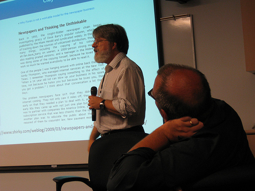
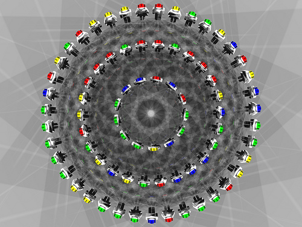

On Thursday afternoon of this year’s [Open Ed conference](http://openedconference.org), a challenging contrast began to emerge between the approaches to student writing being espoused by the various speakers. First was [Gardner Campbell](http://www.gardnercampbell.net/blog1/) and [Jim Groom](http://bavatuesdays.com), who delivered a talk titled [No Digital Facelifts: Thinking the Unthinkable About Open Educational Experiences](http://openedconference.org/archives/541). (This and other links go to Ustream recordings of the talks – they’re well worth your time, if you weren’t able to attend in person.) Gardner’s message echoed some of the familiar strains in [Jim’s talk from the previous day](http://openedconference.org/archives/434), putting forth the idea that instead of herding students together into a single platform of our choosing, we should be giving them the tools and knowledge to be creators and curators of their own digital identity. (See [this post at bavatuesdays](http://bavatuesdays.com/a-domain-of-ones-own/) for some of Jim’s thoughts on “a domain of one’s own”.) Gardner pushed this line of thinking a step further, suggesting that students literally become the sys admins of their own web space. Not only should students be able to move outside of the institutional platforms to develop their digital selves, the argument goes, but they should be free to choose and maintain whatever platform they’d like, without the different but perhaps equally cumbersome constraints of free/commercial platforms (like wordpress.com and others).

[Gardner and Jim | cc licensed flickr photo](http://flickr.com/photos/colecamplese/3820201375/)shared by

[colecamp](http://flickr.com/people/colecamplese/)

Now, before I start talking about where the tension arose, I should point out that while there’s something very right about this idea of Gardner’s, there’s something arbitrary about it as well. He suggests that we conceptualize something like cPanel as a meta-framework for the construction of identity. But why stop there? If cPanel > wordpress.com because of cPanel’s additional freedom to maneuver, doesn’t it follow that it’d be better to give each student a virtual machine with a bare OS on it? Or maybe for them to build their own kernel from assembly code, which would truly provide the most software freedom? The obvious reason is that at some point the tradeoff is no longer worth it: what you gain in freedom by dropping down a level of abstraction is not worth the extra effort you’d need to master the medium. And I’d argue that as time goes by, and software both advances to higher levels of abstraction from the raw code and at the same time becomes more useful, the calculus of determining the ideal level of abstraction is constantly in flux. To echo [a discussion from this year’s THATCamp](http://thatcamp.org/2009/06/from-history-student-to-webmaster/): while it might be the case that most students would benefit from learning some HTML and some basic programming *today*, it’s likely that there will come a point at which it’ll no longer worth the trouble; this, in much the same way that you don’t need to know assembly code to qualify as a computer geek (in most circles?!). A GUI like cPanel might be the right meta-framework for most students today, but we should constantly be reassessing this conclusion.

OK, so back to Thursday afternoon’s tension. The session following Gardner and Jim’s was led by [John Maxwell](http://thinkubator.ccsp.sfu.ca/) and was titled [Thinkubator: Wiki as CMS/LMS](http://openedconference.org/archives/549). (Actually, sandwiched between the two was [a fricking awesome demo](http://openedconference.org/archives/549) by [Grant Potter](http://networkeffects.ca/) of some work he’s doing with virtual worlds – but I’ll gloss over it for the purposes of this post.) John has been doing amazing things with the wiki, related to his research, to organizations he’s been involved with, and – most germane here – to his courses. He conceptualizes the wiki as a place where students – especially graduate students – learn to work in the way that scholars work. (John, I’m going to fill in some points you left unsaid here, so please tell me if I’m borking.) While it’s of course true that individual scholars maintain their own voices and perspectives, there is also a voice that emerges from a community of scholars who are writing about the same things, publishing in the same journals, editing and reviewing each other’s work, teaching in the same departments, etc. In one of the best one-liners of the conference, John pointed out that students get practice in developing this kind of communal space in kindergarten and in graduate seminars – but not in between. Multi-authored wikis are, by their very nature, communal spaces. Thus, when students do their work on a wiki, they are learning the sociology of group work and of their discipline at the same time that they’re learning the subject matter of the course.

So here’s the tension (which John himself articulates very clearly in [his own reflection on the talk](http://thinkubator.ccsp.sfu.ca/ThinkingAboutWikisInTheContextOfOpenEducation)). The Campbell/Groom angle is that students are better served by stewarding their own spaces: emphasis on the individual voice. The Maxwell angle is that students learn about how scholarship functions by authoring together in a space like a wiki: emphasis on the communal voice.

There is a sense in which the tension might be fundamental, going to the heart of what we want our students gain from our classes. If the point of education is to shape students’ individual agency – to make them sys admins of their own souls (?) – then it makes perfect sense to make them sys admins of their online selves. If the point of education is to develop the next generation of scholars (or, if we want to take the point further, the next generation of *society members*), then the wiki approach might be more sensible. Insofar as there is a real conflict here, it might run even deeper than the purpose of education, but to the purpose of knowledge production itself: is it more important to foster and encourage each individual’s idiosyncratic “truth” scheme or our collective movement toward Truth?

[Distributed groups | cc licensed flickr photo](http://flickr.com/photos/fdecomite/3841651845/)shared by

[fdecomite](http://flickr.com/people/fdecomite/)

From a practical point of view, the tension is probably not so stark. A student with a developed voice and identity is more likely to be able to step back and envision his or her place in communal spaces; and someone who is comfortable participating in shared knowledge development will be better equipped to develop his or her own particular point of view. But the contrast with respect to educational technology policy remains. A wiki setup like Maxwell’s is homogeneous and centralized, while the Campbell/Groom arrangement is various and distributed. I wonder how much of this is a technological accident, though, and to what extent the phenomenal qualities of Maxwell’s method can be superimposed on the Campbell/Groom architecture. What I mean, very roughly, is that we might envision a new generation of software whose underlying infrastructure is essentially distributed and customizable – respecting the agency of individual student-sysadmins – while communal spaces, rich with the versioning and community feature of wikis, can emerge at the higher levels of abstraction. I’m not smart enough to envision what this might look like in detail, but in theory it might preserve some of the educational advantages of each approach.

What do you think? Is there really a tension between the two approaches? Does the underlying technological model you choose for classroom work rule out certain rhetorical models, or does it just make some a little harder to attain?

*[On the communal v. the individual student voice](http://teleogistic.net/2009/08/on-the-communal-v-the-individual-student-voice/)*by

*[Boone Gorges](http://teleogistic.net)*, unless otherwise expressly stated, is licensed under a

[Creative Commons Attribution-Noncommercial-Share Alike 3.0 United States License](http://creativecommons.org/licenses/by-nc-sa/3.0/us/).

Related posts:
