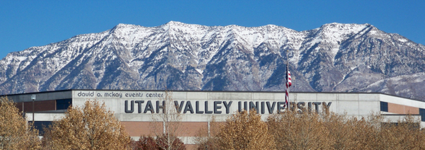

 OREM, UT - At the

[Utah Valley University](http://www.uvu.edu/), there is a strong commitment to engaged learning. In what follows, I try to offer a model by which social media technology can be used to cultivate the active engagement of students in their own education.

This model is based on two insights:

1. Learning is social and so it is most effectively pursued in communities of education in which teachers and students are actively engaged together.
2. Social media technologies are transforming education because they are able to open dynamic communities of learning between teachers and students.

*The power of new social media technologies for education lies not in the information they deliver, but the communities they can create*.

Let me begin with a short presentation on the pedagogy of blogging and why I think it is particularly powerful in cultivating dynamic communities of engaged learning.

In order to speak in practical terms about how faculty might begin to cultivate such a dynamic community of learning in their classrooms, I would like to highlight the structure of my course on Ancient Greek Philosophy at Penn State.

This course focuses on the question of Socratic politics and is driven completely by our course blog,

[Socratic Politics in Digital Dialogue](http://www.personal.psu.edu/cpl2/blogs/digitaldialogue/blog/). All the writing for the course except for the final research paper is posted to the blog.

[Here is the syllabus for my PHIL200 Ancient Greek Philosophy course in pdf format](http://www.personal.psu.edu/cpl2/Courses/AGPSyllabus.pdf).

*There are no specific writing assignments*. Students write when they are moved to write by the texts we are reading. As faculty, I have clearly set out the expectations for the course in the

[Blogging rubric (.pdf)](http://www.personal.psu.edu/cpl2/blogs/cplportfolio/Blogging%20Scoring%20Rubric.pdf), which is the key to the success of this model.

The other way I try to cultivate the active participation of the students is through the

[Weekly Round-up podcasts](http://www.personal.psu.edu/cpl2/blogs/digitaldialogue/weekly-round-up-podcast/)they produce in teams each week. The goal of these podcasts is for students to reflect upon the week of class and to highlight readings, aspects of in-class discussion, blog posts and to connect them to issues of contemporary social-political concern.

**Highlighting Success**
Here I have gathered some links that highlight some of the ways we have been successful in cultivating a community of learning this semester:

- Cody Yashinsky and Pam Dorian produced a weekly round-up podcast that focused on the media's influence on Philosophical discussion, the question of the Good and specific blog posts of the week.

[Listen to Cody and Pam on Weekly Round-up #2](http://www.personal.psu.edu/cpl2/blogs/digitaldialogue/Weekly%20Round-up%20Week%202.mp3)

- Themes and topics emerge organically as students gravitate to issues of common concern. This semester some of those issues have included:

- The question of the Good, exemplified by the robust comments received by Jordan Sanford's post [Why Should We Be Good?](http://www.personal.psu.edu/cpl2/blogs/digitaldialogue/2009/10/why-should-we-be-good.html)
- The issue of [piety](https://blogs.psu.edu/mt4/mt-search.cgi?blog_id=12594&tag=Piety&limit=20) and how it is related to the life of philosophy Socrates lives: here is a post from Cody Yashinsky entitled "[Is Religion Part of the Good?](http://www.personal.psu.edu/cpl2/blogs/digitaldialogue/2009/09/is-religion-part-of-the-good.html)" that typifies the sort of discussion this issue has generated.
- [We encouraged Marina McCoy from Boston College to invite her students to participate in our discussion](http://www.personal.psu.edu/cpl2/blogs/digitaldialogue/2009/10/welcome-bc-students-to-our-digital-community.html) when we realized that they were reading the *Phaedrus* the week we were.
- Marina's post on [Rhetoric and Soul Leading](http://www.personal.psu.edu/cpl2/blogs/digitaldialogue/2009/10/rhetoric-and-soul-leading.html) was commented upon heavily by her students and mine.
- The dialogue between my students from Penn State and hers from Boston College was excellent.  Take a look at the response Pam Dorian received on her post about the [Charioteer Allegory in the Phaedrus](http://www.personal.psu.edu/cpl2/blogs/digitaldialogue/2009/10/charioteer-allegory.html).

- Critical to the success of this model is how the blog is integrated into the classroom discussion.  I use [Evernote to highlight specific posts and comments in class for discussion](http://www.evernote.com/Home.action?__fp=Xz8V6L4uYcM3yWPvuidLz-TPR6I9Jhx8&username=longc2&rememberMe=true&login=Sign+in&login=true&_sourcePage=kYNibkKBh0fiMUD9T65RG9ZCS8k3ZqiOcvMVtI39TuE%3D&targetUrl=#v=t&n=baaf4cf4-c681-4088-ab04-8a032174605a&b=86858704-64c5-47d5-94fa-7fe038b81a25&z=d).
- This is a great way to get the students who are more reticent to talk in class to contribute to the discussion: call up their post and ask them to summarize it for discussion.

These examples beautifully illustrate the power social media has to cultivate a dynamic community of engaged learning.

I look forward to seeing what UVU might develop in this regard, as I am encouraged by the way UVU is already using its web presence to aggregate their social media activities through the

[UVU Social Media Directory](http://www.uvu.edu/visitors/social-media-directory/).
