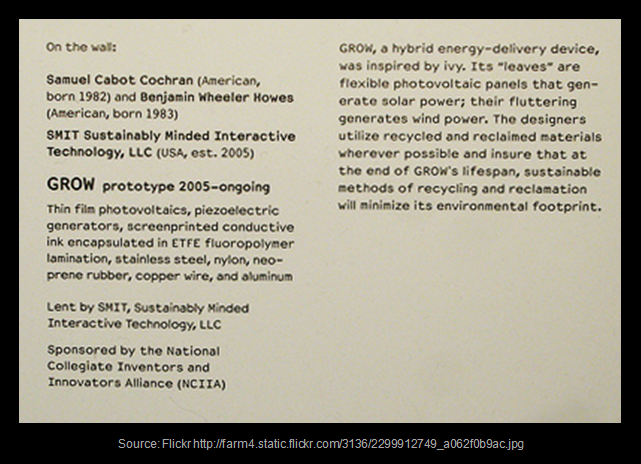
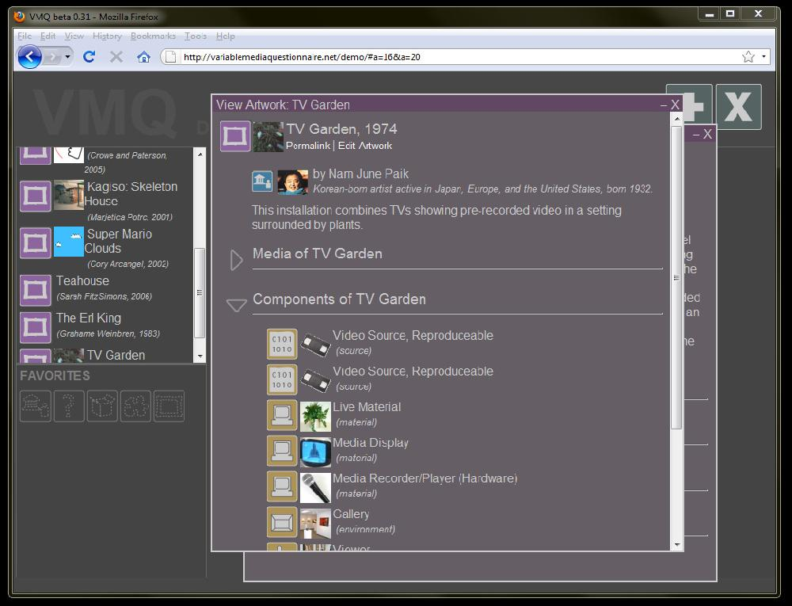
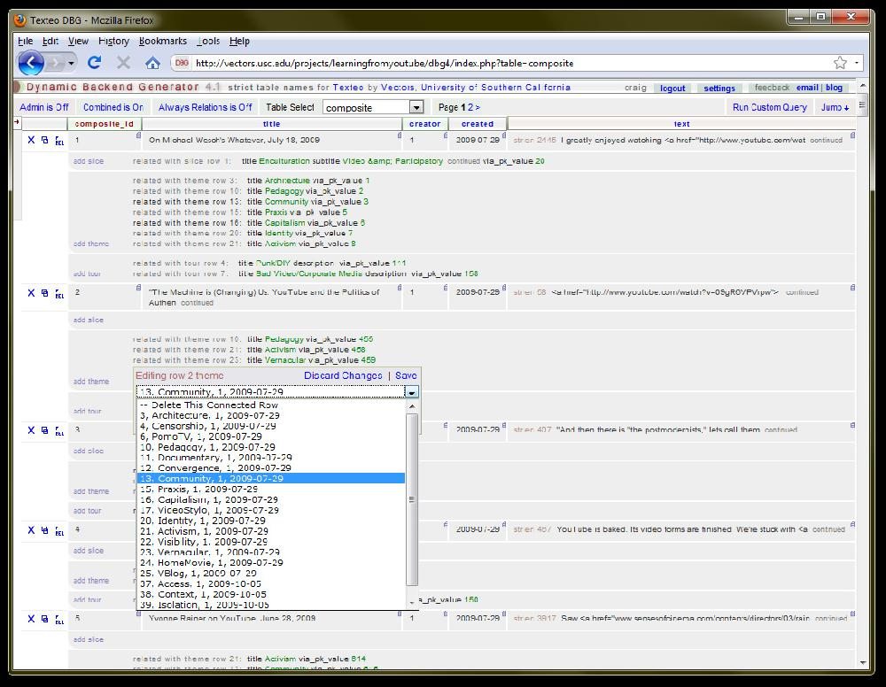

This essay outlines three considerations for digital media learning: ecologies, formlessness, and relational literacy.  Parts originally presented at the [2010 Digital Media and Learning conference](http://dmlcentral.net/conference/sites/all/files/documents/dmlconf_feb2010.pdf) \[pdf\] panel "Setting Critical and Creative Parameters for a Cross-Disciplinary / Platform Research Agenda"

This drab slide is a wall label, the ubiquitous signage that sits next to an artwork describing its parts.  The text includes such things as creator, date created, medium, and dimensions, reaching a quandary for works of new media: none of the descriptors have relevance to the ways creative people create in the Internet age.  Works are routinely remixed, re-hashed, or re-purposed from older material.  Medium and dimension?  These are terms befitting paintings, but can't contend with the multitudes of media types, formats, and linkages.  And how can we define a date-created when digital projects increment their version numbers? 

But I'm being too nice. [Jon Ippolito](http://en.wikipedia.org/wiki/Jon_Ippolito) does a much better job of summing up the problem in his article, [Death by Wall Label](http://vectors.usc.edu/thoughtmesh/publish/11.php):

Traditionally, artwork is described by presumed facts such as medium and dimension. The essence of a work—its meaning—is crafted by its constituent components—its form. Yet form isn't just the visible elements of a work, it's also connections between elements, and when we rely on form-flattening paradigms such as the wall label documentation misses most of the things that make work meaningful in the first place. Understanding this threat, the

[Variable Media Network](http://www.variablemedia.net/)has been re-imagining how we document creative work. They recommend archives store information about constituent stakeholders, components, and relationships. Using descriptors such as encoded, installed, performed, and networked, catalogs using the variable media approach retain essence and are adaptable to a work's changes over time and in technology.

Unfortunately, many of the de facto standards in education encourage students to make projects for wall label consumption. If students try to emulate network culture they are labeled cheaters for daring to make work that re-interprets, connects, or bridges concepts or people. The University of Washington's

[guidelines for cheating](http://depts.washington.edu/grading/pdf/AcademicResponsibility.pdf)\[pdf\] go so far as to define "Illegal collaboration." This apparently occurs when students — in computer science for example — are asked to create an application outline together but then to write different software modules based on the outline. If one student's module is too similar to another's, they are cheaters.

The chips are stacked against students when they are asked to collaborate but must follow archaic rules of single-authorship in the end. Also troubling about this notion is that it protects against precisely the way industries operate. Take software companies, where workers create chunks of code separated out in object-oriented patterns so that other developers don't have to concern themselves with the particulars of each other's modules. It doesn't matter where the code comes from or whether the coder ripped it from an O'Reily book, as long as it gets the job done.

But there's a catch to this kind of openness: Microsoft, for example,

[just got hit with a lawsuit](http://techrights.org/2009/08/01/groklaw-on-microsoft-gpl-violations/)for violating a

[GNU Public License](http://en.wikipedia.org/wiki/GNU_General_Public_License), meaning, one of its developers copied from the wrong place. It's no wonder that licenses such as the GPL get abused; for many, copying licensed open source software fits into the free side of Western culture's binary options of free or closed. Without an appreciation for sharing protocols, people can't be expected to respect the terms of a license. This problem is only perpetuated by the business of free culture. Quoting Professor

[Joline Blais](http://jolineblais.net/),

[citation](http://www.intelligentagent.com/archive/ia6_2_communitydomain_blais_indigenousdomain.pdf))

Void of exchanges between creator and consumer, relying on detachment over engagement, these MP3s are about as free as sub-prime loans. Resiting the detrimental properties of free and closed cultures, systems that forefront network-building will safeguard our organic and electronic ecologies. Just as education based on hierarchy has taught us to obey police officers and place our money in retirement accounts, education in the 21st century can motivate based on network models incorporating knowledge and trust.

One of the outcomes of the aforementioned Variable Media Network is the

[Variable Media Questionnaire](http://variablemediaquestionnaire.net/)(VQM), a web-based application developed to make apparent connections between artwork components. The application asks questions of an artwork: is it "contained" inside materials or frameworks? What are the properties of the room it is installed or performed in? How was the digital material encoded? With these properties in place, the Variable Media Questionnaire then asks questions from the artist: what changes can be made to the materials while maintaining your original intent? Can a room be lit differently? Will encoding in a different file format or playing on with a HD projector change the work's meaning? The Variable Media Network has defined an artwork not just by its visible elements, but also the harder-to-determine relationships of the components inside a work, between works, and artists to their work.

We can look to the VMQ as inspiration for setting educational parameters. The VMQ asks questions of artists; here we can ask questions of students. Are there conversations in your community that relate to your animation? What parts of your autobiography led you to choose a certain technology? How will a

[fieldtrip to the University of Maine's Steam Plant](http://www.flickr.com/photos/zeveisenberg/2875039343/in/set-72157607411986999/)relate to your Internet-based project? The questions encourage an awareness of ones surroundings, but also, importantly, they ask us to create tangential relationships that might not be apparent. Wall labels emphasize surfaces; ecologies emphasize relationships.

Wall labels work well for art made up of static objects.  However, network-based practices often produce variable results, and their creative ecologies can be even more difficult to pinpoint. The struggle to find form in the formless is what French writer [Georges Bataille](http://en.wikipedia.org/wiki/Georges_Bataille) described as formlessnes.  Further developed by [Yve-Alain Bois](http://en.wikipedia.org/wiki/Yve-Alain_Bois) and [Rosalind Krauss](http://en.wikipedia.org/wiki/Rosalind_E._Krauss) in their book [Formless: A User's Guide](http://mitpress.mit.edu/catalog/item/default.asp?ttype=2&tid=7439), the formlessness construction is a reaction to entrenched arguments about form and content epidemic in the art scene. A painter might paint not in a methodology pleasing to intellectuals (form), or without making a great pronouncement with its content. Rather, the art can be free, irrational, and tangental for the pleasure of the process.

The body of work described as formless is considered indefinable by some. In fact, Bois and Krauss in their book state that they will not attempt to define the formless, but rather will put it to work. The trap here is that a lack of definition procures a whole set of pseudo-definitions. Some group into formless that which incorporates ephemeral materials such as goo or trash. There are also more loosely defined forms such as dirty, fat, messy, useless, and futile, utilized to describe the form of formlessness. 

Formless art tends to favor trash and other earthy materials because it begs a closer relationship between the creator and materials. Perhaps reasoning formless as indefinable is like choosing to believe that the consequences of ecology don't exist (which, for example, many of us do every day when we [shop at large chain stores or purchase processed foods](http://www.ichass.illinois.edu/hastac2010/HASTAC_2010/Presentations/Entries/2010/4/15_Avoiding_a_Cultural_Bottleneck__Networked,_Distributed,_and_Agile_Collaborations.html)). Rather, formlessness can be viewed as a trust between the various materials and  technologies that establish form, and messages that provide content.

RSS feeds are lists of blog posts and news reports that users pull into programs such as Google Reader and iPhone reader apps to provide quick access to sites they view daily.  They are heavy on content but don't have much form—in fact the format was created specifically to pull out content from design-heavy HTML documents.  In Fall 2009, [IML400](http://iml.usc.edu/index.php/courses-of-instruction-iml/2010/01/14/iml-400-web-based-scholarly-multimedia-2/) student Meri Bills produced a creative project in [RSS](http://en.wikipedia.org/wiki/RSS) titled "[the hidden truth](http://storm.usc.edu/%7Embills/elitproject/hiddentruth.rss)." This isn't a typical interactive media project.  It is simply an [RSS feed](http://en.wikipedia.org/wiki/RSS).  Though, instead of each entry feeding to a blog post (how RSS is commonly used), they are individual lines of a poem. Clicking a line takes you to a web page with abstract photography Meri made specific form each line. 

If Meri showed this project in a gallery, its wall label might try to grab on by listing "RSS", "webpage," and "web browser" as constituent compoents. Yet this description disregards its essence: RSS is intended to move users to scattered content on the internet, but Meri's project miss-uses the format to bring parts of the internet together. 

Interestingly, the RSS project's dispersed, relational form of writing is similar to the ways of working at USC's 

[Vectors Journal](http://vectors.usc.edu/).  At Vectors we find that much of the beginning stages of creating an interactive work focus on the "structuring up" of the data by using database tools like the [Dynamic Backend Generator](http://vectorsjournal.org/journal/blog/category/tools/dbg/) (DBG).  Fundamentally, the DBG creates a spreadsheet view of each table in a MySQL database. Though it goes one step further, predicting relationships between database tables representing them as HTML pulldown menus.  This way, relational data can be managed without the back-and-forth between tables and by novice or expert users. 

Unexpected at first, we often see Vectors' fellows using the tool to re-imagine and recreate their scholarship by using the tool as a canvas for ideas, not simply data management.  Relationships that would be considered non-sequitor or even non-existent in linear form become connected in relational form.  And once initial connections are established, fellows often start remixing and re-remixing their scholarly work.  So while database literacy is being established, new scholarly relationships between content -- ecologies -- are being created.

Students can begrudgingly discuss the themes of [Shakespeare](http://en.wikipedia.org/wiki/William_Shakespeare) or [Animal Farm](http://en.wikipedia.org/wiki/Animal_Farm), and in some schools dissect a [Cubist painting](http://tinyurl.com/373hsgu).  However, when students begin to work with data networks, such as using Wikipedia to find new paths for a book report, or instant messaging their friends during class, society starts to squirm.  Looking through a traditional literacy lens, students use new media to conjur up all sorts of tangential and farcical ideas using networks, appearing to be the scholarly equivalent of turning iron into gold.  Though as is often the case, seeing processes outside one's own literacies can look a lot like magic.  

Investigating cross-disciplinary bewilderment, the [Magic Project](http://magic.still-water.net) conducted interviews at 2009's [NEH IML-Vectors Institute](http://vectorsjournal.org/journal/blog/category/vectors-iml-summer-institute/), a month of rapid prototyping of digital humanities projects between cultural specialists and technologies. A couple quotes stand out in relationship to database literacy: in an interview, [Virutualpolitik](http://virtualpolitik.blogspot.com/)'s [Elizabeth Losh](http://virtualpolitik.blogspot.com/) describes how her videos were transformed by the addition of a video-annotation player,:

The transformation wasn't magical in the sense of turning one thing into another, but rather the different technologies (video and annotation player) and content (video and annotations) revealed a fascination when they were brought together (in the form of an annotated video).

Another interview speaks to the wizardry of technologists. In the context of the shaman who transforms to travel to other places, when a programmer conjures up a game-changing algorithm, does this take the project to a new place?

[David Shorter](http://www.wac.ucla.edu/person.php?pid=153)describes a moment in his project's development:

The coders here will point out that this isn't what really happened: a lot of planning, effort, and creativity went into writing the project's code, but to the non-programmer it appeared to be a conjuring. Though, if the roles were reversed, the technologist would see similar magic: David conjuring up a ground-breaking notion in anthropology during a meeting.

Whether fetishizing the medium or seeing magic in the work of others, the net effect, at least in these interviews, is excitement. Sure, science can rebuke astrologists for not sticking to the hard facts, but astrologers have a much more intimate relationships with the objects in the sky than the average person. Perhaps we can promote the positive, spectral aspects of new media — "

[unleash the unexplainable](http://critcode.ning.com/forum/topics/week-4?commentId=4969581:Comment:1022)", put forth by

[Micha C�rdenas / Azdel Slade](http://critcode.ning.com/forum/topics/week-4?commentId=4969581:Comment:1022)— to foster higher interest in mulitmedia systems that drive most of our daily routine?

Much like astronomy was built on the foundations of astrology's mystical persuits, perceived magic between all diciplines can encourage interdisciplinary opportunities. For example, in the digital humantities a writer might want to learn

[phpMyAdmin](http://en.wikipedia.org/wiki/PhpMyAdmin)— the cumbersome but effective MySQL database manager — after seeing their text "automatically" mapped to a semantic tag database. And, just like the gadgets and tables of astrology made their way into the science classrooms of today, down the road we might see phpMyAdmin added to the curiculum toolset. If educational anchor MS-Word instills linear editing skills, PowerPoint linear presentation skills, and Excel an intro to flat files, phpMyAdmin would provide valuable literacy for relational data and by association an introduction to technology concepts critical to digital production.
