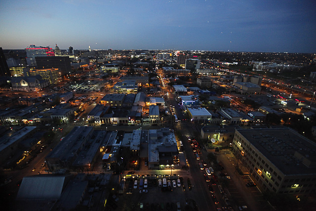

## [Location Literacy, Research, and Foursquare](http://www.deanterry.com/blog/index.php/location-literacy-foursquare-in-the-classroom/)

*This is the first of a series of posts called “Re-imagining Location”  about location, place and the mobile web as it relates to academia,  research, and the arts. For the past three years I’ve been heavily  engaged in projects in a collaborative research and creative group  called [MobileLab](http://emac.utdallas.edu/research/).   As we are entering a period where notions of location are beginning to  be discussed in these circles I thought I’d share some of the things  I’ve been thinking about along with students and colleagues.*

In 2012 mobile web access will eclipse desktop access. This means a lot more than shrinking the web so it fits on a mobile screen. The mobile web is not just a smaller desktop web. In the mobile web context is key. It is the central component that differentiates the mobile experience from the desktop one (what I like to call, semi-jokingly, the Late Desktop Era). And location / place is a critical contextual layer.

Understanding location and place in the mobile ecosystem is something that, from my experience over the last several years, takes time and concrete examples. There are a number of location applications that can be used to provide a very basic (if misleading) experience of location. These applications are all commercial, very early, and are based on simplistic, even crude concepts of place. Still, they allow us to begin to think about our location, our social networks, our data, and the web at the same time. The goal is to get the basic experience of a digitally enhanced place, or the networked location.

My graduate level [Emerging Media + Communication](http://emac.utdallas.edu) class is called MobileLab and we are looking at the current and near future state of the mobile space for media, research, education, and experimental creative projects. I am requiring everyone in the class to get Foursquare accounts. Why? It’s not because Foursquare is the best way to understand location, space and place – it’s not. It is an ambient game centered on “checking in” to locations built by a startup whose whose aim is to make media and retail deals. Providing a robust location tool and vehicle for expression and place annotation is not part of the plan (even though people are using this way anyway – more on that later).

We are using Foursquare because it is an accessible, easy to use platform that is, being location based, uniquely mobile in orientation. It is an app that only makes sense in a mobile context. (Looking at the non-geo web on an iPhone is not a mobile experience. It is a shrunken down desktop experience.) It is a way to stimulate discussion about the meaning of location and place as it relates to the emerging mobile Internet and experience. It is a start on getting your head around location.

When using a location based social application it may seem at first as if you are just “sharing location” but you are also: 1) leaving information in places (in this case a micro history and ‘tips’), 2) changing other people’s experience of places by the information you leave, and 3) beginning to create a contextual layer in the location. These are things we will all be doing more and more in the near future: creating and interacting with geolocated media and extending the idea of place and adding layers of context.

Foursquare is a very early take on location and looks at places through a narrow game centered and commercial lens. Locations are, by default and intention, retail restaurants, grocery stores, bars, etc. Foursquare calls them “venues.” One result of this is to reinforce a consumerist orientation to place. You never check in to a neighborhood, or area, or place where something meaningful happened, or could or will happen. You check into Pizza Hut.

In some ways it makes places not mean anything, and contributes to the further sense of unplaceness. You are at a Best Buy. I’m at a Best Buy. But they are 20 or 2000 miles apart. It’s never I’m in the favorite corner of my favorite room. There are no ‘hoods or haunts. *(Note to self: write a post entitled “Looking for ‘Hoods and Haunts”)*



Because of these limitations, and because we want to think about place in more interesting ways than checking in to specific venues, we’ve taken to inventing places. In MobileLab, it happened spontaneously. A couple of us experimented with making up places, and then everyone started doing it. Naming a place is a way to give it meaning, to make sense of it and to situate it in a social context.

In the building that houses our two degree programs we’ve created a whole overlay of named locations. Some are just classroom names. Others are “my off white office” which, originally, was supposed to mean my office, but now my colleague David Parry uses it. (In fact, he’s trying to wrest it from me in a gaming sort of way.) There are also names for specific classes and research labs. Beyond our building, some of us have created imaginary locations like “[a happy place](http://foursquare.com/venue/705624),” “[an uncertain place](http://foursquare.com/venue/1100940),” and even “[1 : 1.618034](http://foursquare.com/venue/1487008)” – the number for the Golden Mean. And I spent several weeks thinking about a imaginary place called “[Club Silence](http://foursquare.com/venue/1086530)” (more on this soon).

The point is we very quickly ran up against the narrow limits of Foursquare. We wanted to make places. We wanted to name things. We wanted to play, experiment, express. We wanted to define space. Foursquare, with its checkins and pointless points, mayorships, and badges instantly became unsatisfactory. What it did do was to expose a need we did not know we had. We wanted to label locations and name places, making them personal and social objects. Turns out we wanted something like a [psychogeography](http://en.wikipedia.org/wiki/Psychogeography) app. (We’re working on it – see [Placethings](http://www.placethings.com/))

Pushed a bit, these initial gestures can become a form of location/place related media, writing, art or transmedia. I’m writing another post that goes into this in detail. For now, part of the thought is that if I have to check in to all these rather droll places, why cant I “check in” to an interesting one, a place that engages the imagination the same way it would with a scene in a novel. Or what about imagined virtual political gatherings – places you checked into to to express solidarity with a cause or political viewpoint. As we get better services and more media attached to places there can be more film, game, and emergent narrative experiences.

The social networks we are all used to were born in the Late Desktop Era. The mobile era is upon us and will evolve more quickly than the desktop web era and it is not the same. The competence and confidence we’ve all developed in desktop era social media and digital literacy will be significantly altered by the mobile web and it’s new contexts. Location and place are central to it all. My point of using location apps was to introduce this experience in an immediate, if immediately lacking, way. Everyone in my MobileLab class can see what’s missing now and what the landscape is beginning to look like, at least in outline. And that’s all I can hope for in an emerging media and communication course.
