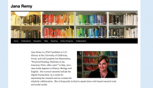

## Creating an Online Portfolio, Part 2

By Jana
			
				
My efforts to 

[create an online portfolio continue](http://historycompass.wordpress.com/2010/05/17/creating-an-online-portfolio/).  In the process I’ve altered the categories somewhat, and have weighed how much to reveal about my various online niches.  For example, in some online communities I am most well-known for my decision to leave the LDS Church and my blogposts about this choice and the ensuing [church discipline](http://pilgrimgirl.blogspot.com/2009/09/this-post-brought-to-you-by-letter-or.html) against my husband.  But in other communities I’m known for my posts about my experiences with [cancer](http://pilgrimgirl.blogspot.com/2009/08/on-cancer-canoes-and-connectedness.html) and a [disability](http://pilgrimgirl.blogspot.com/search/label/amputee).  Neither of these are aspects of oneself that would necessarily be revealed in an academic job interview–particularly because prejudices can be so strong about religion and ability.  However, because a simple google search would easily reveal this information about me, I’ve chosen to integrate my writings on these topics into my online portfolio.

While I presented at UCSB’s “[Literature. Culture. Media Slam](http://dhsocal.blogspot.com/2010/05/ucsb-literatureculturemedia-center.html)” last Friday, I showcased my online portfolio and spoke with attendees about the pros and cons of aggregating such information for a search committee.  I asked whether the group thought this was dangerous to one’s employ-ability, and the consensus was that because of google we can’t hide much nowadays, so it’s better to “own” it and collate it ourselves (or for those with common names, it’s helpful to distinguish ourselves from all of the other “John Smiths” that appear on google).

Even more than the content of the portfolio, I’ve struggled with the overall tone of the site.  I want it to reflect my ‘playful’ online persona, but also show that I’m a serious scholar.  The decision to feature my colorful bookshelves seemed a good way to illustrate both the artistic and serious sides of myself.  I also wanted the site to be solidly functional–with clear navigation and static content (note the lack of widgets or any web 2.0 interactivity).  My intention is that this will keep the site usable for the less-tech-savvy hiring-committee faculty who might be perusing my profile.  But have I gone too far and made a terribly vanilla-boring list of links?  Also, do you think the simplicity of the site downplays my technical acuity?

I welcome your feedback: [http://janaremy.wordpress.com](http://janaremy.wordpress.com/).

Tags: [portfolio](http://en.wordpress.com/tag/portfolio/), [online identity](http://en.wordpress.com/tag/online-identity/)

This entry was posted  on May 24, 2010 at 5:00 am and is filed under [Online Resources](http://en.wordpress.com/tag/online-resources/), [digital humanities](http://en.wordpress.com/tag/digital-humanities/).						You can follow any responses to this entry through the [RSS 2.0](http://historycompass.wordpress.com/2010/05/24/creating-an-online-portfolio-part-2/feed/) feed.
													You can [leave a response](http://historycompass.wordpress.com#respond), or [trackback](http://historycompass.wordpress.com/2010/05/24/creating-an-online-portfolio-part-2/trackback/) from your own site.
