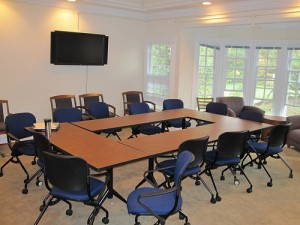

Like many ProfHackers, I’m constantly [tinkering with my syllabi](http://www.profhacker.com/?s=syllabus&searchsubmit=Search) and assignments, looking to improve the experience for the students (and for myself).  For many of my writing assignments, this tinkering has meant that the guidelines have grown longer and longer (as I address specific issues that have come up in previous iterations).  However, in my senior undergraduate seminar, Adventures in Digital History, I’ve taken the opposite approach, giving students the broadest of guidelines and providing them with the opportunity to create their own assignments for their group digital history projects.

\[A note about the course \[[2008](http://digitalhistory.umwblogs.org/) and [2010](http://dh2010.umwblogs.org/) iterations\] and my goals for it:  it is focused on digital history concepts and methods, and explicitly offers an alternative to the semester-long research paper that allows students to create something fun, interesting, lasting, and important, while engaging history majors in something substantively different (both in terms of technology and in terms of working with others) than the discipline as a whole.  It is intended to [push students out of their comfort zones](http://mcclurken.blogspot.com/2008/01/starting-new-semester-and-new-class.html), and, hopefully, provide them with some marketable skills.\]

**Overview of the Process I give each group a broad topic, expose them to a variety of digital tools, and then have them write a contract (4-5 weeks into a 15 week semester) explaining what their plans are for the project, what tools they will use, and what their calendar is.**

The four or five members of each group work on a particular project all semester.  They begin with a broad topical direction from me (e.g., “do something on the history of our school”) and they begin doing research for themselves, working with me and various resources (sources and people) to come up with their own direction for the content of their project.  At the same time (in those first four weeks), they are introduced to a variety of open-source/freely available tools for online discussion, content creation, and presentation, including [Omeka](http://omeka.org/), [GoogleDocs](http://docs.google.com/), [SIMILE/Timeline](http://simile.mit.edu/timeline/), [WordPress](http://wordpress.com/) (via [UMW Blogs WPMU](http://umwblogs.org/)), WindowsMovieMaker/iMovie, and [Zotero](http://zotero.org/).  The goal of these early semester sessions is not mastery of all these tools, but rather a brief introduction to the capabilities, strengths, and weaknesses of each so that the students can evaluate them for their own needs.  If a tool looks like it might be useful, then they play around with it more to see 1) if it will meet their vision for their project and 2) if the learning curve is one they can manage in the course of the semester.

After weeks of playing, researching, exploring, and talking about their projects, each group uses Google Docs to write their contract and submit it to me, including the following:

- Mission statement, including a full description of the project, with its goals and audience(s)
- List of tools/software, with an explanation of how they will be used.
- Schedule of milestones (when critical pieces are ready to present)

I comment on the draft, addressing issues (most often with practicality of the time line, or clarity of goals); the group rewrites their contract and then they are posted to the course website (see [here](http://digitalhistory.umwblogs.org/group-contracts/) and [here](http://dh2010.umwblogs.org/group-contracts/)) so that we all agree what it is each group is working on.  At the end of the semester, the groups are graded on how well they have met the contract that we agreed upon.

Three relevant points here:

- Each group can revise the contract as the semester goes on, though only with good reasons. \[For example, good reasons include serious technological problems or issues with access to sources. They do not include problems related to poor effort or planning.\]
- At the end of the semester, each student writes a brief explanation of how their group met their contract. \[See [here](http://mdowns.umwblogs.org/2008/04/23/official-reflections-on-digital-history/) and [here](http://kwuyscik.umwblogs.org/2008/04/23/yes-i-am-happy-i-took-this-class/) for examples.\]
- I recommend an interim evaluation of the project at roughly 2/3 of the way through the semester (week 10 for our 15 week semester) so that students have some sense of your sense of how they’re doing.

**Results of the open-ended contract 1) In my experience, the proposed projects are more ambitious than those I would have assigned had I been very precise about what I wanted.  Although each time one or two of the groups may have to ultimately scale back their goals a little bit, thinking big is what I want them to be doing.  \[Scaling down is easier than scaling up, especially later in the semester.\]**

2\) In most cases, the students come up with significantly more creative projects than I would have been able to design, and the projects are much better for it.

3\) Students who have finished these group projects based on their contracts have an incredible sense of accomplishment, as well as skills in a variety of areas not traditionally taught to them in my discipline (project management, tool evaluation and selection, and group work, just to name the most obvious).

**What experience have you had with having students write their own contracts?  What advice do you have for those looking to do so?**

\[The image in this post is of one of UMW's seminar rooms from my [flickr account](http://www.flickr.com/photos/52355157@N00/4062082592/).  Based on my experience you'll have better results if you add students.\]
