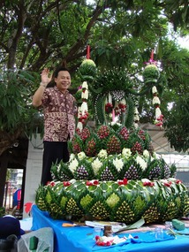
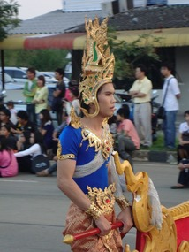
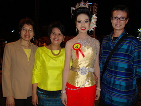
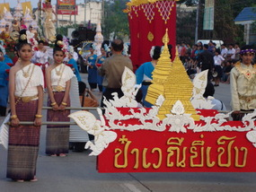
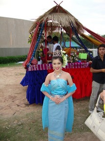
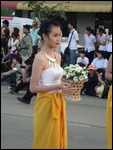
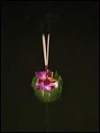
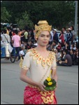

# **No powerpoint? Whatever loys your krathong...**

**Trip Start**Oct 20, 2009

1

16

42

**Trip End**Nov 29, 2009

Loading Map

[Map your own trip!](http://www.travelpod.com)

Map Options

Show trip route

Hide lines

 

Today was a little tough because I didn't get a chance to sleep after arriving home from Cambodia. I had heard classes were going to be cancelled because of the Loy Krathong festival, so I was looking forward to catching some z's in the morning and preparing my lectures for the rest of the week. No such luck - even though most classes on campus were cancelled, mine wasn't. I walked over to campus in time for my morning workshop, titled "Writing for Publication," and was surprised to see 10 people came despite the fact the rest of the campus was pretty much shut down for the day. The participants were all professors in the Faculty of Nursing, Faculty of Medicine, and Faculty of Public Health. For the classes I'm teaching here at [Khon Kaen](&lt;http://www.travelpod.com/travel-blog-city/Thailand/Khon Kaen/tpod.html>), my lecturing is done entirely in English, but I'm having to speak slower than usual so that people can understand me. Also, I'm having to explain a lot of metaphors. I hadn't realized how many times a day I use metaphors to explain concepts to people but apparently it's a lot
      
        [Activities Director readying nursing float](http://images.travelpod.com/users/acquaviva/1.1257242489.activities-director-readying-nursing-float.jpg)
      
       . It can be a challenge explaining metaphors to people who speak English as a second language but it's also pretty amusing because it often involves me having to draw a picture on a whiteboard to explain what I mean. My drawings are horrible so everyone laughs and they relax a bit as I try to explain the metaphor to them in English.

When I arrived at today's class, the professor who was hosting the session told me to sit at the podium and load my powerpoint. I let her know that I would be leading an interactive discussion and so I would not be using Powerpoint. She was baffled and said "ajan's (professors) always use powerpoint. This is the Thai way." I gently but respectfully conveyed to her that since they have invited me to teach them to approach things differently in terms of conducting research and writing, I hoped she would bear with me as I used a new way of teaching to facilitate teaching a new way of thinking. She was really quite stunned - all professors MUST use Powerpoint and must lecture TO the audience, not engage WITH the audience. But she told me if that's how I want to do it, then it's fine. I was a little shook up at first, I have to admit, because I want to be deferential to the faculty and their culture. But I also know that the Dean and others have encouraged me to be creative and push people to look at things differently while I'm here, so I pressed on, albeit a little nervously.

The faculty attending today's workshop had many of the same questions that faculty in American have regarding getting their work published - i.e. how to pick which journal to target? How do you deal with rejection? etc. But they also struggle with some issues unique to non-native English speakers. For example, several of the faculty said they work so hard to make their English writing sound eloquent and intelligent that sometimes they fail to grasp the required structure of a research paper - i.e
      
        [Male student carrying a banner in the parade](http://images.travelpod.com/users/acquaviva/1.1257242489.male-student-carrying-a-banner-in-the-parade.jpg)
      
       . the core elements of an abstract, the minimal level of details required re: methodology, etc. Also, from a cultural perspective, they are somewhat baffled by editor's feedback and how to respond if they disagree with a particular comment from an editor. We talked about strategies for responding to editor's feedback and spent over 2 hours discussing the required structure and content of a well-developed abstract and research paper, using a JAMA article on patient outcomes between NP's vs MD's as an exemplar/teaching tool. The most interesting part of the class for me, however, was the discussion about giving peer feedback to faculty colleagues. Faculty members shared with me that in Thai culture, when you are asked to provide feedback on a paper or grant proposal, it is the expectation that you offer respectful praise and admiration but you do not provide criticism.We talked about strategies for providing peer feedback in a way that's both respectful and helpful, and the faculty seemed genuinely excited to have the opportunity to learn how to do this while I'm here in Thailand. I was hopeful that the faculty participating in today's workshop could practice some peer feedback between today and our next follow-up session, but the hosting professor said she wants them to wait and provide feedback for the first time in front of her at the next session so that she can tell them if they're doing it right. Hmmm......not exactly the collaborative approach I was hoping for but it's a start. The hosting professor took the microphone from me and made it very clear she will not be sharing her writing for feedback at the next session since she is a very busy person, but she expects the other faculty to provide feedback to each other in front of her at our next session.  I could tell some of the participating faculty were a little uneasy with this, so I let the participants know I'd be available to work with them one-on-one between now and the next session so that they can get additional training and practice giving and receiving feedback

        [Me with student and administrators](http://images.travelpod.com/users/acquaviva/1.1257242489.me-with-student-and-administrators.jpg) 
      
       . People seemed relieved. At the end of the class, the hosting professor took the microphone from me and asked me if I would please teach her and the other faculty more about this American style of teaching. She said she enjoyed it and she could tell there is much her university can learn about teaching strategies from me while I'm in Thailand. Phew....thank goodness the absence of powerpoint ended up being a good thing, not a bad one.

After my class was over, it was around 2pm and I headed back to my office to edit articles. So far, I've edited 2 research abstracts and 1 research newsletter, but I have 10 research articles I'm currently in the process of editing and providing comments. In addition, I'm meeting individually with the doctoral and masters students to give feedback to them on their research proposals. Very busy but I'm loving every minute of this. They have intentionally structured my time here at [Khon Kaen](&lt;http://www.travelpod.com/travel-blog-city/Thailand/Khon Kaen/tpod.html>) University so that I'm doing work similar to a dean of research, mentoring faculty, coaching assistant and associate deans, and strengthening the scholarly productivity of the school of nursing as a whole. I'm surprised at how much I love the work I'm doing - it's extremely energizing and I feel like I'm really making a difference, albeit slowly.

At the end of the day, the Associate Dean for Academic Affairs came to my office to let me know that the van and driver would be taking the two of us to the Loy Krathong Festival
      
        [Loy Krathong parade](http://images.travelpod.com/users/acquaviva/1.1257242489.loy-krathong-parade.jpg)
      
       . The Dean was in

[Bangkok](http://www.travelpod.com/travel-blog-city/Thailand/Bangkok/tpod.html), so the Associate Dean was the Dean's designee at the Festival. When we arrived at the festival, she and I watched the parade floats and dance performances and it was astonishingly beautiful. A few observations about the Loy Krathong Festival at KKU: 

1) All of the parade floats are stunning - decorated with hand-carved crafts, flowers, and bamboo artistry.

2) Each school (called a "Faculty" here) has their students create a float and present a traditional Thai dance performance. The Faculty of Engineering consisted almost entirely of men wearing regular work clothes and wearing paper hats with "ENGINEER" written on them. Their float consisted of a giant pile of speakers blaring music. They didn't dance. In contrast, the Faculty of Medicine appeared to be comprised of an inordinate number of talented float designers and male dancers. To be honest, it was like watching a gay pride parade but with straight Thai medical students, only the Thai medical students were way more flamboyant and were better dancers.  The Faculty of Nursing had a fabulous float, beautiful and talented dancers, and a wonderful energetic spirit. 

3) Puzzling to me was the fact that there appeared to be a big contingent of goth students in traditional Thai costumes attending the festival
      
        [Nursing student in front of FoN Float](http://images.travelpod.com/users/acquaviva/1.1257242489.nursing-student-in-front-of-fon-float.jpg)
      
       . I'm not sure what that was about - I plan to investigate further to find out if there is any Thai cultural significance to this.

4) At Loy Krathong, you float ("loy") a leaf boat ("krathong") onto the lake, letting go of past feelings of negativity, anger, and ill will. People sometimes put money in the leaf cup before putting it into the water. The Thai police apparently frown on people swimming out into the lake and shaking down the krathongs for change - I saw several people arrested doing this.

5) It's a HUGE festival - thousands of people attend - and it was wall-to-wall people as far as the eye could see. 

Overall, it was a really cool event to attend. The Associate Dean brought me to meet some of the university administrators and vice presidents, and I practiced my "wai" and Thai greetings with each one to show my respect. I was happy I thought to dress up a little - I met far more administrators than I had expected, given that it was a nighttime street festival.

The van took me back to my room around 9:30 and I spent the rest of the evening catching up on email.  I was so sleepy - I was in bed by 11, listening to the soothing sounds of the gigantic lizard (called a "tookay" gecko) that lives outside my dorm room in the hallway. It's about 12 inches long and scares me half to death when it jumps out of the shadows because it's known for it's vicious, pit-bull like bite and I soooo do not want to get bitten by a tookay. (To get the tookay off you when it bites, it's a nightmare. It can maintain it's grip for an hour or more. To make it let go, you have to submerge it in water. Ouch.  But it's nighttime call is said to bring good luck, as long as it issues a string of at least 7 "kays" each time it makes it's "too-too-too-TOO-kay, too-kay, too-kay" sound." It's quite pleasant sounding. But I still don't want that thing to bite me, no matter how pretty it sounds!

## [Post your own travel photos for friends and family](http://www.travelpod.com)  More Pictures

|     [Female student marching in the parade](http://images.travelpod.com/users/acquaviva/1.1257242489.female-student-marching-in-the-parade.jpg)             |     [My Krathong after I set it afloat on the lake](http://images.travelpod.com/users/acquaviva/1.1257242489.my-krathong-after-i-set-it-afloat-on-the-lake.jpg)             |     [Dancers in the parade](http://images.travelpod.com/users/acquaviva/1.1257242489.dancers-in-the-parade.jpg)             |     [Male student in the parade](http://images.travelpod.com/users/acquaviva/1.1257242489.male-student-in-the-parade.jpg)             | 

[**Previous Entry**](http://www.travelpod.com/travel-blog-entries/acquaviva/1/1257150185/tpod.html)
            

[**Next Entry**](http://www.travelpod.com/travel-blog-entries/acquaviva/1/1257245201/tpod.html)
            

[0](http://www.travelpod.com#like)
