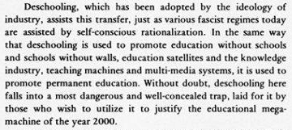

Illich and Vern's booklet, [Imprisoned in the Global Classroom](http://leighblackall.blogspot.com/2010/05/imprisoned-by-global-classroom.html) is a difficult read. Its paragraphs point out in all directions, but not with much recognisable accuracy.. perhaps too much has passed between now and 1976. It makes an impression of a vague sense, but using exact and urgent language. I imagine many would dismiss it out of frustration, but reading passages over and over, and reflecting on its meaning takes time, and the thoughts and ideas it gives me feel worth the time.

This paragraph appears on page 12, and should give all of us in the edtech game reason to pause. It talks about life long learning, and its sinister appropriation by education agents using it to justifying themselves (ring any bells?). While I'm half certain I sit on the right side of the fence on this one, I'm cautious not to appropriate the statement as an endorsement of my work either - because I just might be guilty of exactly what Illich and Verne point to here.

Is my work in opening up an educational institution, its processes and resources, and then to situate its teachers and research in the popular arena, in fact just further entrapment of independent social existence, and bringing it under the dominance of Education? On may levels it is, I can see that. To build awareness of learning as it happens in social networks and its media, and then to nurture ideas in the educational institution on how they might measure, recognise and reward that learning, seeks to further legitimise the dominance of the Education paradigm, impacting further on individual and community self determination and sufficiency. Its just as bad as what marketing agents are doing, government agents, even the medical institutions. There lacks [a genuine sense of altruism](http://keithlyons.wordpress.com/2009/12/21/vicarious-learning-and-reciprocal-altruism/) from these institutions.

Is my work the lessor of a greater evil though? Or is it actually better that institutionalised education exist as it does behind its own walls, restricting access to the opportunities (or illusion there of), and making itself irrelevant to more and more people? Perhaps Education, and Academic Capitalism will actually help societies more by perpetuating this exclusion, thereby reducing its dominance over more people's real lives, leaving their communities little choice but to devise other ways of learning and individual growth?... Perhaps the large scale economic model of education today ensures that it ignores small scale community learning projects precisely because they are small scale, leaving the participants to their own ends, unmolested by education's corruption.

Its an interesting notion to throw around a bit. I see a reason to wait longer now, either for the space for genuine altruism in our institutions to develop (rather than being forced by a few radicals), or for the spread of community learning initiatives in response to the institutions weakening. Of course there's no guarantee that either will happen within a present lifetime, in fact there's plenty of evidence to the contrary.

Unfortunately [the Amazon scan](http://www.amazon.com/Imprisoned-Global-Classroom-Ivan-Illich/dp/0904613305/ref=sr_1_1?ie=UTF8&s=books&qid=1273640203&sr=1-1#reader_0904613305) I'm using to photograph paragraphs from this book, finishes at page 12! I'm looking for another scan so I can continue noting thoughts from this dense little book.

There really is a relentless source of criticism in this book, to the globalisation of education. Chapter 3 titled Political Inversion is written by Illich alone, and I find it a more familiar writing style. This chapter revisits the importance of conviviality and self determination, set against the dominance of institutions that can be shown to take away conviviality - starting with prisons, but moving right through all our institutions. Many of my colleagues would argue that education prepares people for conviviality, but I'd be interested to know if their belief survives a reading of Illich, where he brings the hidden into plain view and exposes education as the separation of things into specialties, in a political context of short term, and an economic cycle of escalating consumption and collapse.

#### 5 comments:

[Post Comments (Atom)](http://leighblackall.blogspot.com/feeds/1244036991246457857/comments/default)
