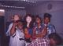

**Submitted by[Mechelle](http://www.hastac.org/users/mechelle) on Oct 06, 2007, 09:38 PM**

How do you teach a smile? When I went into teaching I had no idea really what I was getting myself into. Yes, I had a master's degree when I started teaching. So, I was an expert teacher on paper. Right? Well, actually no. My first week I was more like a deer in headlights.

Reading about disabilities in a textbook is so much different than actually working with children day to day and trying to figure out creative ways to connect with each child.Throughout the years, I have explored various digital media and found it essential for helping me individualize instruction and to provide multimodal learning opportunities. This includesstudents who have autism.

Sammy was a delightful student and I learned so much from him. The following are two video clips of my experimenting with video as a way to teach social scripting. In this case, I used video to teach Sammy to smile. The first video is the basal where we both journeyed together.It was tricky because I was holding the camera and teaching at the same time but wanted to capture his basal. Next, I'd play the video clips on the computer and we'd practice smiling together.Over time, I took many videos so that he could see his progression. Video is a great self-reflective tool for students with special needs. Also, I could share thevideos with his family to show his progressionas he emerged from within his world to ours. I hope you like the videos...and I hope they make you smile. : )

Part 1:

[http://lpcesc07.ning.com/video/video/show?id=683712%3AVideo%3A1566](http://lpcesc07.ning.com/video/video/show?id=683712%3AVideo%3A1566)

Part 2:

[http://lpcesc07.ning.com/video/video/show?id=683712%3AVideo%3A1562&context=user](http://lpcesc07.ning.com/video/video/show?id=683712%3AVideo%3A1562&context=user)

Cheers,

Mechelle : )

- [Mechelle's blog](http://www.hastac.org/blogs/mechelle)
- [Login](http://www.hastac.org/user/login?destination=node%2F966%23comment-form) or [register](http://www.hastac.org/user/register?destination=node%2F966%23comment-form) to post comments
- 
