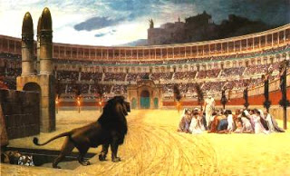

This semester, as I mentioned below, I'm going all in on practomimetic education.

In my myth course, I've divided the three hundred students into teams of 15 who are going to compete in a series of mythomachies on such questions as "What's the better example of modern myth,

*Star Wars*or

*The Lord of the Rings*?" for the title "Lords of Myth." I'm also awarding Honor Points for answering trivia questions that I've stuck into the intros of my video lectures, and for doing cool stuff like coming up with innovations that make their fellow students' lives easier.

*The Game*). Little bits of information about that will be emerging in various places, including here, as the semester continues, but, although I (Roger Travis) am not supposed to know about this, I (shadowy leader of a clandestine, ancient guild of bards) am now in the process of recruiting the students to fulfill bardic missions in

*The Lord of the Rings Online*.

*amor romanus*(Roman love--that is, getting erotic with Ovid in Augustus' Rome) and

*amor Romae*(love of Rome--that is, getting serious with Horace and getting with Augustus' fascist program). In the first

*fabula*of the course, the students, all cousins one with another, have been sent to Rome to stay with their wicked uncle, Gaius Recentius Malus, and look after an important lawsuit in which the Recentii are attempting to recover a farm that was confiscated by Octavian (you know, Augustus before he really got going) after the Civil Wars and given to a veteran.

*fabula*is called

*Carmina Romani Gravis*"Poems of a Serious Roman."

**Practomime:**

**What it is**

**Alright, I'll concede it just for the moment: if you wanted to call **practomime** "playing pretend" or "playing a role-playing game" I wouldn't argue. Think about it: how much do people learn playing pretend, whether that's playing a game, acting in a play, going through a religious ritual, or reading a historical novel? I would contend that it's more than they ever learn in school.**

**How it works**

From a purely technical perspective, the entire course is a big practomime. (In fact, if you think about it, every course you've ever taken \[with the exception, to be sure, of my previous courses\] is a boring practomime in which you pretend to be a student who's getting to know the stuff he or she needs to know to pass the course.) You are learning to be something like a Roman who could function in some small range of ancient Roman culture.

From a practical perspective, your sessions of reading Latin poetry, however, which would be interludes in the life of the Roman you portray, will in the world of this course dominate his or her practomimetic life. The rest of his or her existence—the times in which he or she gets to "do stuff"—will be squeezed in between the reading. This fact of course means that we get to skip the boring parts of Roman existence (sleeping, walking, eating non-banquet food) and concentrate on the interesting ones.

In between defined units of poetry, we will be doing this practomime. Some of it will occur in class-session, but most of it will happen in Google Wave, once I get you familiar with the system. Once we're up and running, you will be required to take at least one turn in each break between class-sessions (as you'll see in a moment, a "turn" is just an action you take in ancient Rome). You will find that there are many interesting things to be found out from the characters you meet, beginning with your uncle Gaius Recentius Malus, but if you would rather spend your time doing rather than talking, the only limits are your imagination and our fairly scanty knowledge of the period. At the start of the course, you will be confined to the house, but once the first *fabula* is over, you'll be able to roam the streets of Rome. As you'll see from the syllabus, I've got a broad idea of where I'm going to try to funnel you, and at some points I may have to tie you up to get you where I need you to go, but those moments will be few and far between.

So: *aliquid age*. Do stuff. That's how it works: decide what you want to do; determine how well it goes; tell the rest of us what you're doing, and you've done it.

(What follows \[that is, how action is governed in the practomime\] is a version of Corvus Elrod's [HoneyComb Engine](http://www.honeycombengine.com/).)

Any time you set out to narrate yourself doing something, you'll roll a ten-sided die, either with the dice-link on Wave or with a real die in the classroom (zero is zero for this purpose—9 equals critical success; more fun that way \[oops, I said the f-word\]). The result on that die determines how well you succeed in what you've undertaken to do.

Thus, you'll first tell us what you want to do, then roll a die, then narrate what happens. There are ways to modify the roll which we'll discuss as the course moves along, but I want you to grasp, first of all, the simplicity of the concept.

Here's an example. I'm Gaius Recentius Malus, your uncle. I'm at a banquet and I've just been told that I'm to be prosecuted for adultery. I decide that I'd like to take a sip of wine to buy myself a moment to think. I announce to the class: "I'm going to take a sip of wine" or, better, "Vinum bibam." I roll a die, and get a 1. I narrate, perhaps, "Conor a sip vini bibere, but end up spilling it super togam meam."

**Some guidelines**

The purpose of practomimetic coursework is always to achieve course objectives. For this course (CAMS 3102 Horace and Ovid) that means that in your practomime your object is to enhance and to demonstrate your growing mastery of the thematic meaning of the poetry we are reading, of the language in which that poetry was composed, and of the cultural background from which that poetry derived its meaning. There are no limitations on what you, in acting the life of an ancient Roman, can attempt to do in the virtual world we are creating together, but in order to demonstrate your work towards course objectives a few guidelines will be helpful.

- Try as hard as you can to use Latin. Broken Latin is absolutely acceptable (e.g. "Pono money meum in arca" \[*arca* means "safe"\] would be perfectly acceptable, if you should happen to forget that *argentum* means "money"), as is incorrect Latin (I would never e.g. tell you that you should have used a Future Less Vivid condition instead of the simple present one you used).
- Try hard, also, to use the Latin we're seeing in the poetry. Echoes of Horace and Ovid in our practomime are exactly what I'm hoping for.
- Try to find out things about the story you're in. The course is going to put you in situations conducive to discovering the information and developing the cultural skills that will satisfy course objectives. How you do that discovery and development is up to you.
