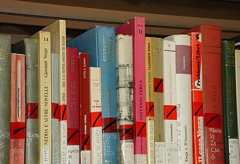
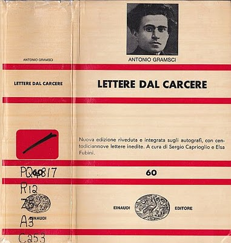
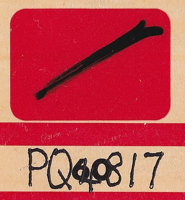
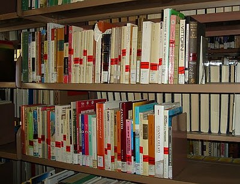

Under the somewhat deceptive title of Collection Appraisal Project, the

[library at Victoria University](http://www.victoria.ac.nz/library/index.html)proposed in 2004 to dispose of up to 130,000 titles - approximately one-fifth of its overall holdings - so that some of its space could be freed up for other functions than the storage and display of books. It was initially decided that the books that hadn't been taken out of the library for ten years or longer would be marked for inclusion on this list, and that it would be up to the academic staff and students to indicate whether any of them should be spared. Once this initial phase had been completed, some of the books would be relegated to the stacks and the balance would be de-selected, that is to say destroyed. Library staff proceeded therefore to apply red stickers onto the spines of these seldom-borrowed books, and informed us that in order to take them off the list we would have to mark the stickers with a black felt pen.

This didn't go down well, especially in the humanities. In an email circulated around the faculty under the subject line 'Barbarians at the gates', Professor Robert Easting lamented the time he had been forced to spend on his hands and knees hunting for red-stickered books. He pointed out that the already scarce holdings of the library could hardly afford to be reduced further; that the crude ten-years criterion was singularly ill-suited to establish relevance to humanists and social scientists. He described the practice of destroying books as 'barbaric'. Soon the polemic reached the newspapers and a nationally televised panel TV show, and some time later the plan was abandoned.

But the books themselves preserve its memory. To this day if you browse the library, especially on certain floors, you'll find more books with the red sticker than books without. The Italian section was hit especially hard. Whole shelves, whole centuries of our literature had been plastered with the stickers. I recall going through them at the time and marking them just as indiscriminately. Save one, save all. I don't care how long it has been since the complete works of

[Giovanni Boccaccio](http://en.wikipedia.org/wiki/Giovanni_Boccaccio)were checked out. We need them; they must be there, occupy that space, or we might as well not have an Italian department at all.

It had already been marked with a thick black forward-slash by the time I got there, but I recoiled especially at seeing Antonio Gramsci's

[Lettere dal carcere](http://search.barnesandnoble.com/Letters-From-Prison/Antonio-Gramsci/e/9780231075589)sporting a red sticker. The letters that Gramsci had penned as a political prisoner, under the constraints of censorship and the rationing of his writing privileges, and that together form an extraordinary prison memoir, yes, but also a chronicle of intellectual life during Fascism and the autobiography of one Europe's greatest political thinkers and philosophers of the last century - it seemed such an astonishing indignity for that particular book, such an offence to its history and ours, that it might even be suggested to remove it from view, let alone destroy it. It also underscored the poor intellectual effort that had gone into assessing the value of the library's collections, just when the times demanded our sharpest possible thinking on the subject of which print materials ought to be displayed, and how, and at what cost, and which titles would do better in a digital environment; how to balance the needs of current and future researchers with broader cultural considerations; how to understand the value of books as material objects, and the act of browsing them as a physical journey into a topic or the history of a country, within a set of spatial coordinates that don't always map well inside of a computer network.

\*\*\*

[Antonio Gramsci](http://en.wikipedia.org/wiki/Antonio_Gramsci)didn't die in prison, but only just. Mussolini had him arrested in 1926 along with others Parlamentarians of the opposition. At his trial, in 1928, public prosecutor Michele Isgrò famously spoke of the need to 'render that brain of his inoperative for at least twenty years'. And while his steadily deteriorating health bought him some respite from the harshest conditions of his imprisonment, and finally an early release in April of 1937, he had regained his freedom for less than a week when an aneurysm killed him. He was forty-six years old.

Far from rendering his brain inoperative, prison made a philosopher out of Gramsci. No longer able to carry out his active political duties as communist leader, he resolved from the outset to occupy as much time as he could with systematic studying and writing. Indeed in the very first letter following his arrest, addressed to the family whose apartment he was renting at the time, Gramsci asked if they could please send him some of his books and purchase for him a cheap copy of Dante's

[Divine Comedy](http://en.wikipedia.org/wiki/Divine_Comedy). (He pointed out to them that these books would have to be stripped of their covers in order to pass inspection.) At his initial internment destination, on the island of Ustica, he started a school programme with

[Amedeo Bordiga](http://en.wikipedia.org/wiki/Amadeo_Bordiga)and other political detainees. Later, in prison proper, he was involved in constant negotiations concerning which books he was allowed to receive and keep, how much stationery he was allowed to have, and how often he was allowed to write to his family and friends.

These constantly changing restrictions on his reading and writing are painstakingly documented in the letters, which are also a chronicle of how the

[Prison Notebooks](http://books.google.co.nz/books?id=Gc8edC9wPEgC&dq=%22Prison+Notebooks%22+gramsci&source=gbs_book_other_versions)came to be. Here too the posthumous title is descriptive not of a literary or philosophical subject, but of a concrete practice, of the circumstances in which the author was forced to operate: in prison, on a series of thirty-two notebooks that he had no meaningful hope of seeing published. Yet to these notebooks he entrusted his thoughts on hegemony, on the philosophy of Croce, on the role of public intellectuals, on Machiavelli, on literature. It was his intellectual legacy. Nearly three thousand pages, each paragraph seemingly composed inside his head and then written down - like the letters - already in final draft, not to waste precious paper or the time that he was allowed to spend on such activities. And once his ill health finally forced him to abandon the project, in 1935, so too from his correspondence disappeared the requests for books or periodicals, all signs of the febrile discipline that had given him a focus and a purpose for the best part of a decade and of the gestures that accompanied it. Gramsci's life was winding down, and what little energy he had left was spent writing to his family in Russia, to his two boys Delio and Giuliano, whom he had barely had time to see and who were now just old enough to be able to read his letters and respond.

Reading Gramsci's letters, more so than the Notebooks, I am reminded of Primo Levi and of his

[extraordinary compulsion to write](http://bat-bean-beam.blogspot.com/2009/11/canto-of-ulysses.html#write)while still a prisoner at Monowitz, knowing that if any of those scraps of hastily scribbled upon paper had been found on his person he would be put to death, and so they had to be immediately destroyed. Yet he wrote, as if the act alone could leave a material trace of his conscience, of his passage through that infernal machinery whose purpose it was to destroy him and every sign of his person. Gramsci too, albeit in a lesser hell, was almost physically consumed by the need to fight with the only weapon he had left the forces that wished to neutralize his intellect.

When a library wants to get rid of some of its books, it is sometimes referred to as a cull. Bear in mind that these are the same people who refer to the acquisition of digital information as ‘

[ingesting](http://www.dlib.org/dlib/december05/choudhury/12choudhury.html)’. But culls need to occur, and it may not be as inapt a word as all that. In order to make room for new acquisitions a library simply has to either physically expand or withdraw some of its holdings. It happens all the time. Of course generally they don’t ask you about it. On your next visit you might simply find that a familiar book or series has disappeared. And since frequency of borrowing is in fact one of the indicators of the relative value of the titles in a collection, checking a favourite book out from time to time may just be a smart thing to do, if you really care about it.

What made the exercise at Victoria objectionable then wasn’t the decision to get rid of some books, or the involvement of staff and students in the selection, but the ulterior aim, which was an actual reduction of the overall holdings so that other functions - primarily IT - could be expanded. By rights this move ought to have followed a discussion on what it means to have more computers and fewer books; whether or not it broadens access to key knowledge and resources; whether it leads to better research rather than just faster research. But in the clumsy way they went about it, the library administrators also created an interesting case study, in that they made visible and in fact indelible the process that leads to the elimination of books from a collection. The red sticker on the letters of Gramsci, as well as the black mark on the sticker itself, are now part of the history of that book. They broaden its meaning and contribute to its interpretation, inviting further reflection on the material circumstances in which the letters were written, and the history of their publication and ongoing reception. And when the book is threatened to be displaced due the encroaching of a new technology, those signs also remind us that before the digital humanities there was this thing called the analogue humanities, and that the transition between the two is enormously sensitive and fraught.

Antonio Gramsci. Lettere dal carcere. Edited by Sergio Caprioglio and Elsa Fubini. Turin: Einaudi, 1965.

All the photographs were taken by me at the library in April of 2010.

Readers who have come here by way of[Hacking the Academy](http://hackingtheacademy.org) might be interested in [Carl Dyke's response to this post at Dead Voles](http://deadvoles.wordpress.com/2010/05/24/nightmares-of-dead-generation/), as well as in the comments below.
