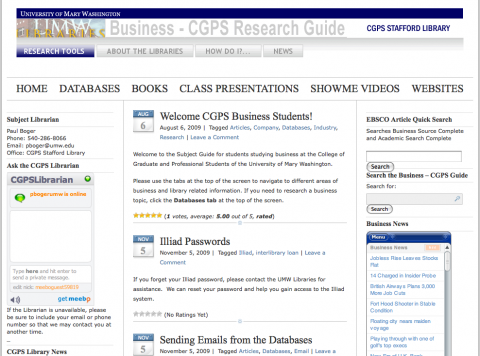

Published by [Reverend](http://bavatuesdays.com/author/admin/) November 6th, 2009					
					in [WordPress](http://bavatuesdays.com/category/wordpress/) and [wordpress multi-user](http://bavatuesdays.com/category/wordpress-multi-user/).
									
									
									 
			  
			
				
The librarians here at UMW’s Stafford Campus have been experimenting with [UMW Blogs](http://umwblogs.org) to create their own version of [LibGuides](http://www.springshare.com/libguides/index.html). Jami Bryan and Paul Boger came to me almost a year ago and showed me LibGuides (a subscription CMS for libraries using Web2.0 features) and its various [features](http://www.springshare.com/libguides/features.html)—you can see it in action at [DePauw University](http://libguides.depauw.edu/index.php).

Jami noted that most of those features could be reproduced in WordPress, so they went about creating their own LibGuides using WPMu. I would like to say I helped with the process, but usually I would get an email from Paul asking me about a particular feature, and by the time I replied—often far too late—he had figured it out.

And what Jami and Paul did is pretty amazing. You can see their WordPress hacked LibGuides 

[here](http://educationcgpslibrary.umwblogs.org/), [here](http://msmiscgpslibrary.umwblogs.org/), [here](http://businesscgpslibrary.umwblogs.org/), and [here](http://bpscgpslibrary.umwblogs.org/). And they have incorporated just about every feature LibGuides has using widgets and a few hacks, and this without the investment in the LibGuides service which ranges from $1,000-$3,000. I really love the way they themed their LibGuides knock-off with the same header as the Library site, and actually included all the class resources within their sites/blogs. Take a look at how they are using [SlideShare to share class presentations](http://businesscgpslibrary.umwblogs.org/class-presentations/), a page to share [instructional videos](http://businesscgpslibrary.umwblogs.org/show-me-videos/), a Meebo Chat widget, a Twitter widget, and a tag cloud of relevant subjects covered. And that’s just a few of the features. You can also see they have embedded an EBSCO Article quick search, as well as widgets with relevant subject news if you go to [the Business LibGuide homepage](http://businesscgpslibrary.umwblogs.org/), for example.

And don’t mistake this post as a slam on LibGuides, because I have to admit I never used this service and from what I can see from the outside it does a fine job of integrating Web 2.0 tools. That said. it’s nice to know we have the possibility to hack our own within our preferred publishing platofrm. So, kudos to Paul and Jami for pulling this off, and now if they would just blog the process we would be that much richer 

#### Related posts
