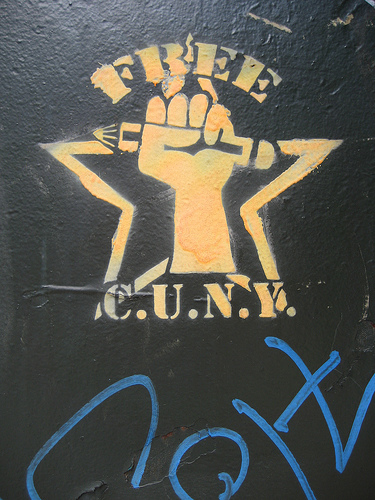

 Well, this past Friday was a real blast for me on many levels. First, I returned CUNY which was my old stomping ground for over 10 years, a place where I met some amazing people (many of whom are still there and leading the edtech charge), had way too much fun, and faced some of my most difficult years struggling with my relationship to academia. I spent a decade in the English Ph.D. program at the CUNY Graduate Center, I struggled to get to “ABD” status and even put two-and-a-half chapters of a dissertation on paper, only to officially leave the program in 2007. I’m still not entirely sure why I left the Ph.D.—and many have pointed out how stupid a choice it was—but I do know the self-doubt and eternal guilt that comes with that process had worn thin on me, not to mention the ironic fact that as a blogger and instructional technologist I was finding I was far more prolific and invested in the work I was doing than I ever had been as a Ph.D. student. It’s funny, but my training at CUNY uniquely prepared me for the work I am now doing as an instructional technologist, nonetheless when I made what was then the difficult decision to leave the Ph.D. I thought it would be one I would live to regret and beat myself up over for the rest of my life.

And I’ve been waiting for almost two years for the self-loathing and reproach to kick-in, but strangely enough it hasn’t yet. Maybe I am in denial, but more likely I think I haven’t regretted my decision for the simple fact that I love what I do as an instructional technologist, and it turns out people think I’m half-way decent at it—which is a first for me. Instructional technology is an amorphous, rapidly changing space that is more appropriate to my sloppy writing and less than precise thinking, both of which are far better suited for this personal blog than a scholarly journal. Moreover, I’ve always been better at getting people excited about what they think and do, than actually framing some intelligent and painstakingly researched theory of the world. My role as an instructional technologist allowed me to build on my teaching experience, create stuff, share my enthusiasm, and engage in a form of praxis that is rare in the academy. In short, I stumbled into a truly fascinating and relatively uncharted field within the academy that has only just begun to be imagined and explored given the remarkable moment we are living through. It’s truly a frontier field that is premised on traditional scholarship, yet divergent from it at the same time in so many simultaneously exciting and frightening ways.

But at this point in the post you might be thinking to yourself, “Hey, Ego-boy, what’s with the biography? How about some CUNY WordCampEd goodness for Christ’s sake?” Well, the two for me are so intimately tangled in my mind because returning to CUNY to talk about WordPress with a group of over 100+ CUNY faculty and technologists—all of whom  were chomping at the bit for open source alternatives—was something I couldn’t have imagined three-and-half years ago when I l eft NYC under financial and personal duress (much of which is still with me, guess some things you can’t ever escape  ) Much less, a year and a half ago when I became a Ph.D. drop-out. Being invited back to CUNY to talk about this stuff and provide a vision—however meager—for the possible future of instructional technology at CUNY might very well be the highlight of my professional career (while at the same time so deeply personal).

My excitement over this talk is not simply for the prodigal son and drop-out makes good narratives that are rolled up in all of this for me, though they are definitely there and I openly admit that. But also, and more importantly, because CUNY is such a remarkable place, and I think that is something you can only know if you have spent a certain amount of time there and labored at one, or several, of their 22 campuses and taught a tiny fraction of the over 150,000+ students from the  largest and most diverse public, urban university system in the US, and possibly the world. CUNY has all the trimmings of the “best kind of dysfunctional family/love relationship” (to quote Luke Waltzer): it’s a huge bureaucracy, it is grossly under-funded, a number of campuses are literally falling-apart, there are unforgivable disparities between those campuses that have and have-not, it’s an adjunct factory, and a starting professor’s salary can barely cover their rent. But, despite all this, *CUNY is New York City*, it is representative of the most fantastically idealistic mission of education: provide a public system that will accept and educate anyone who has the will to learn.

From community colleges, to four-year campuses, masters degrees, law degrees, and Ph.D.’s, CUNY provides a wide range of amazing programs to the inhabitants of New York City for a fee that is unbelievably affordable when compared to just about any other public institution of higher education in the nation. And for many of the students at CUNY, and a large majority of the professors who work with them, this mission is key to that relationship. It is the very nature of that compelling attraction that makes all the dysfunction and undeniably insane machinations of a system that is far too big somehow deeply intimate, personal and rewarding. What happens at CUNY is not a luxury of wealth made possible by bountiful endowments, but a fundamental belief in the idea that everyone in the world’s greatest city has the right to a college education that is both affordable and meaningful. An education for all classes of the city; a university system premised on the possibilities of any and every one, and one that is willing to forego financial and academic discrimination to attain it. Now such a mission for a campus this large is impossible to understand at the aggregate level, it can only manifest through the relationships between people, and it is precisely there that CUNY is richer than any other university system in the US—which given the nature of New York City’s population is comprised of some of the most fascinating, unique, and truly remarkable stories you could find anywhere. A truly heterogeneous and polyglot system that couldn’t be further from the archetypal image of college framed by bucolic, ivy-festooned campuses—CUNY is a bustling, non-stop engine of difference and change, a space where populations and cultures from campus to campus may be as different as they are from country to country.

And that, for me, is the promise of this past Friday’s [CUNY WordCampEd](http://blsciblogs.baruch.cuny.edu/cunywordcamped/), the personal relationships that fuel the best part of this university system brought together on a significantly smaller scale to imagine the possibilities of an open source CUNY, a CUNY that is not only re-investing in people rather than corporations to steer the future of education for this space, but a vision of imagining the technology as a way to make visible and accessible the work happening at the most diverse collection of urban campuses in the nation. A vision of open education that trumps courseware or videos or blog posts, a vision that brings 22 disparate campuses into some real communication with one another fueled by a community that believes in the irrefutable value of open, affordable, and relevant education in the 21st Century.  For all those ready and willing to open up CUNY, I salute you! We all salute you!

Image credit: [Sreed99342′s CUNY](http://www.flickr.com/photos/sreed99342/774937399/)
