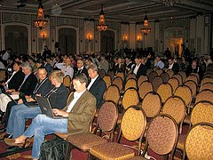

| Previous [Take a Minute to Collect Your Thoughts With Evernote](http://chronicle.com/blogPost/Take-a-Minute-to-Collect-Your/24020/) | Next [From the Archives: Get Ready for Summer](http://chronicle.com/blogPost/From-the-Archives-Get-Ready/24048/) | 

May 17, 2010, 02:00 PM ET

# Notes on Organizing an Unconference

While the term "unconference" has been applied (or self-applied) to a wide variety of events, it usually refers to a lightly organized conference in which the attendees themselves determine the schedule.  In most cases, unconferences attempt to avoid the traditional unidirectional paper model in favor of meaningful and productive conversations around democratically agreed upon topics (organized into sessions).  Unconferences traditionally have low registration fees, and therefore run on a much more conservative budget (compared to more traditional meetings or conferences).  The other thing that sets unconferences apart from traditional conferences is that they usually have far fewer attendees.  It is not uncommon for unconferences to be attended by no more than 75 to 100 people.

Despite the fact that the unconference idea got its start (and is still going very strong) in the tech sphere (at events like [BarCamp](http://barcamp.org/), FooCamp, and BloggerCon), they are becoming increasingly popular in the scholarly landscape.  This is no great surprise as many scholars are beginning to feel that traditional academic conferences and meetings are perhaps not as productive as they once were.  In addition, in today's economic climate (with many departments reducing—or even completely removing—travel funds) the financial burden (I'm mainly talking about the often very high cost of registration) of a traditional conference has made it impossible for many scholars to attend more than one or two conferences in their domain (or perhaps none at all).  Hence the often very low registration fees of an unconference makes them quite appealing.

Don't get me wrong, I'm not saying there isn't a place for traditional conferences in academia. They are important for a lot of reasons (not the least of all being part of the tenure and promotion machine). However, I think that unconferences fill an extremely important niche in the scholarly ecosystem. It is worth noting that several traditional conferences are planning on experimenting (or have already experimented) with unconference sessions—essentially, an unconference within a conference.

I was very fortunate to co-organize [Great Lakes THATCamp](http://www.greatlakesthatcamp.org/) (a regional [THATCamp](http://www.thatcamp.org/)) this past March and found it one of the most rewarding and exciting things I've ever done. As such, there were some things that I learned during the process which might prove useful to those adventurous souls who are thinking about organizing their own unconference (either as a standalone event or as part of a traditional conference)

As is customary with many of my similarly themed "here are some tips" [articles](http://chronicle.com/blogAuthor/ProfHacker/27/Ethan-Watrall/240/) on ProfHacker, these notes are hardly exhaustive. Instead, they simply represent some highlights of my experience that I feel should be passed on.

"Lightly Organized" Doesn't Mean No Organization

Just because an unconference doesn't have the organizational and logistical trappings of a traditional conference (lengthy paper submission/acceptance cycle, mind boggling schedule, detailed conference program, and complete conference abstracts) doesn't mean that a lot of work doesn't go into to making sure they are organized well. I was quite surprised by the number of colleagues (people unfamiliar with the unconference model) who, upon hearing that I was co-organizing Great Lakes THATCamp, said something akin to "well, I guess that means you don't have a lot to do." Nothing could be further from the truth. If an unconference is to be done right, it's not just a matter of getting some rooms, setting a date, and spreading the word. "Light organization" is an art unto itself. There are things that need to be organized and controlled—there is absolutely no doubt about that. However, you can't step over the line into over-organization (trying the control every little bit of the event).

Venue that Facilitates Conversation

One of the most important hallmarks of an unconference are meaningful and productive conversations—whether they take place in large groups, small groups, or between two or three attendees. As such, unconference organizers should do their best to arrange a venue that facilitates these kinds of conversations. If you can manage it, a venue with a variety of room types and sizes is great. If all you can manage are classrooms (which might be the case if your unconference is taking place on a university campus), try to to get rooms where the chairs/desks aren't bolted to the ground. This allows the attendees to reconfigure the space as they see fit. If you are able, also try to find a venue that has smaller, informal conversation spaces as well. Conference rooms are great for this. Don't discount two or three comfortable chairs (or even benches) strewn hither and yon in hallways and corners. Anywhere where people can hang out comfortably during the day and have meaningful conversations (there is that phrase again).

Remember, An Unconference Isn't About You

An unconference is as much about the participants themselves as it is about you. You might have organized the event, but it doesn't belong to you. As such, you need to make sure that, whenever possible, decisions are made by the attendees themselves. In many ways, each attendee should be seen as much of an organizer as you.

Be Flexible

This is easily the most important thing I learned when organizing Great Lakes THATCamp. Be flexible. Flexibility and fluidity is the name of the game at an unconference. Attempting to control every aspect of the event with an iron fist will probably end up in disaster. If the participants want to change the overall schedule on the fly, let them (remember, the participants are as much in charge as you are). If participants decide to change the topic of a particular session midway through, don't raise a fuss. If you need to push lunch forward so that the momentum of a particularly fruitful and exciting session can continue, do so. If the way in which you planned on building the initial schedule isn't working out, figure out a better way (and don't be afraid to ask the attendees themselves).

The Bottom Line

The subtext of all of these thoughts (in one way or another) is that you should never forget that the conversations between attendees drive an unconference. You need to do everything you can to facilitate these conversations.
