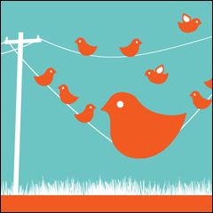

Recently (27-30 December 2009, in fact) the annual convention of the [Modern Language Association](http://www.mla.org/) took place in Philadelphia. This convention is, unless I’m mistaken, the largest annual gathering of scholars and teachers of language and literature: papers are presented, roundtable discussions are hosted, job candidates are interviewed, new books are promoted, and formal & informal gatherings take place.

One category of informal gatherings this year was the “Tweetup” — a meeting of convention attendees who happened to be using the micro-blogging social media tool [Twitter](http://www.twitter.com). (Note that you can [browse the archive](http://twapperkeeper.com/MLA09/?limit=5000) of what people have been saying on Twitter about MLA ‘09. Anything written on Twitter that includes the [hashtag](http://help.twitter.com/forums/10711/entries/49309)

#mla09

will be captured in this archive.). Tweetups are nothing new, really, just a slight variation on the tradition of the “

[meetup](http://www.google.com/search?q=define:%20meetup).” (Consider, as one example among many, the

[bloggers’ meetup](http://www.insidehighered.com/news/2004/12/30/blogger12_30)that took place at MLA 2004.) However, a significant development in academics’ use of social media took place at MLA 2009: one of the Tweetups was organized and hosted by

[Rosemary Feal](http://rll.buffalo.edu/people/faculty/profiles/feal/), the Executive Director of the Modern Language Association.

What makes this development significant is the (still, unfortunately) marginal and somewhat disreputable status of social media in academia: while some are embracing and exploring the possibilities offered by new tools of communication, others continue to view them primarily in a negative light. For someone as prominent as Feal to host a Tweetup is perhaps sign of a change in these attitudes. (You might remember that we’ve written [a thing](http://www.profhacker.com/2009/09/15/academics-and-social-media-ymmv/) or [two](http://www.profhacker.com/2009/09/29/mentoring-graduate-students-through-social-media-or-how-i-made-it-through-the-last-5-years/) about social media previously here at *ProfHacker*.)

The MLA Tweetup was covered by *Inside Higher Ed* in [a story](http://www.insidehighered.com/news/2010/01/04/tweeps) that concluded with these thoughts from Philip Lewis, vice president of the Andrew W. Mellon Foundation and professor emeritus of Romance Studies at Cornell University:

*Twitter, he said, “trivializes” the very work done by language scholars, and he doesn’t understand why some are embracing it. “I’m not sure you should feel good about that.”*

This comment prompted responses in the comments section of the *IHE* article from three people who had talked to the reporter at the event and responded to the “trivializes” comment during the Tweetup, though their comments were not included in the article. These responses gave me an idea: via [our own Twitter account](http://www.twitter.com/profhacker/), *ProfHacker* solicited answers to the following question: “How did Twitter affect (positively or negatively) your experience of #MLA09?”

What follows are the responses we received. Two of them, both of whom requested anonymity, are from the point of view of job search committee members. In the first of these, the commenter explains that he decided to recommend removing a candidate from consideration based on a “spurious” Tweet from a job candidate. At first, I hesitated to include this comment because, to my eyes, it continues the “Be afraid! Be very afraid!” attitude that [I’d like to see us leave behind](http://www.profhacker.com/2009/09/29/mentoring-graduate-students-through-social-media-or-how-i-made-it-through-the-last-5-years/#comment-1420); in the end, and after consultation with Jason, I decided to go ahead and include it since that attitude still persists among many. In the second, the commenter chose to address a different social media tool: the English Job Search Wiki. I decided to include this non-Twitter comment because the wiki is part of larger trends in using social media to answer professional needs.

The remainder of the comments come from graduate students, academic professionals, untenured faculty, tenured faculty, and — *huzzah!* — Rosemary Feal, the aforementioned Executive Director of the MLA. The comments are alphabetized by the last name of the author, and I’ve included the author’s Twitter name at the beginning of each first paragraph.

After interviews, we narrowed our pool of candidates down to six. We can only afford to bring three to campus, and it was decided that we’d wait to choose after we all returned home to review our notes and think about each candidate further. When I was going through the MLA twitter feed that night, I saw two of our candidates had posted something. I really did not like what one person had to say. The tone seemed spurious. After alerting the rest of the committee to it, he/she is now out of the running. We’re not against new media. Our committee consists of bloggers and Twitter people and all that. They were the ones who alerted me to the MLA thread on Twitter. The other candidate on Twitter sounded fine, and he/she is likely to be invited to campus. People need to think about what they say in public and how interviewers will judge those comments. I think some people grew rather excited about the Twitter feed and posted without thinking. When we have well over a hundred candidates, it comes down to minor details. Twitter will probably help some people get jobs, but it’s going to hurt some people too.

Anonymous #2
I was part of an interview team this MLA, which meant I was cooped up with my (admittedly charming) colleagues for two days interviewing candidates. Because the interview schedule prevented me from seeing many panels (except the one I was on), and also because of the need for confidentiality regarding the candidates and our selection process, social media was more or less useless to me during this MLA. (I suspect it may also be the same for candidates who are doing interviews. You simply can’t talk about it publicly until your situation is resolved.) However, one new internet phenomenon that does prove useful — for people on both the hiring and applying ends of the job market — is the [English Job Search Wiki](http://academicjobs.wikia.com/wiki/English_Literature_Jobs_AY_2010-2011). This is obviously an invaluable resource for candidates on the market, but I think it may also be pretty valuable for departments interviewing candidates. By lurking on the Wiki, departments can get a decent sense of how well your search progress is being transmitted to candidates. There is also a fair amount of candid feedback regarding different “horror stories” at particular schools, which reminds those of us who are doing interviews to always play it straight & not make the interview experience any more painful than it has to be for the candidate. Departments also get a pretty good sense of what their competition is in a given year, and even a few hints about how candidates are seeing the field overall.

In short, Wikis may not be as exciting as Twitter, but given the need for confidentiality in the job search process, they may be the most valuable social media tool for many job seekers and departments who are hiring at the MLA.

Ryan Cordell
[@ryancordell](http://www.twitter.com/ryancordell): This year I both attended MLA and interviewed for the first time. Twitter provided an instant community that grounded what could have been an overwhelming experience. From the first day I met (or, met for the first time in person) folks who knew something about the direction of my work and career, and whose work I knew something about. I felt like an old hand catching up with colleagues, rather than an unmoored junior academic. MLA aspires to be a different experience than the smaller author- or period- centered conferences I’ve most frequently attended. MLA aspires to speak to and for the profession as a whole. Unlike many academic cohorts, the Twitter crowd comprised graduate students, assistant professors, associate professors, librarians, and administrators—a snapshot, that is, of that larger profession. This online community led me into panels I’d likely have missed only a year ago, panels that spoke to issues of scholarly production and collaboration that resonate across geographic or period-based fields of literary scholarship. There’s one thing that I think the much-debated plaudits about this being the “year of the digital humanities” have just right: this crowd seems uniquely tuned to most pressing issues in literary studies today. By incorporating me into those conversations, the Twitter community helped me feel like a literary professional, rather than a novice or interloper.

[@mlaconvention](http://www.twitter.com/mlaconvention): When I set up @mlaconvention  in early fall 2009, I thought I’d use it to give information on the December 27-30 MLA convention in Philadelphia. My early tweets were mostly factual: early registration ends soon, the program is in the mail. I also included lighter fare, even chatting in LOLcatspeak– language scholar that I am. Soon people began to ask me questions on Twitter (“I didn’t get my badge”) and I decided to answer them myself rather than referring them to the appropriate MLA department. Granted, if there were dozens of questions a day, this wouldn’t work out too well! As the convention got closer, I found myself drawn into the tweetstream. Those who were planning to attend began discussing particular sessions, talking about their job interviews (or, sadly, lack thereof), and generally creating excitement around the events to come. I knew some of the people, like @kfitz, who is on the MLA Program Committee, but others were new to me. I began to feel a personal connection developing among those who were tweeting #MLA09. Once I arrived in Philly, I started tweeting the preconvention happenings on Christmas day. People responded. During the course of the convention, I managed to find time to tweet about the (precious few) sessions I attended and the MLA-related activities in which I participated. I also followed what others were saying about #MLA09. This was my eighth time at the convention in my current role, but it was the first time I felt I had an ear to the ground as well as a perch high above the city (the infamous 31st floor of the Loews where the tweetup was convened at 11 p.m. on the last night of the convention). About that tweetup: really, I just wanted to toast my tweeps and continue the conversations begun in September. The idea was to have a bit of fun, break some new ground (and maybe a few unspoken rules). I never thought it would go viral or I’d get, as one person put it, “mad props” for it. If there are any props, they go to the many members of my staff who were behind the scenes (you think I designed the logo or remembered the last day of discounted registration?). Now that I see the power of Twitter for communicating with MLA members, convention attendees, and other interested people, I will think about more ways the MLA can promote conversations that extend well beyond the walls of the cities in which we meet.

[@kfitz](http://www.twitter.com/kfitz): My suspicion is that space requirements on Inside Higher Ed — however ironic that compression might seem, given the infinite expansibility of web texts that aren’t restricted to 140 characters — resulted in the removal of several key points made in various interviews with the reporter, my own included, which tried to counter the article’s closing point about trivialization. As my colleagues Ryan and Matt pointed out in their comments on the article, none of us do all of our scholarly work in Twitter, but we do use the form to draw one another’s attention to the key arguments being made elsewhere, and are in that fashion able to keep far more up to speed with what’s going on in the field at any given moment than we ever were before.

But buried within the sense that the 140-character form trivializes our work — a complaint about condensation that might not be so far removed from faulting poetry for its failure to present extended realist narratives — is an implied concern about who it is that sees us being trivial. This is a concern that has dogged public scholarly work for eons, from those scholars who have written crossover books, to those who have written editorials for major publications, to those who have developed blogs and other online presences. Yes, Twitter is the most elliptical of these, but it’s a key form of outreach not just to our colleagues but to the broader intellectual public, and to those whom we need to support higher education. All of these public forms of writing have the potential to demonstrate what it is that we as scholars do, and why the broader culture should care about it — and until we get over our fears of talking with the broader culture, in the forms that we share with them, we’ll never manage to convince them that what we do is important.

Jason B. Jones
[@jbj](http://www.twitter.com/jbj): Watching the MLA09 twitterstream, it occurred to me that this is how to explain to graduate students what you do at big conferences.  In addition to the actual intellectual conversation, the critical mass of faculty on Twitter means that you can see what faculty do: How often people go to panels, when they go to the book exhibit, when they need downtime, whether they’re still working on papers, and more.  There’s a comfort in seeing the different ways in which faculty and graduate students inhabit the conference: There’s not just \*one\* way of participating in a conference, and so you should feel empowered to make the event as meaningful/productive for you as possible, without worrying too much about whether you’re “doing it right.”

I was on the “Links and Kinks in the Chain: Collaboration in the Digital Humanities” panel, and it struck me as funny that I couldn’t get decent 3G service from the front of the room (of course wifi was out by policy). Given the high number of Twitter users in the audience, it seemed like a logical panel for voicing some of the reactions from the backchannel, but it wasn’t possible. I definitely think the MLA should look for ways to bring the internet into sessions in a more logical way.

Matt Kirschenbaum
[@mkirschenbaum](http://twitter.com/mkirschenbaum): I’ve been on Twitter for two years, maybe a little less. I have something over 700 followers. At a conference like MLA, Twitter is an invaluable ready-made network, particularly for newbies and junior scholars for whom the convention often looms like an orbital Death Star poised to suck every ion of individuality and intellectual self-worth into its all-consuming tractor beam. Twitter, by contrast, is the Cantina in Mos Eisley spaceport. The “tweet-ups” are a great example of this: If you need a break, need a drink, or just need some time to turn off and chill out, you know when and where to go with none of the pressure and hang-ups of “Am I really invited?” “Will anyone talk to me?” Nothing in an institutionalized world is ever purely democratic or transparent of course, but I think it’s fair to say that academic rank and status are markedly less important than if, say, you try sidling up to someone at the New Literary History cash bar. Most of all what I think Twitter does at a conference like MLA is create a common narrative; or better, it’s a kind of \*communal\* narrative to which all can write simply by virtue of opening an account and invoking the #hashtag. ReTweets and Replies define the plot and tempo. The narrative is not complete or comprehensive of course, but that’s not the point. Narratives are enabling precisely because they are partial representations. Who knows this better than literature scholars?

[@jcmeloni](http://twitter.com/jcmeloni): I’ve written before about [the impact of social media on my time as a grad student](http://www.profhacker.com/2009/09/29/mentoring-graduate-students-through-social-media-or-how-i-made-it-through-the-last-5-years/), and I went to #mla09 with the expectation that a good chunk of my social network would magically appear before my eyes (like an [augmented reality browser](http://www.readwriteweb.com/archives/new_version_of_layar_makes_augmented_reality_socia.php) “that adds social features to the act of looking at data on top of the world around you”) and we would carry on like friends and colleagues in what would otherwise by a sometimes dull, sometimes overwhelming, sometimes lonely experience (7500 people rushing around you to job interviews, conference sessions, and other networking opportunities when you’re just relaxing with your coffee).  That’s essentially what happened. Using Twitter, I discovered one morning that [@kfitz](http://twitter.com/kfitz) was sitting approximately 30 feet from me, and I walked over and we chatted up a storm about social media, the conference, and the future of digital scholarship. Never met her before.  Using Twitter, I was able to broadcast information about something I heard in a session, that resulted in the subject of that information (an author) [reading that tweet and wanting to know more](http://www.academicsandbox.com/blog/?p=336) about what was being said. Because of the network I created for myself on Twitter, I was able to sit in a packed conference room, listening to a panel full of people I already knew (in a virtual space, who later became people I knew in meatspace) talk to a room full of people I already knew, about [issues](http://nowviskie.org/2009/monopolies-of-invention/) I understood were directly affecting *those real people*. Twitter made my conference experience much more **real**.

[@nowviskie](http://www.twitter.com/nowviskie): “Twitter as Scholarly Communication?” I’ve found myself reflecting on Twitter use at this winter’s MLA through the lens of — what was for me — the year’s 140-character conference highs and lows.

*The only twit in Tucson:* In a coffee break during an [SCI-sponsored](http://uvasci.org) meeting of humanities center directors from [centerNet](http://digitalhumanities.org/centernet/) and [CHCI](http://chcinetwork.org/), I posted a query to my Twitter contacts.  It was something on the order of, “if you had a dozen of the most influential humanities & digital humanities center directors in the room right now, what would you ask or tell them?” Ten minutes later I shared the fascinating results. This was January of 2009, and Twitter penetration in that distinguished group was fairly low. I recall how shocked and delighted some of these center directors were at the immediacy and high quality of the response — especially those who had been talking about strategies for “the public humanities.”

*What I did on my summer vacation:* At [Digital Humanities](http://www.mith2.umd.edu/dh09/), the DH crowd is surprised (to be surprised) that a well-networked colleague like [@sramsay](http://twitter.com/sramsay) can make as powerful a remote intervention in formal panel Q&As as if he were present. Some good discussion happens about the degree to which side conversations on Twitter enrich or distract and muddy our conference chatter.  There’s none of that sense — either (thankfully) of surprise or (perhaps worryingly) of analytical engagement with the medium itself — a few days later at [THATcamp](http://thatcamp.org/), where it’s all about the cacophony and the crowd.

*SCI in Charlottesville:* A day after *that*, several people who had been at DH and THATcamp trucked down to Charlottesville, where the [Scholars’ Lab](http://lib.virginia.edu/scholarslab) hosted an invitation-only [SCI gathering](http://www.uvasci.org/current-institute/) on spatial tools and methods.  Twitter bombed at SCI. Only a small number of us were tweeting (with, I think, excellent intentions about broadcasting ideas to a wider group of interested interlocutors) but there was a level of consternation at what might be shared — and to whom we might be speaking, unbeknownst to the other attendees. We therefore took a page from THATcamp, and splayed the [#sci7 tweets](http://twapperkeeper.com/sci7/?limit=1000) all over the wall in the conference room… which made things much worse, effectively killing both sides of the conversation, as the Twitterati grew bashful and the rest of the group failed to find purchase in a multimodal conversation. I learned later that Twitter had badly disrupted SCI’s traditional “kitchen cabinet” feel.

*#mla09:* I’ll write less about Twitter at MLA itself, because I know my colleagues will adequately cover the [pathos](http://chronicle.com/article/Missing-in-Action-at-the-MLA-/63276/) and [bathos](http://www.samplereality.com/2010/01/02/tips-for-the-modern-language-association/).  And the conversation [continues](http://twapperkeeper.com/MLA09/?limit=5000)! But I will say that Twitter buzz from a talk I gave — at a panel I expected to be sparsely attended and, frankly, inconsequential like many at professional society gatherings — happily drove me to [put my text online](http://nowviskie.org/2009/monopolies-of-invention/) and to pay the piper when I got back home, speeding up some work I had been fostering, perhaps too slowly, in my administrative role. Even a [small mention](http://chronicle.com/article/The-MLA-Convention-in/63379/) in the *Chronicle*, by a reporter who admits she “caught more of the proceedings via Twitter than she could by ear,” can be the nudge one needs.

The year’s lesson in twittering at conferences, for me, is that context is all. We’re still figuring out how media that are at once synchronous and asynchronous, and audiences that are at once present and absent, fit into our comfortable conference-going habits. But, to paraphrase [a critic](http://www.insidehighered.com/news/2010/01/04/tweeps), we are (as usual) learning as we write, and “I’m sure you should feel good about that.”

[@samplereality](http://www.twitter.com/samplereality): I could pick any number of sophisticated ways to talk about Twitter’s impact upon my experience at the MLA–invoking Benedict Anderson’s “imagined communities,” or Howard Rheingold’s “virtual community,” or Jean Lave and Etienne Wenger’s [communities of practice](http://www.ewenger.com/theory/index.htm)–but all I really have to say is this: it was damn fun. Perhaps my perspective is skewed. After all, I’m the person most of the MLA twitterati associate with the [satirical tips](http://www.samplereality.com/2010/01/02/tips-for-the-modern-language-association/) for convention attendees and prospective job candidates. I’d argue the function of these tips was far from trivial though. It was a community-building effort, aided by digital humanists like [Amanda French](http://twitter.com/amandafrench), [Brian Croxall](http://twitter.com/briancroxall), [Dave Parry](http://twitter.com/academicdave), and many other contributors. And it gave the followers of the [#MLA09](http://twitter.com/search?q=%23MLA09) hashtag a sense of the conference before it even began. I don’t know a better way to generate enthusiasm and raise the spirits of so-called “demoralized” professors and graduate students than making fun of things–and of ourselves.

And oh, there was that whole conference backchannel thing, which was really cool too, except when I got [shushed for tweeting](http://twitter.com/samplereality/status/7133052347) about a panel when I should have been staring slack-jawed and face-forward toward the front of the room.

[@eetempleton](http://www.twitter.com/eetempleton): I started tweeting just a few months ago, so I’m still relatively new to the Twitter scene, but MLA09 was my fifth MLA.  At first, I attended because of the job market, and more recently I’ve gone to participate in panels and to attend the annual meeting of the William Carlos Williams Society (I’m an officer).  I have always enjoyed the convention (even that first year when I struck out on the job market) because I like having the opportunity to reconnect with friends and colleagues from other campuses.  But this time around, Twitter added an entirely different dimension to my convention experience.  Reading the conference back channel made the convention seem somehow more familiar, and I felt connected in ways that I hadn’t previously.  Often I found it a great source of amusement or a helpful source of information–sometimes both at the same time.  There were also moments when I felt like I was eavesdropping on someone else’s conversation or on the outside of an inside joke, but that’s the nature of the medium.  I often found myself making observations on the conference back channel in part to share what I was thinking or something funny that I had witnessed, and in part to record those thoughts for myself as well as for anyone else who might be reading them.  I only attended the final tweetup of the conference—I had other obligations for the others, save for the first one, which found me still on the train to Philly—and it was a really positive experience.  Not only did I get to enjoy Rosemary Feal’s hospitality, but at one point I found myself getting introduced to the President of the MLA, Catherine Porter. At another, I was able to meet some of the scholars and academics I’d been following for some time already.  It was great to put names to faces, or human beings to avatars and usernames.  All in all, it was great fun.

[@janineutell](http://www.twitter.com/jdrouin): The confluence of two significant events in our social media world—David Carr’s ([@carr2n](http://www.twitter.com/carr2n)) much-tweeted [article from this past Sunday’s *NYT*](http://www.nytimes.com/2010/01/03/weekinreview/03carr.html) on why Twitter will endure and the presence, however limited, of Twitter at the MLA—has led me to think about the role this form of networking plays in my professional life.  I am a scholar and teacher of 20th century British literature, primarily modernism.  Twitter allows me to follow people who may seem tangential to that primary interest, but who actually give me access to major shifts and trends that, if they are not impacting my work today, will be in the short or long term.  So I follow people in the digital humanities; student affairs, faculty development, and higher ed policy types; writing teachers; publishers.  Yet what following #MLA09 on Twitter revealed to me was both how connected I felt to my profession and how much I was missing the contributions of people in my specific field of interest.  There was a silence, a whistling void where there should have been voices:  where were the literature folks, people doing research, giving and listening to papers in my area?  Where are my fellow modernists, commenting on what we were all learning at the convention?  Maybe some Victorianists?  Even a long 18th-century person or two?  Of course the dominance of the digital humanities is an important force, and their work should be recognized (although, as a good number noted, that story has been going on for quite a while).  But I would also like to see the thinking and writing of scholars in other fields where vital work is being done, the brainstorming, the trials and tribulations of creating that new project that may change the face of 20th-century studies.  This may be selfish on my part, but I do think a major opportunity to share knowledge and ideas, to join a profession-wide conversation beyond the tables and chairs of meeting rooms, was lost at MLA.  I follow some great people in my field:  [@jdrouin](http://www.twitter.com/jdrouin), [@eetempleton](http://www.twitter.com/eetempleton), [@cforster](http://www.twitter.com/cforster), [@Obridge](http://www.twitter.com/Obridge), [@triproftri](http://www.twitter.com/triproftri), [@annecmccarthy](http://www.twitter.com/annecmccarthy), [@LaurenElkin](http://www.twitter.com/LaurenElkin).  But I fear more prevalent are not the comments of the lucky tweeps quoted in the recent IHE article about the ubertweetup, those who got to hang with Rosemary Feal, but the gentleman quoted at the end of that article who sees Twitter as trivializing what we do, not sharing but shallow-making.  The presence of Twitter at the MLA shows that this has the potential to be a quick-moving and vital profession, that we have the capacity to remake our landscape:  it would be a shame if some were left behind.  (But if you’re out there and I haven’t found you, let me know at [@janineutell](http://www.twitter.com/jdrouin)!)

I could say a great deal about the sociality of this year’s MLA and the role Twitter (and other social networking tools) played in it — about the spontaneously organized get-togethers, the backchannel conversations, and the excellent camaraderie among the Twitter-users, including quite a few digital humanists I’ve been following for quite a while online and finally got to meet in person. But I suspect my fellow contributors to this post will have a lot to say on the same point, so instead I’m going to focus on just one tweet, by Kari Kraus of the University of Maryland, posted soon after *Inside Higher Ed* covered one of the MLA “tweetups”:

In part Twitter serves same function as the manicule in Renaissance books: it says, “look, this is interesting!” http://bit.ly/5dyCT5 #mla09 ([Kari Kraus](http://twitter.com/karikraus), January 4, 2009, 11:45 AM)

By an odd coincidence, or maybe not really so odd, I’d stopped at the MLA book exhibit to buy a copy of William Sherman’s *[Used Books: Marking Readers in Renaissance England](http://www.amazon.com/exec/obidos/ASIN/0812220846/profhacker-20)*, the book Kari Kraus mentions in her tweet. Sherman has an entire chapter on the history of the manicule, the pointing-hand symbol (☞ or ☜) that both readers and printers placed in the margins of books to mark noteworthy passages.\* The tweet as manicule is perhaps my favorite metaphor yet for what Twitter does — particularly in the light of Sherman’s discussion of the individuality of early modern readers’ hand-drawn manicules:

Aside from the rich set of associations these hands brought with them…, they were also recognizable as their \[readers'\] marks and must have played an important role in the personal process of making a book meaningful. (William Sherman, *Used Books: Marking Readers in Renaissance England* \[Philadelphia: University of Pennsylvania Press, 2008\], 52.)

The mark that points to something interesting (look at this!) also marks out a reader’s distinct patterns of annotation and meaning-making — which is pretty much what we all do when we filter the web for interesting stuff, or follow other people because they filter interesting stuff. My interests lie both in digital humanities and in the history of the book, and I attended some excellent MLA panels in both areas. For me, it’s immensely satisfying to connect the medieval and early modern history of reading with the digitally mediated present and future of reading. And I especially like the linkage between the “printer’s fist” and the various touch-screen devices most of us were using to converse, annotate, highlight, point, and make new meanings of our own.

An earlier version of Sherman’s chapter, from 2005, can be [found online](http://www.livesandletters.ac.uk/papers/FOR_2005_04_002.html).

[@wpwend42](http://www.twitter.com/wpwend42): I came of age in the mid 1990’s in the hardcore/punk DIY community. We did our own gigs, fanzines, record labels, and bands. Much like the ill-informed media coverage of Straight Edge, veganism, and the underground community in general during that time, the mainstream media never seems to “get” alternative ideas or tools like Twitter until they can find some sort of use for it. For me, Twitter is the means that I use to keep in touch with my community in academia. That community is the Digital Humanities. When the mainstream doesn’t cover us correctly, or at all, a hashtag like #mla09 allows digital humanists to participate in a conference in terms that work for us. I used #mla09 to prep my trip, make plans with friends from other continents, and discuss what is/was happening as the conference went on. Personally, I have a lot of problems with how the Digital Humanities are covered in the mainstream education media. #mla09 allows digital humanists a chance to discuss their work and philisophical concerns, highlighting and emphasizing what is important and interesting (for example, the coverage of Brian Croxall’s essay that took off from Twitter). By filtering coverage through a hashtag on Twitter, I could participate in the conference, while there and on days I did not attend, in ways I am comfortable with and accentuate the digital humanities.

What was your experience with Twitter at the MLA 2010? Alternately, what has been your experience with Twitter (positive or negative) at conferences?
