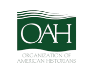
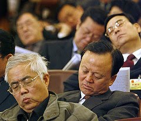

So I was looking at the Organization of American Historians new 

[2009 Draft Strategic Plan](http://www.oah.org/strategic/sp09draft-final.html) and their request for member comments. The OAH is suffering the fate of many professional organizations--an aging and declining membership, fewer subscribers for its journal, less interest in its annual conference. I was typing out a long email response when it hit me: I have a blog.

I have only occasionally been a member of the OAH, usually when I go to the annual conference to present or to listen. I respect the organization, but it has never seemed very relevant to me. The articles in the [Journal of American History](http://www.journalofamericanhistory.org/) tend to be narrow and densely written--which is fine when they publish something in one of my subfields, but of course this doesn't happen very often. The OAH conference consists largely of people in suits reading fledgling JAH articles out loud. I have drawn on the valuable OAH Speakers Bureau when designing a Teaching American History grant, and I do like the [Magazine of History](http://www.oah.org/pubs/magazine/) that they began putting out a few years ago. I always thought the OAH should be more of an advocacy organization for funding for history programs but they [don't seem to do much](http://northwesthistory.blogspot.com/2009/02/scanner-ready.html) (correct me [if I am wrong](http://northwesthistory.blogspot.com/2009/05/no-stimulus-for-you.html)). So I have supported the OAH intermittently, sometimes feeling guilty for not doing more. Anyway, here is my plan:

1. Drop the print journal. The declining readership of the JAH is not a reason to "continue and further develop" that journal. There is simply a declining public and even professional interest in this sort of scholarship. Eliminate the print edition entirely and make it a digital publication to save money (à la [the University of Michigan Press](http://northwesthistory.blogspot.com/2009/05/death-of-scholarly-publishing.html)). The Magazine of History on the other hand is pretty good and should continue.

2. Reboot the conference. The conference needs an overhaul! 3 panelists + 1 commenter + passive audience = snooze fest. (The accompanying picture is of the audience at my last OAH presentation.)  Some changes:
Ban the reading of papers and shorten presenters time

3. One blog to rule them all. Establish a year-round OAH community blog and discussion forum. Community blog means that any member of the OAH can create a post! Have some loose guidelines (no advocacy except for historical advocacy, no pictures of your cats) and name some moderators (and yes I am volunteering). The H-NET lists are largely moribund and online historical discussion has been atomized across a hundred different forums. The OAH can bring some of it together and gain scholarly energy and relevance. The closest model for what I have in mind is  to ten minutes.    One-half of each session should be dedicated to discussion with the audience.    Ask presenters to summarize their evidence and arguments on a conference blog in advance of the conference. Allow others to comment and engage the presenters.    Ditch the roundtables, which are actually even more of a snooze than the traditional panels because no one prepares anything new to say. The majority of roundtables come off as the most forced and awkward imaginable sort of cocktail party conversation.

Free wireless throughout the session, and encourage use of a Twitter hash tag to open another channel for conversations. This is important.

In short, make the conference a bit [more like THATCamp](http://northwesthistory.blogspot.com/2009/06/what-happens-at-thatcamp.html). Try including some "unconference" sessions at the 2010 meeting.[the general interest community blog MetaFilter](http://www.metafilter.com/), except limited to historians and requiring users to post under their real names.

(BTW, Katrina Gulliver and I have been discussion this at considerable length, mostly via email but [here is a post where she elaborates on some of the ideas](http://www.katrinagulliver.com/2009/07/history-metablog.html).)

4. Build up from the grassroots. Encourage smaller regional informal gatherings--OAH Pizza, Beer and History nights, OAH historical tours, the OAH History Book Discussion groups, etc. These could draw in school teachers, folks who majored in history in college but work outside the profession, and others.

5. A lifeline to independent scholars. Offer a home to independent scholars and public historians. And by a home, I mean access to the scholarly databases that are the 21st century life blood of our profession. Academic discussion boards are full of [plaintive pleas](http://www.google.com/search?hl=en&rlz=1B3GGGL_enUS309US310&q=%22how+can+i+get+access+to+jstor%3F%22&aq=f&oq=&aqi=) from unaffiliated historians who lost access to these resources when they left graduate school and whose scholarship is hamstrung because of the fact. Work out a deal with JSTOR and MUSE and the Evans Collection and Footnote.com to give OAH members access as part of their paid memberships. (I see that the American Economic Association [is already on it](http://www.aeaweb.org/e-pubs/jstor.php), at least with JSTOR--why not the OAH?)

6. Get on the grants train. The OAH should try to offer it services as a partner in more grant activities--especially the [Teaching American History Grants](http://www.ed.gov/programs/teachinghistory/index.html). And industry of history content providers has arisen in response to the more than $800 million that the Department of Education has pumped into this program so far. Some of these content providers are frankly shady shallow commercial outfits with marginal qualifications. (Must...not...name...names...) Why isn't the OAH getting on board? Its expertise is sorely needed, and could be generously rewarded.

The OAH was founded in the early 20th Century on a 19th Century model. Can it make the leap into the modern era? Can any of or professional organizations?

## Wednesday, September 16, 2009

### [More Cowbell: My Plan to Revive the OAH](http://northwesthistory.blogspot.com/2009/09/my-plan-to-revive-oah.html)

Posted by
Larry Cebula
at
[4:38 PM](http://northwesthistory.blogspot.com/2009/09/my-plan-to-revive-oah.html)
 

Labels:
[blogs](http://northwesthistory.blogspot.com/search/label/blogs),
[conferences](http://northwesthistory.blogspot.com/search/label/conferences),
[oah](http://northwesthistory.blogspot.com/search/label/oah)

Subscribe to:
[Post Comments (Atom)](http://northwesthistory.blogspot.com/feeds/1781908619199020220/comments/default)
