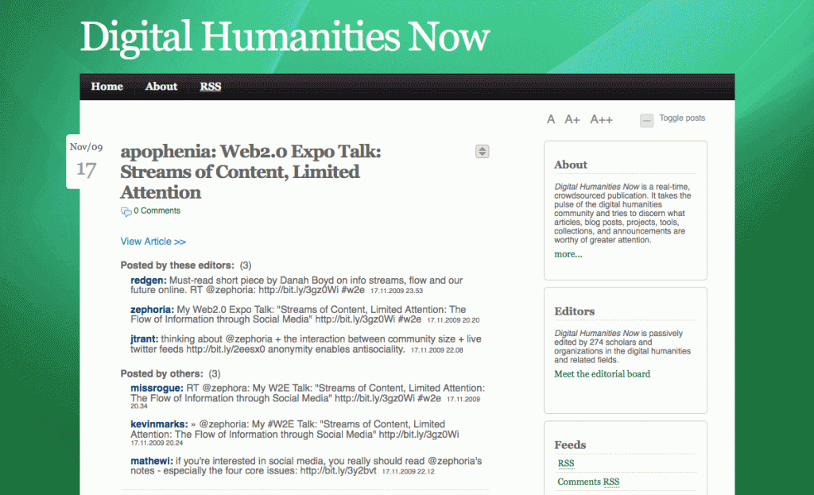

## [Introducing Digital Humanities Now](http://www.dancohen.org/2009/11/18/introducing-digital-humanities-now/)

Do the digital humanities need journals? Although I’m very supportive of the new journals that have launched in the last year, and although I plan to write for them from time to time, there’s something discordant about a nascent field—one so steeped in new technology and new methods of scholarly communication—adopting a format that is struggling in the face of digital media.

I often say to non-digital humanists that every Friday at 5 I know all of the most important books, articles, projects, and news of the week—without the benefit of a journal, a newsletter, or indeed any kind of formal publication by a scholarly society. I pick up this knowledge by osmosis from the people I follow online.

I subscribe to the blogs of everyone working centrally or tangentially to digital humanities. As I [have argued](http://www.dancohen.org/2008/12/05/leave-the-blogging-to-us/) from [the start](http://www.dancohen.org/2005/12/16/creating-a-blog-from-scratch-part-1-what-is-a-blog-anyway/), and against the skeptics and traditionalists who thinks blogs can only be narcissistic, half-baked diaries, these outlets are just publishing platforms by another name, and in my area there are an incredible number of substantive ones.

More recently, social media such as [Twitter](http://twitter.com) has provided a surprisingly good set of pointers toward worthy materials I should be reading or exploring. (And as happened with blogs five years ago, the critics are now dismissing Twitter as unscholarly, missing the filtering function it somehow generates among so many unfiltered tweets.) I follow as many digital humanists as I can on Twitter, and created [a comprehensive list of people in digital humanities](http://twitter.com/dancohen/digitalhumanities/members). (You can follow me [@dancohen](http://twitter.com/dancohen).)

For a while I’ve been trying to figure out a way to show this distilled “Friday at 5″ view of digital humanities to those new to the field, or those who don’t have time to read many blogs or tweets. This week I saw a tweet from Tom Scheinfeldt ([blog](http://foundhistory.org)|[Twitter](http://twitter.com/foundhistory)) (who in turn saw a tweet from [James Neal](http://twitter.com/james3neal)) about a new service called [Twittertim.es](http://twittertim.es), which creates a real-time publication consisting of articles highlighted by people you follow on Twitter. I had a thought: what if I combined the activities of several hundred digital humanities scholars with Twittertim.es?

[*Digital Humanities Now*](http://digitalhumanitiesnow.org) is a new web publication that is the experimental result of this thought. It aggregates thousands of tweets and the hundreds of articles and projects those tweets point to, and boils everything down to the most-discussed items, with commentary from Twitter. A slightly longer discussion of how the publication was created can be found on [the *DHN* “About” page](http://digitalhumanitiesnow.org/about/).

Does the process behind *DHN* work? From the early returns, the algorithms have done fairly well, putting on the front page articles on grading in a digital age, bringing high-speed networking to liberal arts colleges, Google’s law archive search, and (appropriately enough) a talk on how to deal with streams of content given limited attention. Perhaps *Digital Humanities Now* will show a need for the light touch of a discerning editor. This could certainly be added on top of the [raw feed of all interest items](http://twittertim.es/dhnow/rss.xml) (about 50 a day, out of which only 2 or 3 make it into *DHN*), but I like the automated simplicity of *DHN* 1.0.

Despite what I’m sure will be some early hiccups, my gut is that some version of this idea could serve as a rather decent new form of publication that focuses the attention of those in a particular field on important new developments and scholarly products. I’m not holding my breath that someday scholars will put an appearance in *DHN* on their CVs. But as I recently told an audience of executive directors of scholarly societies at an American Council of Learned Societies meeting, if you don’t do something like this, someone else will.

I suppose *DHN* is a prod to them and others to think about new forms of scholarly validation and attention, beyond the journal. Ultimately, journals will need the digital humanities more than we need them.
