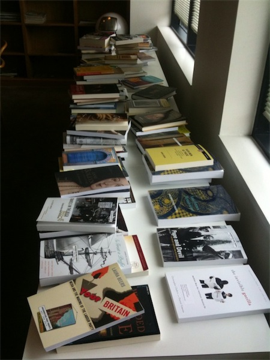

*The following is a summary of my talk, or more accurately, the short written version of my talk, “Burn the Boats,” which I gave a little over a month ago at the [DWRL in Austin](http://www.cwrl.utexas.edu/). You can read the post, or skip to the end and watch the videos (which last about 40 minutes) and give the longer form of the argument.*

Earlier this year [Marc Andreesen was interviewed by TechCrunch](http://techcrunch.com/2010/03/06/andreessen-media-burn-boats/) on the future of publishing,in particular journalism. Andreesen’s response was, provocatively, “Burn the Boats.” What he was referring to was the moment Cortez, fleeing from Cuba, and landing in Mexico, ordered his troops to “burn the boats,” preventing any possibility of return. The lesson: don’t defend lost ground, at times there is no going back, and making decisions to insure that one does not consider a return is a good move. Andreesen’s point was that old print based media forms are dead, and it does no good to try and re-envision them for the 21st century, rather journalism institutions need to boldly move to future web based models, giving up on their print based biases.

In a similar regard I would like to suggest that academics “Burn Their Boats” or in this case, more specifically “Burn the Books,” making a definitive move to embrace new modes of scholarships enabled by web based communication, rather than attempting to port old models into the new register. Rather than providing the book with a digital facelift for 21st century scholarly communications, academics should move past book based biases which structure scholarly communications and instead imagine and execute born digital scholarly forms, which leverage the evolving digital media landscape.

Let me be clear, I like books, in fact it was my love of books, or more specifically my investment in what books can accomplish that led me to graduate school. My PhD is in English after all. Indeed I collect book, and although I don’t do it much anymore I have at times spent time tracking down and acquiring first editions for some of my favorite works. I am not in fact suggesting that we actually engage in book burning, nothing of the sort, although if I did actually burn some of my books I think it would make moving easier. Instead I am suggesting that we burn our love affair with books, and that out of reverence to the book, we stop treating it as the only or indeed primary means of scholarly communication. Not only are there better ways, but if academia wants to remain (or more skeptically, become) relevant we ought to recognize that the book is no longer the main mode of knowledge transmission.

Faced with the transformation to the digital, the newspaper industry chose to protect a business model, instead of preserving their social function. My fear is that academics are making the same mistake. Now granted this analogy is not perfect, there are contours and shapes, and nuance and details that matters here. They are not a direct equivalence, but I think the underlying logic is the same. It concerns me that academics and intellectuals, with some exceptions, seem to be repeating this mistake, following the digital facelift model, asking how they can continue to do what they do now, but do it in the digital space, ***rather than asking how what they do has been fundamentally changed in the age of the digital networked*** archive. Administrators have a tendency to preserve the business function (how can we offer our classes online vs. how does the online reshape the very idea of a class), and academics end up defending the political and ideological function (the importance of books and peer review).

It is probably worth distinguishing here between the materiality of the book, and the ideologies and biases we associate with the book. That is at the most basic level a book is a dead tree processed and bound together in leaves of paper and stained with ink. But, many of the things that we have come to associate with the book are not in fact coterminous with its material structure but rather biases developed over the Gutenberg Parenthesis. I won’t fully develop this idea here but this is what I often call *librocentricism*, or a book biased way of thinking, where the book stands in for certain prejudices and ideas about knowledge. As a way of thinking about this notice how the word book often stands in for, or comes to mean, the entirety of the matter, as in The Book of Nature, to “throw the book at someone,” or The Book of Love. Again there is a lot more to this idea, and I would no doubt need more than a blog post to develop this, but I think it is easy to recognize, even if the full complexity of the argument would take time, that “book” comes to be an epistemological framework for knowledge, not just a material one.

One quick example of how this works, before I move to some ideas for restructuring scholarship: syllabi. A syllabus is often structured like a book, a beginning, a middle and an end, indeed even with chapters (sections), where the traversal (completion of the weeks or reading of all the pages), promises to deliver the knowledge product.

The idea that knowledge is a product, which can be delivered in an analog vehicle is precisely what I want to call into question. What the network shows us, is that many of our views of information were/are based on librocentric biases. If you printed out all the information on the net, roughly 500 billion GB it would stack from [here to Pluto 10 times](http://www.guardian.co.uk/business/2009/may/18/digital-content-expansion). While the book treats information as something scarce, the net shows us precisely the opposite, information is anything but scarce. Books tell us that one learns by acquiring information, something which is purchased and traded as a commodity, consumed and mastered, but the net shows us that knowledge is actually about navigating, creating, participating (to be sure some people still trade in knowledge, buying and selling secrets, but this is of a substantially different order than the work we as academics do, especially humanities based academics).

Knowledge is no longer print based, nor governed by the substrate of paper, indeed while in many ways we might continue to harbor librocentric biases, as we move away from structuring knowledge to end up on paper, these framing structures will prove less and less necessary, indeed may actually impede on our ability to participate in knowledge conversations.

I am not saying that we should whole sale give up on books, actually perform a book burning freeing ourselves from all of the pages we have in our respective offices, but rather something slightly different, we should start conceiving of our scholarship as if if will not end up in books, indeed it still might, **but begin by asking ourselves what would scholarship look like if were not designed to end up in books.**

Here are some ideas, or suggestions for this change over:

- **Stop Publishing in Closed Systems**: If I can only convince you of one thing, I hope it will be this. If you publish in a journal which charges for access, you are not published, you are private-ed. To publish means to make public, if something is locked down behind a firewall where someone needs a subscription to view it, it is not part of the “common knowledge” base and thus might as well not exist. Academic journals are treating knowledge as if it is a scarce commodity, it is not, don’t let them treat it as such. If someone wants to publish something you wrote, ask them if you can [keep the copyrigh](http://www.arl.org/sparc/)t, license under [creative commons,](http://creativecommons.org/) and if they say no, don’t give it to them, and find someone who will. Look for journals which publish only online and only for free.
- **Self Publish:** Publishing and editing are hacks based on the scarcity of paper, no need to carry it over to the new medium. Once publishing was the most efficient way to reach the largest audience, no longer is that the case, so lets get over our publishing fetish. Publishing online allows you to engage a wider audience, both faster and more efficiently than any print based journal. We think of an academics role as presenting polished finished work and ideas, but this need not be the case. We should switch to presenting our ideas in process, showing our work, not just the final product.
- **End the .pdf madness**: A .pdf document is not a web based document, it is a print based document distributed on the web. One of the principle advantages of the web is the way it connects, operates as a network of connections within an ecosystem of knowledge, one can search, copy, paste, edit, link with ease, none of which is true of a .pdf. The .pdf is just a way of maintaining print based aesthetics and structures on the web. In the same way you wouldn’t think of publishing a book without the appropriate footnotes, don’t publish to the web without the appropriate live links.
- **Get Over Peer Review:** Peer Review is another hack based on the scarcity of paper. Given the cost of producing knowledge and the fact that academic journals or academic presses could only afford to produce so many pages with each journal, peers are established to vet, and signal that a particular piece is credible and more worthy than the others. This is the filter than publish model. But the net actually works in reverse, publish then filter, involving a wider range of people in the discursive production. Some of the most productive feedback I receive on my work comes not from peers who have a rather narrow sense of what counts and what doesn’t but from a wider range of people, with a diverse perspective. Why do academics argue for small panel anonymous peer review? One thing we know is diversity of perspective enriches discourse. 
- **Aspire to Be a Curator:** I think we have to give up being authorities, controlling our discourse, seeing ourselves as experts who poses bodies of knowledge over which we have mastery. Instead I think we have to start thinking of what we do as participating in a conversation, and ongoing process of knowledge formation. What if we thought of academics as curators, or janitors, people who keep things up to date, clean, host, point, aggregate knowledge rather than just those who are responsible for producing new stuff. Do we really need another book arguing that throughout the history of literary scholarship the important field of ‘x’ has long been ignored. No. But, we could actually use some really good online resources and aggregators for particular knowledge areas.
- **Think Beyond the Book**: Think of the book as one form, not the form. Indeed think of things that move beyond the book. What if you are writing didn’t have to be stable, didn’t have to have a final version, what if you could constantly update, change alter, make available your work. There will be no final copy, just the most recent version. While the constantly in beta mode might concern those who aim for perfection, it can also be liberating when you realize that nothing is fixed, taking advantage of the fluid. What happens when we give up on, or at least refuse to be limited by librocentricism? What if a piece didn’t have to be 20 pages for a journal article or 250 for a book, there are economic constraints that place limits on the size of academic writing, how much better can we be when we get rid of these. Or what would an academic argument as an iPhone app look like?

Let me be clear, I am not saying that the book is dead, in one regard it is already dead, in another it continues to haunt us and will never die. And we should be glad for this haunting there are many features of the book from which we benefit. What I am saying though is the centrality of the book is gone, and academia would do well to recognize this, to move into new directions, new grounds, where many already are. We should not continue to constrain our thinking by this librocentricism which no longer structures or limits the way that knowledge is produced, archived, or disseminated.

(P.S. Below is a photo I took at my visit to *The Chronicle* last week. Apparently these are all the books they received from academic publishers in the last week (that’s right just one week), which nobody wanted. In other words at an academic institution like *The Chronicle*, not one reader could be found for any of these books. They were giving them away for free. Seriously, we should stop this madness. Won’t somebody please think of the trees?)

(*Below is the full video where I elaborate on the points/ideas above*.)

[Burn the Boats/Books, part 1](http://vimeo.com/11349068) from [DWRL](http://vimeo.com/dwrl) on [Vimeo](http://vimeo.com).

[Burn the Boats/Books, part 2](http://vimeo.com/11359514) from [DWRL](http://vimeo.com/dwrl) on [Vimeo](http://vimeo.com).
