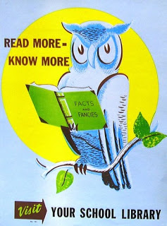

*This is the first in an occasional series of posts where I will share some of my teaching materials. This particular post began when I answered a question on Ask Metafilter. These tips are designed for graduate students reading academic monographs--use at your own risk. Googling the phrase "How to read a book in one hour" produces[this](http://savageminds.org/2007/10/01/how-to-read-a-good-book-in-one-hour/) and [this](http://www.owningwordsforliteracy.com/vconsole/106.htm) page as well.*

**How to Read a Book in One Hour**

"How do I keep up with the reading?" This is perhaps the most frequent question I get from overwhelmed history graduate students. And no wonder. A graduate history course typically has 500 or more assigned pages a week, and a full slate of courses can quickly push your weekly reading assignments into the thousands of pages. How is it possible to read that much?

Those who survive graduate school learn along the way that it is necessary to change the way you read. As children we are taught that reading is always linear--you start on page one and end on page three-hundred-and-sixty-seven and skipping pages is

*cheating*. That is the way you read all through public school and the way most people read their whole lives. Once you get to grad school, however, it is time to leave that childhood illusion behind.

You are no longer reading books for the stories contained inside. As a historian, you are reading them for other reasons--to understand the authors' arguments, to see how they handle evidence, to examine how they structure their arguments, and to analyze their work as a whole. Perhaps above all, you need to understand how any given book fits into the historiography, how it speaks to other works on the subject, its strengths and weaknesses. Plodding through a book one page at a time is not the best way to understand a book in graduate school.

You need to devour books, to fall on them like a hungry weasel on a fat chicken. You break their spines, rummage about in their innards for the tasty bits, and make your way to the next chicken coop. Here is how to do it:

1\. Create a clean space--a table, the book, paper and a writing utensil, and nothing else.

2\. Read two academic reviews of the book you photocopied beforehand. Don't skip this step, these will tell you the book's perceived strengths and weakness. Allow five minutes for this.

3\. Read the introduction, carefully. A good intro will give you the book's thesis, clues on the methods and sources, and thumbnail synopses of each chapter. Work quickly but take good notes (with a bibliographic citation at the top of the page.) Allow twenty minutes here.

4\. Now turn

*directly to the conclusion*and read that. The conclusion will reinforce the thesis and have some more quotable material. In your notes write down 1-2 direct quotes suitable for using in a review or literature review, should you later be assigned to write such a beast. Ten to fifteen minutes.

5\. Turn to the table of contents and think about what each chapter likely contains. You may be done--in many cases in grad school the facts in any particular book will already be familiar to you, what is novel is the interpretation. And you should already have that from the intro and conclusion. Five minutes.

6\. (Optional) Skim 1-2 of what seem to be the key chapters. Look for something clever the author has done with her or his evidence, memorable phrases, glaring weaknesses--stuff you can mention and sound thoughtful yourself when it is your turn to talk in the seminar room. Ten minutes, max.

7\. Put the notes and photocopied review in a file folder and squirrel it away. These folders will serve as fodder for future assignments, reviews of similar books, lectures, grant applications, etc.

8\. Miller time. Meet some friends and tell them the interesting things you just learned (driving it deeper it your memory).

Will you learn as much using this method as you would if you spent the 5-8 hours reading it in the conventional method? Heck no. But the real meat of the book, the thesis and key points, will actually be more clear to you using this method. Otherwise it is too easy for a graduate student to get lost in the details and miss the main points.

This method works better with some books than others. If a book is considered especially important, or if it falls squarely within your research area, you should give it more time. And never, ever tell the professor that you read the assignment in an hour. Not even if that professor is me. I'll flunk you.

\[Image of a 1960s library poster from

[Flickr user VB Library](http://www.flickr.com/photos/vblibrary/4480093522/)and shared via a

[Creative Commons](http://creativecommons.org/)license.\]
