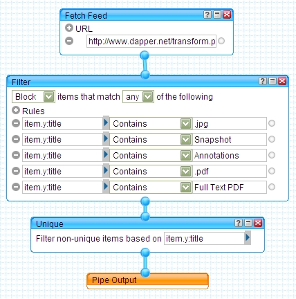

Many of my readers in the humanities already know about [Zotero](http://www.zotero.org/), the free open-source citation manager that works within Firefox and [scares the hell](http://arstechnica.com/web/news/2009/06/thomson-reuters-suit-against-zotero-software-dismissed.ars) out of Endnote’s makers. If you are a student or professor and haven’t tried Zotero, then you are missing out on an essential tool. I use it daily, both for my research and in my [teaching](http://www.samplereality.com/gmu/spring2009/660/?page_id=514). \[Full disclosure: I am not an entirely impartial evangelist for Zotero, as its developers are colleagues at George Mason University, in the incomparable [Center for History and New Media](http://www.chnm.gmu.edu/).\]

The latest version of Zotero allows you to “publish” your library, so that anybody can see your collection of sources (and your notes about those sources, if you choose). In my case, I’ve not only published my library on the [zotero.org](https://www.zotero.org/marksample/items) site, I’ve updated the main sidebar on this very blog with a news feed of my “Recently Zoteroed” books and articles. As I gather and annotate sources for my teaching and research, the newest additions will always appear here, with links back to the full bibliographic information in the online version of my library.

How did I do this?

*Why* did I do this?

What follows is an attempt to answer these two questions. Before I address the how-to, though, I’ll explain the why-to: why I’m making the sources I use for my teaching and research public in the first place.

### Sharing my Library in theory

Like many scholars in the humanities (I imagine), I initially had qualms about sharing my library online — checking that little box in my [Zotero privacy settings](https://www.zotero.org/settings/privacy) that would “make all items in your library viewable by anyone.” Emphasizing the gravity of the decision, zotero.org adds this warning: “Be very sure you want to do this.”

*I do want to do this, I do, I do.*

But why? We are accustomed, in the humanities, to being very secretive about our research. Oh sure, we go to conferences and share not-yet-published work. But these conference papers, even if they’re finished the morning of the presentation with penciled-in edits, they’re still addressed to an audience, meant to be shared. But imagine publishing your research notes and only the notes, shorn of context or rhetoric or (especially or) the sense of a conclusion we like to build into our papers. Imagine sharing only your Works Cited. Or, imagine sharing the loosest, most chaotic collection of sources, expanded way beyond the shallows of Works Cited, past the nebulous Works Consulted, deep into the fathomless Works Out There.

## Proprietary software like Endnote reinforces the notion that the engine of scholarship is competition.

A paranoid academic (and most of us are paranoid) might worry that by sharing our pre-publication sources, whether they’re primary or secondary sources, we are exposing our research [before its time](http://www.youtube.com/watch?v=bpj0t2ozPWY). My sense is that we like to keep our collection of sources private as long as possible, holding them close to our chest as if we were gamblers in the great poker game of academia. And in this game, our colleagues are not colleagues, but opponents sitting across the table from us, bluffing perhaps, or maybe holding a royal flush. Proprietary software like Endnote, which by default encloses research libraries within a walled garden, reinforces this notion, that the engine of scholarship is competition rather than collaboration.

Or, to switch metaphors, sharing our sources in advance of the final product is like sharing the blueprints to a house we haven’t yet built  — a house we may not even have the money to build, and meanwhile you just know there’s somebody out there, more clever or less scrupulous or just damn faster, who can take those blueprints and erect an edifice that should have been ours while we’re still at town hall getting zoning permits. We’ve all had that experience of reading a journal article or — damn it! — a mother effing blog in which the author tackles clearly, succinctly and without pause some deep research concern that we’ve been pondering for years, waiting for it to blossom into a Beautiful Idea in our writing before going public with it. And *POOF!* somebody else says it first, and says it better.

Keeping our sources private is the talisman against such deadly blows to our research, akin to some superstitious taboo against revealing first names. We academics are true believers in occult knowledge.

To put it in the starkest terms possible: before I published my library I was concerned that someone might take a look at my sources and somehow reverse engineer my research.

## Let’s face it, I’m an English professor. It’s not as if I’m working on the Manhattan Project.

Are we in the humanities really that ridiculous and self-important? Let’s face it, I’m an English professor. It’s not as if I’m working on the Manhattan Project. My teaching and [research](http://gamestudies.org/0802/articles/sample) adds only infinitesimally incrementally to the storehouse of human knowledge. I don’t mean to belittle what scholars in the humanities do à la [Mark Bauerlein](http://chronicle.com/article/Diminishing-Returns-in/47107/). On the contrary, I think that what we do — striving to understand human experience in a chaotic world — is so crucial that we need to share what we learn, every step along the way. Only then do all the lonely hours we spend tracing sources, reading, and writing make sense.

Looked at prosaically, public Zotero libraries may be  the equivalent of a give-a-penny, take-a-penny bowl at a local store. This convenience alone would be useful, but the creators of Zotero are much more inspired than that. They know that sharing a library is crowdsourcing a library. The more people who know what we’re researching before we’re done with the research, the better. Better for the researchers, better for the research. Collaboration begins at the source, literally. And as more researchers share their libraries, we’re going to achieve what the visionaries in the Center for History and New Media call the [Zotero Commons](http://www.dancohen.org/2007/12/12/zotero-and-the-internet-archive-join-forces/), a collective, networked repository of shareable, annotatable material that will facilitate collaboration and the discovery of hidden connections across disciplines, fields, genres, and periods.

And *that* is why I’m sharing my library.

### Sharing my Library in Practice

Now, *how* am I sharing it? I’ve taken what seems to be an unnecessarily complicated route in order to incorporate my library into my blog. There is an easy way to do what I’ve done: Zotero has [native RSS feeds](http://www.zotero.org/blog/follow-libraries-and-collections-with-feeds/) for users’ collections, and all you need is to subscribe to that feed using a widget on your blog. In my case I could have used the default Wordpress RSS sidebar widget. But I didn’t. I wound up working with both [Dapper](http://www.dapper.net/dapp-factory.jsp) and [Yahoo Pipes](http://pipes.yahoo.com/pipes/), and here’s why.

I didn’t like how the RSS feed built into zotero.org included *everything* I added, including duplicate citations, snapshots that I later categorized as something else, and PDFs unattached to metadata (even if I [retrieved that metadata](http://www.zotero.org/support/retrieve_pdf_metadata) later). In short, the default RSS stream looked messy in Wordpress (but it looks great in [Google Reader](http://www.google.com/reader/view/feed/https%3A%2F%2Fapi.zotero.org%2Fusers%2F4074%2Fitems?hl=en)). \[UPDATE: Patrick Murray-John's awesome [Zotero WordPress plugin](http://www.patrickgmj.net/node/178) solves these problems and makes the Pipes solution below unnecessary---though still cool.\]

The online mash-up tool Yahoo Pipes is perfect for combining and filtering RSS feeds and that’s what I wanted to use. I can’t program my way out of a paper bag, but Pipes is simple enough that even I can use it. So why did I also use Dapper, another online tool that lets you do fun things with RSS feeds? Because Pipes for some reason would not accept the Zotero RSS feed as valid. I haven’t been able to confirm this, but I’m guessing it has something to do with Zotero’s API using a secure HTTPS rather than HTTP. Or maybe it’s because the Zotero feed is actually XML rather than RSS. Again, I’m not a programmer and I’m just fumbling my way around this hack. In any case I ran my Zotero feed through the [Dapp Factory](http://www.dapper.net/dapp-factory.jsp), which *did* accept it.

Next I dumped the Dapper feed into Yahoo Pipes, using several of Pipe’s operators to filter duplicates and attachment file names that were cluttering the RSS feed. Here’s is a map of [my Pipe](http://pipes.yahoo.com/pipes/pipe.info?_id=brjay5Z63hGRqawnU5Wufg).

Using Yahoo Pipes to filter a Zotero library

It’s quite simple, and with some experimentation I may improve my hack (for example, I’m toying with Feedburner as a substitute for Dapper, which may preserve more of the original XML, giving Pipes more raw data to manipulate and mash). But even right now in its kludged form, the result is exactly what I set out to do.

In addition to its simplicity, one of the advantages of Yahoo Pipes is the variety of output formats available. For my blog’s sidebar I have Pipes generate an RSS feed, but I could just as easily create an interactive Flash “badge” with it:

I find the possibilities of a portable, embeddable version of my Zotero library extremely evocative. It’s a kind of artifact from the future that our methodological and pedagogical approaches haven’t caught up with yet. Here is where the theory and practice of a collaborative library have yet to meet — and I want to end my manifesto/guide with a simple appeal: *let’s begin thinking about the untapped power of this intersection and what we can do with it, for ourselves, our students, and our scholarship.*
