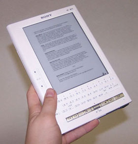
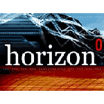
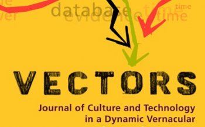

What Color Is Your Scholarship?

A friend of mine has been testing out a major technology company’s new e-book, a sleek little package that aims to reinvent the ways in which we read. It’s not the first sexy, silver object of its kind, but it hopes to be a successful one. Several earlier pioneers have pretty soundly failed, crippled by a lack of available content, by technological snafus and copyright issues, and by an ongoing fondness for that ‘old’ technology, the book. After all, the book works pretty well. It’s an interface we’ve naturalized and grown very comfortable with. As folks are wont to point out, it’s easy to take to bed or bath, it never needs a power source, and it almost never crashes. And, like many other academics, I like the very materiality of my books: their smells, their inscriptions, their covers (especially those from Duke Press.)

But I have to admit to being seduced by the promise and idea of the digital book, particularly its portability and its usability. Every time I find myself lugging forty pounds of books along while on vacation or visiting an archive, I realize I’d give up the physical pleasures of ‘book-ness’ for easy mobility. Sure, I might have to forego reading in the tub or in bright sunlight, but there are gains to be had here, even beyond portability. I’ve become so accustomed to working with digital documents that I find myself stymied by the inadequate indexes of many books I read. I want to search the print book of my own accord and have it capitulate to my desires the way the reams of digital data on my desktop appear to obey my epistemophilic desires. Sometimes I want to read a book cover to cover, in full savor mode, but, increasingly, I want to cut, paste, and remix them.

**the Sony LIBRIe**

Honestly, I guess my TiVo is partially to blame. I can’t remember the last time I watched live TV. Even during the media circus that followed the devastation of Katrina, I had my TiVo working overtime, taping hours of coverage I’d peruse later, while I logged time at my keyboard searching interactive maps (courtesy of Google mash-ups), video snippets, and blog feeds. In her now-canonical essay on television’s temporality circa 1988, Mary Anne Doane argued that information on TV “inhabits a moment of time and is then lost to memory. Television thrives on its own forgettability.” Of course, Doane wrote just as the simultaneous double whammy of the cable explosion and VCR time-shifting began to take full hold. We might read our current investments in DVRs and 500 gig hard drives as our attempt to stave off television’s insistence that we immediately forget. Today, memory is cheap.

My desktop now sports a new folder labeled “Katrina clips,” a small, DYI database of moments I want to remember, culled both from the internet and my own TiVo hard drive. These clips share memory with talks and articles I’ve written about Katrina, with emails I’ve saved from families and friends along the Gulf, and with various news stories and blog postings I’ve catalogued for future reference. While Katrina and its aftermath provoked this particular deployment of memory, the hundreds of folders on my PC catalogue more banal aspects of daily life, from family photos to tax receipts. I move this data about at will, mixing media and matching files, orchestrating new collisions of space and time.

It’s a feeling of control that impacts my interactions with both word and image, returning me to my opening thoughts about e-books. In less than 20 years (I got my first PC and VCR in 1987, shiny new tools for starting grad school), I guess I’ve succumbed pretty fully to the lure of information machines and the control they seem to promise. No matter that this control is more ideology than ontology, to repurpose Jane Feuer’s prescient analysis of television. As fond as I am of my many, many books, I feel primed for new modes of reading and of writing, for information mixes that might open up new ways of knowing and of feeling, new circuits of exchange. New media artists have been pushing the boundaries of digital expression for at least a decade, and the electronic literature crowd has an even longer track record of pushing the boundaries of linear narrative. Still, the scholarly crowd has been slow to respond. Even those of us who study electronic media for a living still largely write and publish the ‘old-fashioned’ way even as academic presses struggle to stay afloat. What might electronic scholarship (rather than scholarship about the electronic) look like?

**Horizon Zero, a publication of the Banff Centre**

Flow already begins to point the way. It closes the feedback loop between publication and reply, between academic call and response, by knitting the ‘comments’ function integrally into each article it publishes. Other online publications like the  [Electronic Book Review](http://www.electronicbookreview.com/) ,  [Kairos](< http://english.ttu.edu/kairos/>) , and the now-defunct  [Horizon Zero](< http://www.horizonzero.ca/>)  have also explored how multimedia or networked scholarship might take shape.   [The Labyrinth Project](< http://www.annenberg.edu/labyrinth/>)  at USC pushes even further, exploring the power of cinematic language for the database documentary and public scholarship.   [Vectors](< http://www.vectorsjournal.org>) , a new electronic scholarly journal, only publishes pieces that can’t exist in print. (In the interest of full disclosure, I edit the last one.)

**Vectors: Journal of Culture and Technology in a Dynamic Vernacular**

Such experiments aim to explore modes of scholarship more fully responsive to the remix possibilities of digital culture and to the visual cultures of film, TV, and the everyday. One goal of Vectors is to investigate the potential of the different affective and sensory registers of scholarship. Can scholarship look and feel differently, requiring new modes of engagement from the reader/user. What happens to argument when scholarship goes fully networked and multimedia? How do you ‘experience’ argument in a more immersive and sensory-rich space? Can you play an article? What color is your scholarship? While these questions may seem trivial or even alien to scholarship as we now know it, I, for one, am game to explore a world where the outputs of media studies participate more fully in the emergent forms and practices of the media we study and populate new devices. I’m not getting rid of my books just yet, but I wouldn’t mind putting Flow on my iPod.

**Sources:**

Doane, Mary Anne, “Information, Crisis, Catastrophe,” in *Logics of Television*, ed. Patricia Mellencamp (Bloomington, Indiana: Indiana UP, 1990).

Feuer, Jane. “The Concept of Live Television: Ontology and

Ideology,” in *Regarding Television*, ed. E. Ann Kaplan (Los Angeles, CA.: AFI, 1983).

**Image Credits:**

2\. [Horizon Zero, a publication of the Banff Centre](http://www.m-cult.net/showimage.php?imageId=41)

3\. [Vectors: Journal of Culture and Technology in a Dynamic Vernacular](http://www.weblogsinc.com/common/images/4845308185452620.JPG?0.9132424341520925)

Please feel free to comment.
