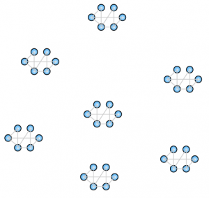
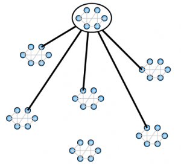
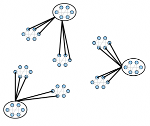

# Intimacy and fidelity: situating social media

Human societies are made in media. Gesture and speech, before writing, the printing press and the internet, have not just been vehicles through which we talk about people and stuff; they have fundamentally shaped what societies 

*are* and what they can *possibly be*.

Each successive development in the long train of communications technologies, from the development of speech through to the invention of the internet, has gradually transformed our ability to connect with other people and imagine our community. As writing begat the advanced agricultural society, so too the printing press begat the nation.

In what follows I seek to situate social media in this socio-economic history so that we can begin to think about what it means for academic work and science communication, and society more broadly.

So that we can properly understand the meaning of modern social media, it’s important to understand how, throughout history, changes in the dominant medium of communication have been deeply formative of human societies. To do this we can usefully characterise the dominant medium at each stage of human social evolution according to its intimacy and fidelity. *Intimacy* can be taken as the extent to which a form of communication reflects a person’s individual needs and interests, while *fidelity* is the accuracy with which the form of communication reproduces information.

### **The long history of rumour: highly intimate, low fidelity**

Face to face communication has rested at the heart of human society for as long as we’ve been human. Gesturing, grunting and talking are the modes of communication that first separated us from the other animals, and for 99% of human existence exclusively defined human societies. Face to face forms of communication were dominant throughout the long era of hunter gatherer and early agricultural societies, when our communities were made up of those we had met in person and could talk to face to face.

Face to face forms of communication can be characterised as highly intimate but with low fidelity. That is, the pieces of information passed on in such communication can be tailored precisely to an individual’s needs and interests (‘Jim, there’s a tiger behind you’), yet without a great deal of fidelity when reproduced (‘Jim was eaten by a tiger’ might quickly become ‘Jim likes to eat liger’).

This means that societies framed through face to face communication can reach only a certain level of organisational complexity. Without the ability to transfer information accurately across time and space, only a certain number of people can meaningfully be part of the community; only a certain number of people can actively be imagined as communal brothers and sisters.

Importantly, though other forms of communication have come to dominance over the years, face to face communication has remained (of course!) a key part of society. We still talk and gesture to pass on information, with the same levels of intimacy and fidelity that talking and gesturing have always had. Indeed, rumour (from day to day gossip to the infamous [monkey-man of Delhi incident](http://en.wikipedia.org/wiki/Monkey-man_of_Delhi)) still forms a key part of our information and news diet.

 

 

### **Organised media 1: The church-state: not intimate, high fidelity**

The development of writing really stirred things up. For the first time, information could be transmitted across space and time to people you couldn’t see or to yourself in a little while. This meant that new forms of society could be brought into being, imagined and constituted at a more abstract level.

Importantly, though writing brought about massive changes to society, the initial expense of the medium (training people to read and write was difficult, and reproducing things required teams of monks, so the work was slow and laborious) meant that the only form of organisation able to use it to wield power was a highly organised and nearly all-powerful church-state, such as the Roman Empire or the medieval Catholic church in Europe.

Returning to the ideas of fidelity and intimacy, writing in the era of the church-state transmitted information with great fidelity, yet with very little intimacy. As the newly dominant form of communication – the form of communication that did most to shape society – writing allowed the development of a social order highly removed from the concerns of most people. In essence, social organisation of this form did great violence to pre-existing communities – something the tribes of Germania and the Incas and Aztecs certainly felt.

 

### **Organised media 2: Print-capitalism and the nation-state: moderately intimate, high fidelity**

As writing allowed dramatic changes in the social order, the printing press again ushered in much revolution. At heart, the printing press continued the revolutions brought about by the development of writing, yet where teams of monks were previously required to whip a book into shape, now all that was required was an elaborate contraption – an elaborate contraption that could be purchased and run at a far lower cost per reproduced volume.

As [Benedict Anderson](http://books.google.com.au/books?id=4mmoZFtCpuoC&dq=benedict+anderson+imagined+communities&printsec=frontcover&source=bn&hl=en&ei=s8XsS4W3Hs2HkQX7_dHnBg&sa=X&oi=book_result&ct=result&resnum=4&ved=0CC8Q6AEwAw#v=onepage&q&f=false) has argued, this brought the dominant mode of communication out of the hands of the all-powerful church-state, and into the hands of the merely rich. New communities – nations in this case – were brought into being:

What, in a positive sense, made the new communities imaginable was a half-fortuitous, but explosive, interaction between a system of production and productive relations (capitalism), a technology of communications (print), and the fatality of human linguistic diversity ([1991: 42-43](http://books.google.com.au/books?id=4mmoZFtCpuoC&lpg=PP1&dq=benedict%20anderson%20imagined%20communities&pg=PA43#v=onepage&q&f=false)).

Where the era of the church-state saw the dominance of a mode of communication with high fidelity but with very little intimacy, the printing press allowed a (slightly) more intimate form of communication. Newspapers could be produced along lines of interest and need more intimate than those open to the church-state, bringing new communities into existence. Again, though perhaps more intimate to pre-existing communities than the early church-state, violence was done – the Second World War was nothing if not the culmination of the idea of nation over other forms of community.

 

### **The emergence of mass social media: highly intimate, high fidelity**

This brings us to the final emergence in this trend: the emergence to (possible) dominance of forms of communication both highly reproducible and highly intimate. In essence, social media – and Twitter represents perhaps the most useful example for discussion here – allows the creation of an information stream attuned directly to individual needs, but still reproducible with great fidelity for little price.

It is still far too early to say what this means. On the one hand, the emergence of social media is not likely to erase the forms of community (from family to church to nation) produced by earlier forms of communication. [Jack Goody’s](http://books.google.com.au/books?id=baQtOyscXUwC&printsec=frontcover&dq=jack+goody+the+domestication+of+the+savage+mind&source=bl&ots=iQEIveE_bN&sig=79cb8xdt0og-BFU06tGpme-wvN0&hl=en&ei=ZsbsS7a8GM2HkQWixenWBg&sa=X&oi=book_result&ct=result&resnum=1&ved=0CBoQ6AEwAA#v=onepage&q&f=false) argument that “the written word does not replace speech, any more than speech replaces gesture” ([1977: 15](http://books.google.com.au/books?id=baQtOyscXUwC&lpg=PP1&ots=iQEIveE_bN&dq=jack%20goody%20the%20domestication%20of%20the%20savage%20mind&pg=PA15#v=onepage&q&f=false)) can be paralleled here; social media has not yet replaced traditional mainstream media or church communities, and indeed nor is it likely to. Yet we have not had a change in the dominant form of communication without some violence being done to earlier communities. We have not had a change in the dominant form of communication without new communities emerging.

The question is, what will these communities be?

The very intimacy of the medium suggest that changes wrought by social media may not be as shocking as we might at first imagine. Rather, we may see an emergence to prominence of communities already somewhat in existence; a revealing and reinforcement of possibilities already here, rather than a making of something new.

*First image by flickr user [pierre pouliquin](http://www.flickr.com/photos/pierre_pouliquin/162024298/), from the Canarvon National Park Queensland; this area is significant to the Bidjara, Karingbal, and Kara Kara people of Central Queensland*

Comments are closed.

[Dead Tree Media](http://blog.cpas.anu.edu.au/diffusion/category/dead-tree-media/),

[Social media](http://blog.cpas.anu.edu.au/diffusion/category/social-media/)
